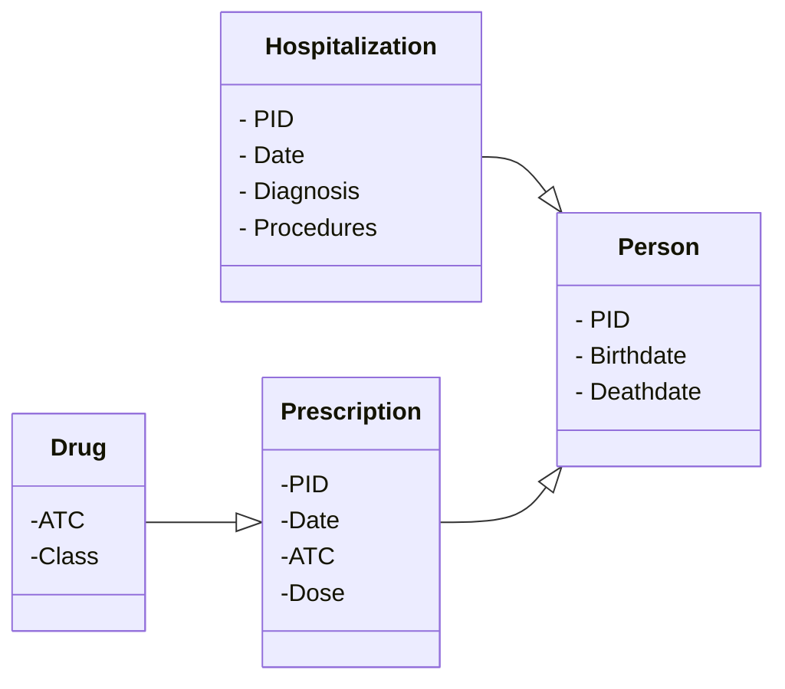

# Syllabus: Programming and statistical modelling in R

A four-day course at the University of Copenhagen, taught by Michael C Sachs. It takes people who already use R a little to the next level: organising projects, working with data structures, writing loops and functions, handling register data, and making graphics. Lectures are listed in teaching order.

Course website: <https://sachsmc.github.io/r-programming/>

Files are under `course/`. Data is in `course/data/`. Run R code with `course/` as the working directory so that `here("data", ...)` finds the files.

## 1. Project organization and workflow (Day 0)

- File: `course/lectures/01-projects.md`
- Goals:
    - Keep each project in one folder with a README and clear subfolders.
    - Understand the working directory and avoid `setwd()` in scripts.
    - Build file paths with the `here` package.
- Exercise: `course/exercises/01-projects.md`, solutions in `course/exercises/solutions/01-projects.md`
- Data: penguins (R package palmerpenguins)

## 2. Introduction and Overview (Day 1)

- File: `course/lectures/02-introduction.md`
- Goals:
    - Know the course goals, schedule, and how to get credit.
    - Understand in broad terms what an LLM is and why it can be wrong.
    - See why git and unit tests make AI coding tools safer to use.
- Exercise: none
- Data: none

## 3. Dynamic Documents (Day 1, A)

- File: `course/lectures/03-dynamic-documents.md`
- Goals:
    - Mix code, output, and prose in one Quarto document.
    - Write basic markdown and code chunks, and render to a report or slides.
    - Control output with chunk options and make tables look good.
- Exercise: `course/exercises/02-dynamic-documents.md`, solutions in `course/exercises/solutions/02-dynamic-documents.md`
- Data: penguins (R package palmerpenguins)

## 4. Data structures in R (Day 1, B)

- File: `course/lectures/04-data-structures.md`
- Goals:
    - Create and index vectors, lists, matrices, arrays, and data frames.
    - Spot and avoid surprises from coercion and recycling.
    - Recognise attributes, environments, S4 objects, tibbles, and data.tables.
    - Read data into R and write it out again.
- Exercise: `course/exercises/03-data-structures.md`, solutions in `course/exercises/solutions/03-data-structures.md`
- Data: reg-ex.rds, starwars.csv, starwars.xlsx, penguins (R package palmerpenguins)

## 5. Flow control and loops (Day 2, A)

- File: `course/lectures/05-flow-and-loops.md`
- Goals:
    - Control what code runs with `if`, `else`, logical operators, and `ifelse`.
    - Handle errors with `try` and `tryCatch`.
    - Write `for`, `while`, and `repeat` loops, including a bootstrap.
- Exercise: `course/exercises/04-flow-and-loops.md`, solutions in `course/exercises/solutions/04-flow-and-loops.md`
- Data: penguins (R package palmerpenguins)

## 6. Functions (Day 2, B)

- File: `course/lectures/06-functions.md`
- Goals:
    - {'Call functions well': 'arguments, `...`, composition, and the apply family.'}
    - Write your own functions and understand scoping and lazy evaluation.
    - Design and document functions, and know `do.call`, `get`, and recursion.
- Exercise: `course/exercises/05-functions.md`, solutions in `course/exercises/solutions/05-functions.md`
- Data: penguins (R package palmerpenguins)

## 7. Strings and dates (Day 3, A)

- File: `course/lectures/07-dates-and-strings.md`
- Goals:
    - Build and format strings with `paste`, `sprintf`, and `glue`.
    - Match and extract text with regular expressions.
    - Parse dates and do date arithmetic with `lubridate`.
- Exercise: `course/exercises/06-dates-and-strings.md`, solutions in `course/exercises/solutions/06-dates-and-strings.md`
- Data: med-2005-ex.rds, penguins (R package palmerpenguins)

## 8. Merging/joining data (Day 3, B)

- File: `course/lectures/08-merging-data.md`
- Goals:
    - Explain keys and one-to-many and many-to-many relationships.
    - Join tables in base R, `data.table`, and `dplyr`.
    - Do non-exact and rolling joins on register data.
- Exercise: `course/exercises/07-tidy-and-reshape.md`, solutions in `course/exercises/solutions/07-tidy-and-reshape.md`
- Data: lpr-ex.rds, med-2005-ex.rds to med-2010-ex.rds, penguins (R package palmerpenguins)

## 9. Tidy data (Day 3, C)

- File: `course/lectures/09-tidy-data.md`
- Goals:
    - Say what makes data tidy, in terms of variables and observations.
    - Turn model output into tidy data frames with `broom`.
    - Reshape between long and wide with pivoting and melting.
- Exercise: `course/exercises/07-tidy-and-reshape.md`, solutions in `course/exercises/solutions/07-tidy-and-reshape.md`
- Data: lpr-ex.rds, med-2005-ex.rds to med-2010-ex.rds, penguins (R package palmerpenguins)

## 10. Data visualization (Day 4, A)

- File: `course/lectures/10-dataviz.md`
- Goals:
    - Apply five principles for clear statistical graphics.
    - Build plots in layers with `ggplot2`, and know the base graphics basics.
    - Choose colour palettes, reuse plot elements, and combine figures.
- Exercise: `course/exercises/08-dataviz.md`, solutions in `course/exercises/solutions/08-dataviz.md`
- Data: penguins (R package palmerpenguins)

## 11. Summary and conclusion (Day 4, B)

- File: `course/lectures/11-conclusion.md`
- Goals:
    - Use Copilot and other LLMs for R code with care, and check what they write.
    - Recall the main points on projects, programming, and working with data.
    - Know where to go next and how to get help.
- Exercise: none
- Data: none

---

<!-- file: course/lectures/01-projects.md -->

# Project organization and workflow

Lecture 1 | Day 0 | Slides: <https://sachsmc.github.io/r-programming/lectures/projects.html>

# Project organization

## Why?

See the **UCPH Policy for Research Data Management**

[figure: DataLifecycle default]

## Set up projects

Quick review of the file system

- File system discipline: put all the files related to a single project in a designated folder.
  - This applies to data, code, figures, notes, etc.
  - Depending on project complexity, you might enforce further organization into subfolders.
- A wide variety of tools to facilitate this are collected here:
  - [CRAN task view on Reproducible Research](https://cran.r-project.org/web/views/ReproducibleResearch.html#project-workflows)

## The importance of README

- Always include a README.txt or .md file at the root of the project
- Plan, Document, Share, and Preserve
- To include: *what* and *how*:
  - Title of the project
  - When it was last updated
  - What is included in the project directory
  - How to run the analysis and use the results (including what dependencies are needed)
  - A license describing the conditions of use

[Example 1](https://github.com/pablogonzalezginestet/megalearner/blob/master/README.md)

[Example 2](https://github.com/sachsmc/doubly-robust-glm/blob/master/README.md)

## An example project structure

```r
twee <- function(path = getwd(), level = Inf) {

  fad <-
    list.files(path = path, recursive = TRUE, no.. = TRUE, include.dirs = TRUE, all.files = TRUE)

  fad_split_up <- strsplit(fad, "/")

  too_deep <- lapply(fad_split_up, length) > level
  fad_split_up[too_deep] <- NULL

  jfun <- function(x) {
    n <- length(x)
    if(n > 1)
      x[n - 1] <- "|__"
    if(n > 2)
      x[1:(n - 2)] <- "   "
    x <- if(n == 1) c("-- ", x) else c("   ", x)
    x
  }
  fad_subbed_out <- lapply(fad_split_up, jfun)

  cat(unlist(lapply(fad_subbed_out, paste, collapse = "")), sep = "\n")
}

cat("example-project\n")
```

    #> example-project

```r
twee(here::here("example-project"))
```

    #> -- .here
    #> -- README.md
    #> -- code
    #>    |__01-process-data.R
    #>    |__02-primary-analysis.R
    #>    |__03-sensitivity-analysis.R
    #>    |__project-report.Rmd
    #> -- data
    #>    |__merge-analysis-dataset.rds
    #> -- documents
    #>    |__background.docx
    #>    |__protocol.docx
    #> -- output
    #>    |__Figure1.png
    #>    |__Figure2.png
    #>    |__Table1.rds
    #> -- rawdata
    #>    |__lisa-2012-full.csv
    #>    |__lisa-2013-full.csv
    #>    |__lisa-2014-full.csv
    #>    |__lisa-2015-full.csv

## R session and the working directory

```r
getwd()
```

    #> [1] "C:/Users/sachs/Teaching/r-prog-agentic/.cache/course-build-31100/lectures"

```r
list.dirs(".", recursive = FALSE)
```

    #> character(0)

```r
list.dirs("..", recursive = FALSE)
```

    #> [1] "../data"            "../example-project" "../exercises"
    #> [4] "../images"          "../lectures"

- The R session runs in the current *working directory*
- Input and output happens relative to that directory
- `"."` means “this directory”
- `".."` means “the directory that this one is contained in”

## Navigating the directory from R

Compose directories and files with `file.path` (it is safe and works in any operating system)

```r
read.csv(file.path("..", "rawdata", "lisa-2012-full.csv"))
saveRDS(analysis_file, file.path("..", "data", "analysis-data.rds"))
```

## The `here` package

```r
library(here)

here()
```

    #> [1] "C:/Users/sachs/Teaching/r-prog-agentic/.cache/course-build-31100"

```r
setwd("../exercises")
here()
```

    #> [1] "C:/Users/sachs/Teaching/r-prog-agentic/.cache/course-build-31100"

Upon librarying the `here` package, it will attempt to identify the root of your project directory: is there an `.Rproj` or `.here` file there? Then you can use the `here()` function to give the path to the root directory no matter where you are in the project directories.

```r
read.csv(here("rawdata", "lisa-2012-full.csv"))
saveRDS(analysis_file, here("data", "analysis-data.rds"))
```

Then, `here` allows you to build paths to subdirectories, starting from the project root.

Use this in your scripts, and everything will run nicely, both interactively **and** programmatically, no matter what your working directory is (as long as it is in the project).

# Workflow

## What?

Personal taste and habits (“workflow”) versus the logic and output that is the essence of your project (“product”)

- The naming/specific structure of your project directory.
- The editor you use to write your R code.

## Get comfortable

Your workflow does not matter, as long as you follow the principles.

Options for IDEs (all free):

- [Rstudio](https://www.rstudio.com/products/rstudio/download/#download)
- [VScode](https://code.visualstudio.com/docs/languages/r)
- [Emacs](https://www.gnu.org/software/emacs/)

All of these support projects, have integrated help files, code completion, and syntax highlighting.

## Setting the working directory

- Open the `.Rproj` file in a fresh R/Rstudio session
- Open an `.R` file in a new session
- Use the drop down menu in Rstudio: Session \> Set working directory
- Use `setwd()` in the terminal

*Avoid using `setwd()` in scripts*

## Bad vs good habits

**Do not**:

- use `setwd()` in scripts
- rely on `rm(list = ls())`
- save `.RData` when you quit R and don’t load `.RData` when you launch R.

**Do**:

- Restart your R session frequently while working
- Set the working directory on launch or interactively
- Use relative paths, or `here` if your project directory is complex

## Practical

- Create a toy project using your favorite tools
- Swap projects with your neighbor
- See if you can reproduce each others results

[Link to lesson](../exercises/projects.html)

[Link home](../index.html)

---

<!-- file: course/lectures/02-introduction.md -->

# Introduction and Overview

Lecture 2 | Day 1 | Slides: <https://sachsmc.github.io/r-programming/lectures/introduction.html>

# Introduction

## Learning objectives

- Understand and apply programming principles to handle repetitive tasks
- Understand how to use and make your own functions in R
- Use loops in R
- Apply these principles to perform efficient data manipulation, analysis, and reporting

## Why?

If your research involves any data, it likely also involves:

- Data management and manipulation
- Analysis
- Reporting of results

This means lots of **code**.

We can borrow some ideas from software development to

1.  Make our lives easier – repetitive tasks, updates with new data
2.  Make science better – reproducible, understandable, reusable

## Goals

At a bare minimum, we want our code to be:

### Organized

- Coherent structure of
  - folders, files, and scripts

### Transportable

- Works on
  - my future computer
  - other people’s computers

### Understandable

- Clearly specified dependencies
- Readable code, sensible naming of things
- Written documentation explaining what and how

## Extras

Nice to have, but not absolutely necessary

### Provably correct

Through automated testing

- Pieces of code correctly do what they should
- Code works together correctly, not sensitive to minor changes in the data
- Valid statistical properties

### Version controlled

- History of development is tracked and documented

## Overview of this course

### Lectures

### Lessons

Work through a problem together, learn tools and strategies

Share solutions/questions/responses on padlet:

<https://leaflet.pub/ba70ae31-c031-4b23-ae9f-86e9e99637b5>

Course website:

<https://sachsmc.github.io/r-programming/>

## Schedule of topics

### Today

0.  AI and LLMs
1.  Reporting, dynamic documents
2.  Data structures and indexing

### Day 2

1.  Flow control and loops
2.  Creating and using functions

### Day 3

1.  Functions continued
2.  Working with data, merging and reshaping

### Day 4

1.  Data visualization
2.  Working with data, dates and characters

# About me

## What I do

- Develop and evaluate statistical methods
  - Write R packages
  - Write R code to test the methods
- Collaborate on research projects involving data analysis
  - Use register and other data from stats Denmark
  - Data analysis, visualization and reporting

## My R philosophy

- I started learning R in 2005 (version 2.2)
- There is almost no problem that can’t be solved with R
  - Flexible and dynamic
  - Plays nicely with almost any other programming language

## Course philosophy

- There are no stupid questions
- There are many ways to solve a problem, there is no single “right way”
- I will not force you to learn any particular way, e.g., `tidyverse` vs `data.table`, we will focus on learning the general principles.
  - Try them out, then choose one and get good at it
  - Same with project organization, choose a system and stick with it
- Show up to class and participate, you will pass and hopefully learn something useful

## Take notes and practice

To get credit for the course, you must attend at least 80% of the course.

I encourage you to work on the exercises and take notes as we proceed.

1.  Use quarto to blend code, output, and prose.
2.  Demonstrate mastery of at least 3 out of the 4 learning objectives.
3.  Review the previous day’s material and build on it in the next day.

## Interactive slides

Slides will occasionally allow you to interact with the code. Follow along with lectures and use it for short quizzes. Try it out:

```r
mod <- lm(mpg ~ cyl, data = mtcars)
summary(mod)
```

    #>
    #> Call:
    #> lm(formula = mpg ~ cyl, data = mtcars)
    #>
    #> Residuals:
    #>    Min     1Q Median     3Q    Max
    #> -4.981 -2.119  0.222  1.072  7.519
    #>
    #> Coefficients:
    #>             Estimate Std. Error t value Pr(>|t|)
    #> (Intercept)   37.885      2.074   18.27  < 2e-16 ***
    #> cyl           -2.876      0.322   -8.92  6.1e-10 ***
    #> ---
    #> Signif. codes:  0 '***' 0.001 '**' 0.01 '*' 0.05 '.' 0.1 ' ' 1
    #>
    #> Residual standard error: 3.21 on 30 degrees of freedom
    #> Multiple R-squared:  0.726,  Adjusted R-squared:  0.717
    #> F-statistic: 79.6 on 1 and 30 DF,  p-value: 6.11e-10

# AI and LLMs

## What is an LLM? A statistician’s view

**A conditional probability model over text**

$$P(\text{next token} \mid \text{text so far})$$

- Text is chopped into **tokens** (~¾ word each)
- A **context window** is the max tokens it sees at once
- **Temperature** $\tau$ controls sampling sharpness: $\tau \to 0$ → greedy; $\tau \to \infty$ → uniform

**How it’s trained**

1.  **Next-token prediction** on massive text corpora
2.  **Instruction tuning** — follow prompts, be helpful
3.  **RLHF / RLAIF** — human (or AI) preference ranking

**Code is a strength**

Code is abundant, structured, and *correct by execution* — a uniquely checkable signal in training data.

## Why they’re confident — and sometimes wrong

**Hallucination**

> The model generates *plausible text*, not *verified truth*.

- Fabricated citations that look real *(always verify)*
- Confident wrong code that compiles but is subtly incorrect
- Invented API arguments or package functions

**Reasoning models** (o3, R1, extended thinking) trade compute for better multi-step work, but the same failure modes apply at higher stakes.

> [!IMPORTANT]
>
> **Always verify**
>
> Every citation · every number every derivation · every API call
>
> Treat model output as a **hypothesis, not a result.**

> [!WARNING]
>
> **Quiet deskilling**
>
> Outsourcing judgement builds dependency, not expertise. Stay in the loop intentionally.

## The context window and memory

**What the model “sees”**

|                      | Typical range    |
|----------------------|------------------|
| Small / fast models  | 8k–32k tokens    |
| Standard assistants  | 128k–200k tokens |
| Long-context leaders | 1M+ tokens       |

A context window is **not memory** — each new conversation starts fresh.

**What counts against it**

- Your prompt
- The entire conversation so far
- Any files or code you paste in
- Tool call results

**How to work within limits**

- **Chunking**: split long documents; summarise sections before sending
- **System prompts**: keep standing instructions short and reuse across sessions
- **External memory**: project `.md` files persist context across sessions
- **Agent memory**: tools like Claude Code maintain a `CLAUDE.md` project file that persists

> [!TIP]
>
> **Practical rule**
>
> If the conversation is getting long, start fresh — older context degrades response quality before it truncates.

## Three tiers of tools

Move up the tiers as the task grows in scope and complexity.

Tier 1 **Chat interfaces**

ChatGPT · Claude · Gemini · Copilot Chat

- Paste code, ask questions
- One-shot generation
- No access to your full repo
- Good for: explaining, drafting snippets, quick checks

Tier 2 **In-IDE assistants**

GitHub Copilot · RStudio Copilot `ellmer` · `chattr` · `gander` · `chatlas`

- Autocomplete in your editor
- **`gander` knows your data frame’s columns** — context-aware suggestions
- Good for: writing functions, transforming data, iterative coding

Tier 3 **Coding agents**

Claude Code · Codex · Copilot · Pi.dev · NanoClaw

- Repo-aware — reads your whole project
- Can run code, read errors, iterate
- Work toward a goal you set
- Good for: multi-file tasks, test-driven development, simulation scaffolding

> [!TIP]
>
> **Suggested on-ramp:** start with copilot in RStudio/vscode. It is the lowest-friction step up from copy-pasting to the chat window.

## Coding agents: from autocomplete to delegate

**What makes agents different**

- **Repo-aware**: they read your `DESCRIPTION`, existing tests, README
- **Tool-use**: they can run R/Python, call the shell, read error messages
- **Iterative**: they retry when tests fail — the loop is automated
- **Transparent**: all changes come as a **diff** you review and commit

**Human-in-the-loop is not optional**

- Read the code before accepting
- Run your own checks — don’t trust “tests pass” without verifying

**Workflow**

    You: "Write a function coverage() that
          computes CI coverage, with tests"

    Agent: reads repo → writes function
           → writes tests → runs tests
           → iterates on failures
           → proposes diff

    You:  review diff → run tests yourself
          → commit if happy

> [!WARNING]
>
> **The agent proposes; you decide.** Never let an agent do something without a human reviewing.

## Text-based computer skills

**Agents live in the terminal and work with plain text. A little fluency here pays outsized dividends.**

**Key skills**

- Navigate a project directory from the command line

- Read and write **plain text files** (`.md`, `.R`, `.py`, `.txt`)

- Understand what a **project root** looks like:

      my-project/
      ├── R/              # functions
      ├── analysis/       # scripts
      ├── tests/
      ├── README.md       # what is this project?
      ├── CLAUDE.md       # instructions for the agent
      └── renv.lock       # reproducible packages

**Markdown files that guide agents**

| File                      | Purpose                                |
|---------------------------|----------------------------------------|
| `README.md`               | human-facing project overview          |
| `CLAUDE.md` / `agents.md` | standing instructions for the AI agent |
| `skills.md`               | reusable task templates                |

> [!TIP]
>
> A well-written `CLAUDE.md` is worth hours of re-prompting — the agent reads it at the start of every session.

## git: the safety net that makes agents safe

**The five operations you need**

| Command      | What it does                                         |
|--------------|------------------------------------------------------|
| `git commit` | checkpoint — a snapshot you can return to            |
| `git branch` | parallel work — experiment without risk              |
| `git diff`   | **what changed** — what you review before committing |
| `git revert` | undo a commit cleanly                                |
| pull request | propose changes for review on GitHub/GitLab          |

**Why git makes agents safe**

> *An agent proposes work as diffs you review and commit — always visible, always reversible.*

**Workflow with an agent:**

    agent writes → you diff → you test
    → you commit → repeat

If anything looks wrong: `git checkout -- .` or `git revert` puts you back exactly where you were.

## Unit tests: making “correct” checkable

**A test is a function that runs your code on a known input and asserts the expected output. It turns “I think this is right” into a pass/fail signal.**

**In R with `testthat`:**

```r
test_that("my_function is correct", {
  expect_equal(my_function(input), known_output)
  expect_error(my_function(bad_input))
})
```

**Test-driven development (TDD):**

1.  **Red** — write a failing test for the behaviour you want
2.  **Green** — write the code that makes it pass
3.  **Refactor** — clean up; tests still pass

The agent *iterates against your tests* — without tests, it has no objective criterion.

**For statisticians: what to test**

- **Correctness**: numbers you can work out by hand (simple DGMs, closed-form results)
- **Boundary conditions**: edge cases, empty inputs, length-one vectors
- **Statistical properties**: symmetry, monotonicity, bounds on estimators
- **Reproducibility**: same seed → same result

> [!TIP]
>
> Tests are not bureaucracy — they are the contract between you and the code.

## Illustration (1/2) — Ask: write the function

**Prompt quality determines output quality.**

**A rigorous prompt:**

> *“Write an R function `coverage(truth, lower, upper)` that computes the empirical coverage probability of a set of confidence intervals. `truth` is a scalar, `lower` and `upper` are equal-length numeric vectors. Return the proportion of intervals that contain `truth`. Validate that `lower` and `upper` have equal length and that `lower <= upper` element-wise. Return a scalar between 0 and 1.”*

**Generated output:**

```r
coverage <- function(truth, lower, upper) {
  stopifnot(length(lower) == length(upper))
  stopifnot(all(lower <= upper))
  mean(lower <= truth & truth <= upper)
}
```

> [!IMPORTANT]
>
> **Generated code is a hypothesis, not a result.**
>
> Read it · understand it · test it.
>
> Would you submit a simulation result without checking the DGM?

**What made this prompt good?**

- Named the function and arguments
- Specified the return type
- Specified validation behaviour
- Specified the estimand (proportion)

*Vague prompt → vague output*

~2 min. Walk through why the prompt is specific. Compare to a lazy prompt: “write a coverage function in R.” The coverage function is small enough that the audience can read and understand it in 30 seconds — that is the point. With a complex function you still need to understand it before trusting it.

## Illustration (2/2) — Test it: validity and correctness

**Tests make the agent’s loop self-correcting.**

```r
library(testthat)

test_that("coverage() is correct", {
  # Correctness — worked out by hand
  expect_equal(coverage(0, c(-1, -1), c(1,  1)), 1)   # all cover
  expect_equal(coverage(0, c( 1,  2), c(3,  4)), 0)   # none cover
  expect_equal(coverage(0, c(-1,  1), c(1,  2)), 0.5) # half cover

  # Boundary — closed endpoint counts
  expect_equal(coverage(1, 1, 2), 1)

  # Validity — bad input rejected
  expect_error(coverage(0, c(1, 2), 3))
})
```

**The TDD loop with an agent:**

    Write tests → agent writes function
    → tests FAIL (Red)
    → agent revises
    → tests PASS (Green)
    → you review diff and commit

> [!TIP]
>
> The test numbers are **yours** — you worked them out by hand. The agent cannot fake correctness against truth you define.

## Summary

- AI can be a performance booster **if used effectively**
- Learn and practice with the tools, autocomplete, agents are superior to chat
- Remember **you are responsible** for the work that is produced, so test, verify, and read
- Effective prompting and testing requires good knowledge of the R foundations, concepts, and vocabulary

# Questions?

[Link home](../index.html)

---

<!-- file: course/lectures/03-dynamic-documents.md -->

# Dynamic Documents

Lecture 3 | Day 1, A | Slides: <https://sachsmc.github.io/r-programming/lectures/dynamic-documents.html>

# What?

## Code and prose

A “literate document” or “dynamic document” is a file that contains **code** and **prose**

The idea was developed by Donald Knuth in the 1980s; his motivation was to use it for software development, but allowing programmers to “concentrate … on explaining to humans what we want the computer to do”.

When the document is **rendered** the code also gets run, from top to bottom in the order it appears in the document, and the results inserted dynamically into the output document

## How does it work?

In an rmarkdown (.Rmd) or Quarto (.qmd) document, at the top you have the **yaml header**, with key: value pairs listed inside a start and end fence (“`---`”). These key: value pairs contain information about the document and control how it is rendered.

*Prose* is written in **markdown**. This is a lightweight markup language (headers, bold, italics, links, figures, tables).

*Code* is inserted in between start and end fences (“\`\`\`”), called **chunks**. Options controlling how the code is run and output can be added to each chunk.

## Markdown

```r
---
title: Example yaml header
author: Homer J Simpson
format: html
---

# First level header
## Second level
### etc

*italics* for emphasis, **bold** for highlighting

- Lists
- can
- also
    + be
    + nested

1. Or enumerated
2. B
3. C


[text](link.html)

Equations:

$$
T = \frac{\overline{X} - \mu_0}{\hat{\sigma}/\sqrt{n}}
$$
```

## Code chunks

Look like this, and the output is below

````markdown
```{r}
rnorm(1)
```
````

    #> [1] -0.75503

In quarto, chunk options are inside the fence after `#|`, e.g., `#| echo: fenced`, each on their own line

In rmarkdown, chunk options are inside the brackets (this is compatible with quarto for now)

You can also have code *inline*:

```r
For example this `r rnorm(1)` will show up inline
```

which will put the output 2.11958 without showing the code.

## Rendering

- The code chunks will be run sequentially in the same, fresh R session (remember when I said restart R frequently when developing)
- The code and output will be inserted into an intermediate document, as directed by the code chunk options
- That document is then processed by [pandoc](https://pandoc.org) which turns it into a format designed for human readability, as directed by the document yaml header
  - html web pages
  - pdf documents (requires Latex)
  - word documents
  - html presentations (like this one)
  - …

## Presentations

I like to use `format: revealjs`

A new slide starts with a level-1 (#) or -2 (##) heading, followed by a title. Then you can include anything, lists, code, output, etc:

```r
## This is a slide title

Here is the _slide content_

## This starts a new slide

- More
- ... content

# This is a new section
```

## Getting output to look nice

Tools of the trade

- Figures are straightforward, can use captions and cross-references
- For inline output, you can write custom print methods, which we will try later
- Tables are the hardest, there are some packages that help
  - `knitr` and the function `kable`, also the package `kableExtra`
  - `xtable` (designed for pdf output)
  - `gtsummary`

## Customizing rendering

- Bibliographies and cross references fully supported
- With Quarto, layout and style can be controlled with commands inside `:::` fences
- html output: further tweaks with custom CSS
- PDF output: Latex and related commands
- word documents: template files? and some html is supported

## Table example

This function outputs the data in a markdown table, which is then interpreted and rendered nicely when the intermediate document is processed by pandoc

```r
knitr::kable(head(palmerpenguins::penguins))
```

| species | island | bill_length_mm | bill_depth_mm | flipper_length_mm | body_mass_g | sex | year |
|:---|:---|---:|---:|---:|---:|:---|---:|
| Adelie | Torgersen | 39.1 | 18.7 | 181 | 3750 | male | 2007 |
| Adelie | Torgersen | 39.5 | 17.4 | 186 | 3800 | female | 2007 |
| Adelie | Torgersen | 40.3 | 18.0 | 195 | 3250 | female | 2007 |
| Adelie | Torgersen | NA | NA | NA | NA | NA | 2007 |
| Adelie | Torgersen | 36.7 | 19.3 | 193 | 3450 | female | 2007 |
| Adelie | Torgersen | 39.3 | 20.6 | 190 | 3650 | male | 2007 |

## Endless possibilities

- In theory, in your paper/presentation, every number and figure that is a result of your analysis can be generated from code
- Easy to update if the data change
- Can inspect the source document to determine where the number came from
- In practice, do the best you can, and sometimes a well-documented “business process” is just as good
- Content comes first – the default “look” and layout is good enough for most applications, but you can also endless tweak that to suit your need

# How?

- Rmarkdown, works great, been around for a while now
- Quarto, relatively newer. Main advantage is increase flexibility of controlling output (and speed) and more features being introduced
- Sweave, old school format used in R. See the `survival` package vignettes and in particular the “noweb” subdirectory which takes the literate programming approach.
- Org mode, an emacs thing

# More about quarto

- [reference for code cell options](https://quarto.org/docs/reference/cells/cells-knitr.html)
- [reference for format options (html)](https://quarto.org/docs/reference/formats/html.html)

Cell options affect the execution and output of executable code blocks. They are specified within comments at the top of a block. For example:

````markdown
```{r}
#| label: fig-polar
#| echo: false
#| fig-cap: "A line plot on a polar axis"
```
````

# Even more

Defaults can be set globally in the YAML header, e.g.,

```yaml
---
execute:
  echo: true
---
```

- Quarto works well with python, Julia, and observable (javascript)
- You can organize collections of documents into books, websites, etc.

# Try it yourself

## Practical

We will briefly try out rmarkdown or quarto so that you are set up for taking notes and keeping track of your exercise solutions.

[Link to lesson](../exercises/dynamic-documents.html)

[Link home](../index.html)

---

<!-- file: course/lectures/04-data-structures.md -->

# Data structures in R

Lecture 4 | Day 1, B | Slides: <https://sachsmc.github.io/r-programming/lectures/data-structures.html>

## Overview

- R is a programming language, most often used to work with data
- I use the term ‘data’ loosely, can refer to
  - data to be analyzed
  - results from a data analysis
  - information used in an analysis (e.g., ICD diagnosis codes)
- Think carefully about organizing your data structures

> “Bad programmers worry about the code. Good programmers worry about data structures and their relationships.”

Linus Torvalds, creator of Linux

## Types of data

logical, numeric, character, factor, date, …

```r
TRUE
```

    #> [1] TRUE

```r
1.2
```

    #> [1] 1.2

```r
"hello"
```

    #> [1] "hello"

```r
factor("low", levels = c("low", "med", "high"))
```

    #> [1] low
    #> Levels: low med high

```r
as.Date("2022-05-11", format = "%Y-%m-%d")
```

    #> [1] "2022-05-11"

```r
NULL
```

    #> NULL

## Vectors

A one dimensional collection of data with the same type. Can be named or unnamed. Can be created in many ways:

```r
1:4
```

    #> [1] 1 2 3 4

```r
seq(1, 4, by = 1)
```

    #> [1] 1 2 3 4

```r
letters
```

    #>  [1] "a" "b" "c" "d" "e" "f" "g" "h" "i" "j" "k" "l" "m" "n" "o" "p" "q" "r" "s"
    #> [20] "t" "u" "v" "w" "x" "y" "z"

```r
rep(TRUE, times = 5)
```

    #> [1] TRUE TRUE TRUE TRUE TRUE

```r
x <- 1:4
names(x) <- c("a", "b", "c", "d")
x
```

    #> a b c d
    #> 1 2 3 4

## Missing and empty/null values

`NA` for missing, and note that this has a data type.

`NaN` for “not a number”, e.g., `0 / 0`

`NULL` is empty, and has 0 length

```r
c(NA, 1) ## different from the next line
```

    #> [1] NA  1

```r
c(NA, "a")
```

    #> [1] NA  "a"

```r
c(NULL, "a")
```

    #> [1] "a"

```r
list(NULL, NULL, 1:3)
```

    #> [[1]]
    #> NULL
    #>
    #> [[2]]
    #> NULL
    #>
    #> [[3]]
    #> [1] 1 2 3

## Indexing vectors

Subsequences of vectors are obtained with square brackets `[]`

Inside the square brackets goes the *index*, which can be itself a vector of numbers, logicals, or characters (if the vector is *named*)

```r
x <- 1:6
names(x) <- c("a", "b", "c", "d", "e", "f")
```

```r
x[c(1, 3, 5)]
```

    #> a c e
    #> 1 3 5

```r
x[-c(2, 4, 6)] # negative index only works for numeric
```

    #> a c e
    #> 1 3 5

```r
x[c(TRUE, FALSE, TRUE, FALSE, TRUE, FALSE)]
```

    #> a c e
    #> 1 3 5

```r
x[(x %% 2) == 1]  ## what does x %% 2 mean?
```

    #> a c e
    #> 1 3 5

```r
x[(x %% 2) != 0]
```

    #> a c e
    #> 1 3 5

```r
x[c("a", "c", "d")]
```

    #> a c d
    #> 1 3 4

## Lists

A *list* is a collection of things not required to be the same type. An element of a list can be any R object. Can also be named or not.

```r
list(1:4, letters[1:4], mean)
```

    #> [[1]]
    #> [1] 1 2 3 4
    #>
    #> [[2]]
    #> [1] "a" "b" "c" "d"
    #>
    #> [[3]]
    #> function (x, ...)
    #> UseMethod("mean")
    #> <bytecode: 0x000002007fb09d20>
    #> <environment: namespace:base>

```r
list(numbers = 1:4,
     letters = letters[1:4],
     mean = mean,
     list = list("a", 1, TRUE))
```

    #> $numbers
    #> [1] 1 2 3 4
    #>
    #> $letters
    #> [1] "a" "b" "c" "d"
    #>
    #> $mean
    #> function (x, ...)
    #> UseMethod("mean")
    #> <bytecode: 0x000002007fb09d20>
    #> <environment: namespace:base>
    #>
    #> $list
    #> $list[[1]]
    #> [1] "a"
    #>
    #> $list[[2]]
    #> [1] 1
    #>
    #> $list[[3]]
    #> [1] TRUE

```r
## an empty list
list()
```

    #> list()

```r
## a list of 3 placeholders
vector(mode = "list", length = 3)
```

    #> [[1]]
    #> NULL
    #>
    #> [[2]]
    #> NULL
    #>
    #> [[3]]
    #> NULL

## Indexing lists

A list can be indexed with square brackets `[]` or double-square brackets `[[]]`, but there is a difference!

```r
xl <- list(numbers = 1:4,
     letters = letters[1:4],
     mean = mean,
     list = list("a", 1, TRUE))
```

```r
xl[[1]] ## returns the first element of the list (vector in this case)
```

    #> [1] 1 2 3 4

```r
xl[1] ## returns a sublist
```

    #> $numbers
    #> [1] 1 2 3 4

```r
xl[-1]
```

    #> $letters
    #> [1] "a" "b" "c" "d"
    #>
    #> $mean
    #> function (x, ...)
    #> UseMethod("mean")
    #> <bytecode: 0x000002007fb09d20>
    #> <environment: namespace:base>
    #>
    #> $list
    #> $list[[1]]
    #> [1] "a"
    #>
    #> $list[[2]]
    #> [1] 1
    #>
    #> $list[[3]]
    #> [1] TRUE

```r
xl[1:2] ## works with vectors
```

    #> $numbers
    #> [1] 1 2 3 4
    #>
    #> $letters
    #> [1] "a" "b" "c" "d"

```r
xl[[1:2]] ## works but does something different
```

    #> [1] 2

```r
xl$numbers
```

    #> [1] 1 2 3 4

```r
xl[["numbers"]]
```

    #> [1] 1 2 3 4

## Concatenating lists

New elements can be added by name or number

```r
xl$LETTERS <- LETTERS[1:4]
xl[[length(xl) + 1]] <- LETTERS[1:5]
xl
```

    #> $numbers
    #> [1] 1 2 3 4
    #>
    #> $letters
    #> [1] "a" "b" "c" "d"
    #>
    #> $mean
    #> function (x, ...)
    #> UseMethod("mean")
    #> <bytecode: 0x000002007fb09d20>
    #> <environment: namespace:base>
    #>
    #> $list
    #> $list[[1]]
    #> [1] "a"
    #>
    #> $list[[2]]
    #> [1] 1
    #>
    #> $list[[3]]
    #> [1] TRUE
    #>
    #>
    #> $LETTERS
    #> [1] "A" "B" "C" "D"
    #>
    #> [[6]]
    #> [1] "A" "B" "C" "D" "E"

The `c` function concatenates new elements to the list

```r
c(xl, AB = list(LETTERS[1:2]))
```

    #> $numbers
    #> [1] 1 2 3 4
    #>
    #> $letters
    #> [1] "a" "b" "c" "d"
    #>
    #> $mean
    #> function (x, ...)
    #> UseMethod("mean")
    #> <bytecode: 0x000002007fb09d20>
    #> <environment: namespace:base>
    #>
    #> $list
    #> $list[[1]]
    #> [1] "a"
    #>
    #> $list[[2]]
    #> [1] 1
    #>
    #> $list[[3]]
    #> [1] TRUE
    #>
    #>
    #> $LETTERS
    #> [1] "A" "B" "C" "D"
    #>
    #> [[6]]
    #> [1] "A" "B" "C" "D" "E"
    #>
    #> $AB
    #> [1] "A" "B"

```r
c(xl, AB = LETTERS[1:2]) # careful!
```

    #> $numbers
    #> [1] 1 2 3 4
    #>
    #> $letters
    #> [1] "a" "b" "c" "d"
    #>
    #> $mean
    #> function (x, ...)
    #> UseMethod("mean")
    #> <bytecode: 0x000002007fb09d20>
    #> <environment: namespace:base>
    #>
    #> $list
    #> $list[[1]]
    #> [1] "a"
    #>
    #> $list[[2]]
    #> [1] 1
    #>
    #> $list[[3]]
    #> [1] TRUE
    #>
    #>
    #> $LETTERS
    #> [1] "A" "B" "C" "D"
    #>
    #> [[6]]
    #> [1] "A" "B" "C" "D" "E"
    #>
    #> $AB1
    #> [1] "A"
    #>
    #> $AB2
    #> [1] "B"

## Matrices

Just like in math, R matrices are like vectors that have 2 dimensions, and are indexed also by square brackets.

There are lots of matrix manipulation functions in base R

```r
M1 <- matrix(1:12, nrow = 3, ncol = 4)
M1
```

    #>      [,1] [,2] [,3] [,4]
    #> [1,]    1    4    7   10
    #> [2,]    2    5    8   11
    #> [3,]    3    6    9   12

```r
M2 <- matrix(1:12, nrow = 3, ncol = 4,
       dimnames = list(letters[1:3], LETTERS[1:4]))
M2
```

    #>   A B C  D
    #> a 1 4 7 10
    #> b 2 5 8 11
    #> c 3 6 9 12

```r
diag(M1)
```

    #> [1] 1 5 9

```r
lower.tri(M1)
```

    #>       [,1]  [,2]  [,3]  [,4]
    #> [1,] FALSE FALSE FALSE FALSE
    #> [2,]  TRUE FALSE FALSE FALSE
    #> [3,]  TRUE  TRUE FALSE FALSE

```r
row(M1)
```

    #>      [,1] [,2] [,3] [,4]
    #> [1,]    1    1    1    1
    #> [2,]    2    2    2    2
    #> [3,]    3    3    3    3

```r
col(M2)
```

    #>      [,1] [,2] [,3] [,4]
    #> [1,]    1    2    3    4
    #> [2,]    1    2    3    4
    #> [3,]    1    2    3    4

```r
diag(3) %*% M1
```

    #>      [,1] [,2] [,3] [,4]
    #> [1,]    1    4    7   10
    #> [2,]    2    5    8   11
    #> [3,]    3    6    9   12

## Indexing matrices

Using square brackets, we get a single value by using two numbers or names separated by a comma:

```r
M1[2, 3]
```

    #> [1] 8

```r
M2["b", "C"]
```

    #> [1] 8

A missing index means “everything”, so this returns a vector

```r
M1[2,]
```

    #> [1]  2  5  8 11

```r
## if you want the result to be a matrix (with 1 row)
M1[2, , drop = FALSE]
```

    #>      [,1] [,2] [,3] [,4]
    #> [1,]    2    5    8   11

Can also use a logical matrix or numeric as a single index

```r
M1[M1 < 7] ## but this returns a vector
```

    #> [1] 1 2 3 4 5 6

```r
M1[M1 < 7] <- 0 ## when used with assignment, the matrix is preserved
M1
```

    #>      [,1] [,2] [,3] [,4]
    #> [1,]    0    0    7   10
    #> [2,]    0    0    8   11
    #> [3,]    0    0    9   12

Index matrices are convenient but hard to understand

Before we used a single index for each dimension:

```r
M2[1, 3]
```

    #> [1] 7

```r
M2[2, 1]
```

    #> [1] 2

```r
M2[3, 4]
```

    #> [1] 12

If we create a series of paired single indices, and store them in a matrix with 2 columns, we can use that matrix as an index:

```r
imat <- rbind(c(1, 3),
              c(2, 1),
              c(3, 4))
imat
```

    #>      [,1] [,2]
    #> [1,]    1    3
    #> [2,]    2    1
    #> [3,]    3    4

```r
M2[imat]
```

    #> [1]  7  2 12

```r
M2[imat] <- NA
M2
```

    #>    A B  C  D
    #> a  1 4 NA 10
    #> b NA 5  8 11
    #> c  3 6  9 NA

## Matrix arithmetic

Matrix transpose, multiplication, inversion, eigenvalues, etc, are all available in R

```r
S1 <- matrix(runif(9), nrow = 3, ncol = 3)
S2 <- matrix(runif(9), nrow = 3, ncol = 3)
x <- c(1, 1.5, 3)

S1 %*% S2
```

    #>         [,1]    [,2]    [,3]
    #> [1,] 0.25278 0.21704 0.29072
    #> [2,] 0.89492 0.69500 1.14636
    #> [3,] 0.54008 0.57679 0.99417

```r
t(S1) %*% S2
```

    #>         [,1]    [,2]    [,3]
    #> [1,] 1.57289 1.04164 0.93338
    #> [2,] 0.58171 0.30170 0.33579
    #> [3,] 0.53096 0.39336 0.39793

```r
x %*% solve(S1) %*% x
```

    #>        [,1]
    #> [1,] 11.986

## Arrays

Arrays are like matrices, but with more dimensions. A matrix is an array with 2 dimensions. Arrays can have more than 2 dimensions.

The data gets filled in by the first dimension, then the second, then the third, …

```r
A1 <- array(1:32, dim = c(4, 4, 2))
A1
```

    #> , , 1
    #>
    #>      [,1] [,2] [,3] [,4]
    #> [1,]    1    5    9   13
    #> [2,]    2    6   10   14
    #> [3,]    3    7   11   15
    #> [4,]    4    8   12   16
    #>
    #> , , 2
    #>
    #>      [,1] [,2] [,3] [,4]
    #> [1,]   17   21   25   29
    #> [2,]   18   22   26   30
    #> [3,]   19   23   27   31
    #> [4,]   20   24   28   32

The data also get “unrolled” in the same way.

```r
c(A1)
```

    #>  [1]  1  2  3  4  5  6  7  8  9 10 11 12 13 14 15 16 17 18 19 20 21 22 23 24 25
    #> [26] 26 27 28 29 30 31 32

Indexing works like it does with matrices:

```r
A1[2, 4, 2] # value
```

    #> [1] 30

```r
A1[2, 4, ] # vector
```

    #> [1] 14 30

```r
A1[, , 2] # matrix
```

    #>      [,1] [,2] [,3] [,4]
    #> [1,]   17   21   25   29
    #> [2,]   18   22   26   30
    #> [3,]   19   23   27   31
    #> [4,]   20   24   28   32

```r
A1[, , 2, drop = FALSE] ## still an array
```

    #> , , 1
    #>
    #>      [,1] [,2] [,3] [,4]
    #> [1,]   17   21   25   29
    #> [2,]   18   22   26   30
    #> [3,]   19   23   27   31
    #> [4,]   20   24   28   32

```r
i3 <- rbind(c(2, 4, 2),
            c(2, 4, 1),
            c(3, 2, 1))

A1[i3]
```

    #> [1] 30 14  7

## Data frames

Data frames look like matrices, but the columns can be different data types:

```r
d1 <- data.frame(logical = c(FALSE, TRUE, FALSE),
                 numeric = c(1, 2, 3),
                 char = c("a", "b", "c"))
d1
```

    #>   logical numeric char
    #> 1   FALSE       1    a
    #> 2    TRUE       2    b
    #> 3   FALSE       3    c

```r
d1[, "char"]
```

    #> [1] "a" "b" "c"

```r
d1[, "numeric"]
```

    #> [1] 1 2 3

While they look like matrices, they act more like lists:

```r
d1$numeric
```

    #> [1] 1 2 3

```r
d1[["char"]]
```

    #> [1] "a" "b" "c"

```r
d1[[1]]
```

    #> [1] FALSE  TRUE FALSE

```r
names(d1)
```

    #> [1] "logical" "numeric" "char"

```r
d1$missing <- c(NA, NA, NA)
d1
```

    #>   logical numeric char missing
    #> 1   FALSE       1    a      NA
    #> 2    TRUE       2    b      NA
    #> 3   FALSE       3    c      NA

## Indexing and manipulating data frames

Multiple ways to refer to a particular column:

```r
d1$numeric
```

    #> [1] 1 2 3

```r
d1[["numeric"]]
```

    #> [1] 1 2 3

```r
d1[, "numeric"]
```

    #> [1] 1 2 3

```r
d1[, 2]
```

    #> [1] 1 2 3

```r
d1[[2]]
```

    #> [1] 1 2 3

Subsetting

```r
subset(d1, logical == TRUE) ## knows where to find logical
```

    #>   logical numeric char missing
    #> 2    TRUE       2    b      NA

```r
d1[d1$numeric <= 2, ] ## need to tell it that numeric is in d1
```

    #>   logical numeric char missing
    #> 1   FALSE       1    a      NA
    #> 2    TRUE       2    b      NA

Manipulation

```r
d1$numeric.squared <- d1$numeric^2
d1
```

    #>   logical numeric char missing numeric.squared
    #> 1   FALSE       1    a      NA               1
    #> 2    TRUE       2    b      NA               4
    #> 3   FALSE       3    c      NA               9

```r
d1 <- within(d1, {
  numeric.cubed <- numeric^3
  not.logical <- !logical
})
d1
```

    #>   logical numeric char missing numeric.squared not.logical numeric.cubed
    #> 1   FALSE       1    a      NA               1        TRUE             1
    #> 2    TRUE       2    b      NA               4       FALSE             8
    #> 3   FALSE       3    c      NA               9        TRUE            27

```r
with(d1, {

  sqrt(numeric)

})
```

    #> [1] 1.0000 1.4142 1.7321

Careful with attach if you know about it.

```r
attach(d1) ## this is like a global with/within
### many texts recommend not using attach

numeric
```

    #> [1] 1 2 3

```r
!logical
```

    #> [1]  TRUE FALSE  TRUE

```r
numeric.squared
```

    #> [1] 1 4 9

```r
og.num <- sqrt(numeric.squared) ## this does not work like within

detach(d1)
og.num ## still here
```

    #> [1] 1 2 3

```r
numeric.squared ## not attached anymore
```

    #> Error: object 'numeric.squared' not found

# Two important data gotchas

## Coercion

Coercion is what happens when data gets converted from one type to another (e.g., numeric to character).

This can also be done explicitly using the `as.` family of functions.

One of R’s “nice” features is that it will **automatically attempt to coerce data** when different types meet in an operation.

Examples

```r
c(FALSE, TRUE, FALSE) * 1.0
```

    #> [1] 0 1 0

```r
1 - c(FALSE, TRUE)
```

    #> [1] 1 0

```r
as.logical(1 - c(FALSE, TRUE))
```

    #> [1]  TRUE FALSE

```r
paste("A", 1:4, sep = "_")
```

    #> [1] "A_1" "A_2" "A_3" "A_4"

This is useful sometimes, other times it can cause problems:

```r
as.numeric(c("1.35", "2.5", "<.01"))
```

    #> [1] 1.35 2.50   NA

Hopefully R warns you if data is destroyed due to coercion.

If the data type is critical for an operation then it is up to you to check using the `is.` family of functions.

## Recycling

Vector and array arithmetic works elementwise, as long as the things have the same dimension.

If not, the shorter one is sometimes *recycled* to match the larger dimension thing

```r
c(1, 2) * c(1:6)
```

    #> [1]  1  4  3  8  5 12

```r
c(1, 2) * c(1:5)
```

    #> [1] 1 4 3 8 5

I often make this mistake when calculating proportions from a table:

```r
t1 <- table(mtcars$cyl, mtcars$gear)
t1
```

    #>
    #>      3  4  5
    #>   4  1  8  2
    #>   6  2  4  1
    #>   8 12  0  2

```r
## I want column proportions
t1 / colSums(t1)  ## this is wrong because of recycling rowwise
```

    #>
    #>            3        4        5
    #>   4 0.066667 0.533333 0.133333
    #>   6 0.166667 0.333333 0.083333
    #>   8 2.400000 0.000000 0.400000

```r
## create matrix of the same dimensions
t1 / rbind(colSums(t1), colSums(t1), colSums(t1))
```

    #>
    #>            3        4        5
    #>   4 0.066667 0.666667 0.400000
    #>   6 0.133333 0.333333 0.200000
    #>   8 0.800000 0.000000 0.400000

```r
## or use a built-in function
proportions(t1, margin = 2)
```

    #>
    #>            3        4        5
    #>   4 0.066667 0.666667 0.400000
    #>   6 0.133333 0.333333 0.200000
    #>   8 0.800000 0.000000 0.400000

Again, hopefully R warns you about this, but when in doubt check and validate lengths.

# Special data structures

## Attributes

Any object can have attributes, which are data that get attached to the object. It is a flexible way to include information with an object.

They are stored as names and value as in a list. Query or replace them with `attributes` or `attr`

```r
attributes(A1)
```

    #> $dim
    #> [1] 4 4 2

```r
attr(A1, "dim")
```

    #> [1] 4 4 2

```r
attr(A1, "note") <- "This is a new attribute"

A1
```

    #> , , 1
    #>
    #>      [,1] [,2] [,3] [,4]
    #> [1,]    1    5    9   13
    #> [2,]    2    6   10   14
    #> [3,]    3    7   11   15
    #> [4,]    4    8   12   16
    #>
    #> , , 2
    #>
    #>      [,1] [,2] [,3] [,4]
    #> [1,]   17   21   25   29
    #> [2,]   18   22   26   30
    #> [3,]   19   23   27   31
    #> [4,]   20   24   28   32
    #>
    #> attr(,"note")
    #> [1] "This is a new attribute"

Some attributes are special, e.g., `class`, `comment`, `dim`, `dimnames`, …, and have special ways of querying and setting

```r
comment(A1) <- paste("I created this array on ", Sys.time())
A1
```

    #> , , 1
    #>
    #>      [,1] [,2] [,3] [,4]
    #> [1,]    1    5    9   13
    #> [2,]    2    6   10   14
    #> [3,]    3    7   11   15
    #> [4,]    4    8   12   16
    #>
    #> , , 2
    #>
    #>      [,1] [,2] [,3] [,4]
    #> [1,]   17   21   25   29
    #> [2,]   18   22   26   30
    #> [3,]   19   23   27   31
    #> [4,]   20   24   28   32
    #>
    #> attr(,"note")
    #> [1] "This is a new attribute"

```r
comment(A1)
```

    #> [1] "I created this array on  2026-11-12 09:22:12.145197"

## Environments – how does R find things?

An environment is kind of like a list, it contains a number of arbitrary objects.

The *global environment* is a special one, look at the upper right pane of Rstudio, or run

```r
## all of the objects in the global environment
ls()
```

    #>  [1] "A1"              "M1"              "M2"              "S1"
    #>  [5] "S2"              "d1"              "i3"              "imat"
    #>  [9] "og.num"          "pandoc_dir"      "quarto_bin_path" "t1"
    #> [13] "x"               "xl"

When you type a name in the console, it will first look for it in the global environment. If it cannot find it there, it will then look in the attached packages.

We will come back to environments when we talk about functions.

## Packages

Add on packages can be installed from a few different places, CRAN, Bioconductor, github, R-forge, and locally from package files.

They are installed to your system with `install.packages("pkgname")`

When you use `library("pkgname")`, the package is *attached*, so that objects in the package can be found just by typing the name:

```r
library(palmerpenguins)
head(penguins)
```

    #> # A tibble: 6 x 8
    #>   species island    bill_length_mm bill_depth_mm flipper_length_mm body_mass_g
    #>   <fct>   <fct>              <dbl>         <dbl>             <int>       <int>
    #> 1 Adelie  Torgersen           39.1          18.7               181        3750
    #> 2 Adelie  Torgersen           39.5          17.4               186        3800
    #> 3 Adelie  Torgersen           40.3          18                 195        3250
    #> 4 Adelie  Torgersen           NA            NA                  NA          NA
    #> 5 Adelie  Torgersen           36.7          19.3               193        3450
    #> 6 Adelie  Torgersen           39.3          20.6               190        3650
    #> # i 2 more variables: sex <fct>, year <int>

You can use objects from packages without attaching them with `::` (two colons)

```r
head(survival::aml)
```

    #>   time status          x
    #> 1    9      1 Maintained
    #> 2   13      1 Maintained
    #> 3   13      0 Maintained
    #> 4   18      1 Maintained
    #> 5   23      1 Maintained
    #> 6   28      0 Maintained

and you can get internal objects from a package with `:::` (three colons)

```r
library(survival)
plot.aareg ## error
```

    #> Error: object 'plot.aareg' not found

```r
head(survival:::plot.aareg) ## finds it
```

    #>
    #> 1 function (x, se = TRUE, maxtime, type = "s", ...)
    #> 2 {
    #> 3     if (!inherits(x, "aareg"))
    #> 4         stop("Must be an aareg object")
    #> 5     if (missing(maxtime))
    #> 6         keep <- 1:length(x$time)

## S4 objects

Some packages you may use (e.g., from Bioconductor) return *S4 objects*. These are kind of like lists, but to access objects (called ‘slots’) inside, use `@` (the at symbol).

For example

```r
## A simple class with two slots
track <- setClass("track", slots = c(x="numeric", y="numeric"))
## an object from the class
ts1 <- track(x = 1:10, y = 1:10 + rnorm(10))
ts1
```

    #> An object of class "track"
    #> Slot "x":
    #>  [1]  1  2  3  4  5  6  7  8  9 10
    #>
    #> Slot "y":
    #>  [1]  0.99348  1.06068  2.48869  3.43941  4.13535  5.22588  6.18689  7.93458
    #>  [9]  9.96068 12.72302

```r
ts1@x
```

    #>  [1]  1  2  3  4  5  6  7  8  9 10

## Tibbles

Tibbles (cute name for ‘table’) are data frames with enhanced printing.

```r
library(tibble)
library(palmerpenguins)
class(penguins) ## this will be data.frame in the browser, but tbl_df in R
```

    #> [1] "tbl_df"     "tbl"        "data.frame"

```r
penguins
```

    #> # A tibble: 344 x 8
    #>    species island    bill_length_mm bill_depth_mm flipper_length_mm body_mass_g
    #>    <fct>   <fct>              <dbl>         <dbl>             <int>       <int>
    #>  1 Adelie  Torgersen           39.1          18.7               181        3750
    #>  2 Adelie  Torgersen           39.5          17.4               186        3800
    #>  3 Adelie  Torgersen           40.3          18                 195        3250
    #>  4 Adelie  Torgersen           NA            NA                  NA          NA
    #>  5 Adelie  Torgersen           36.7          19.3               193        3450
    #>  6 Adelie  Torgersen           39.3          20.6               190        3650
    #>  7 Adelie  Torgersen           38.9          17.8               181        3625
    #>  8 Adelie  Torgersen           39.2          19.6               195        4675
    #>  9 Adelie  Torgersen           34.1          18.1               193        3475
    #> 10 Adelie  Torgersen           42            20.2               190        4250
    #> # i 334 more rows
    #> # i 2 more variables: sex <fct>, year <int>

You can convert a regular data.frame to a tibble

```r
library(tibble)
mttbl <- as_tibble(mtcars)
mttbl
```

    #> # A tibble: 32 x 11
    #>      mpg   cyl  disp    hp  drat    wt  qsec    vs    am  gear  carb
    #>    <dbl> <dbl> <dbl> <dbl> <dbl> <dbl> <dbl> <dbl> <dbl> <dbl> <dbl>
    #>  1  21       6  160    110  3.9   2.62  16.5     0     1     4     4
    #>  2  21       6  160    110  3.9   2.88  17.0     0     1     4     4
    #>  3  22.8     4  108     93  3.85  2.32  18.6     1     1     4     1
    #>  4  21.4     6  258    110  3.08  3.22  19.4     1     0     3     1
    #>  5  18.7     8  360    175  3.15  3.44  17.0     0     0     3     2
    #>  6  18.1     6  225    105  2.76  3.46  20.2     1     0     3     1
    #>  7  14.3     8  360    245  3.21  3.57  15.8     0     0     3     4
    #>  8  24.4     4  147.    62  3.69  3.19  20       1     0     4     2
    #>  9  22.8     4  141.    95  3.92  3.15  22.9     1     0     4     2
    #> 10  19.2     6  168.   123  3.92  3.44  18.3     1     0     4     4
    #> # i 22 more rows

The indexing behavior is slightly different from data frames:

```r
mttbl[, "mpg"] ## still a tibble
```

    #> # A tibble: 32 x 1
    #>      mpg
    #>    <dbl>
    #>  1  21
    #>  2  21
    #>  3  22.8
    #>  4  21.4
    #>  5  18.7
    #>  6  18.1
    #>  7  14.3
    #>  8  24.4
    #>  9  22.8
    #> 10  19.2
    #> # i 22 more rows

```r
mtcars[, "mpg"]
```

    #>  [1] 21.0 21.0 22.8 21.4 18.7 18.1 14.3 24.4 22.8 19.2 17.8 16.4 17.3 15.2 10.4
    #> [16] 10.4 14.7 32.4 30.4 33.9 21.5 15.5 15.2 13.3 19.2 27.3 26.0 30.4 15.8 19.7
    #> [31] 15.0 21.4

```r
mttbl[["mpg"]] ## gives a vector
```

    #>  [1] 21.0 21.0 22.8 21.4 18.7 18.1 14.3 24.4 22.8 19.2 17.8 16.4 17.3 15.2 10.4
    #> [16] 10.4 14.7 32.4 30.4 33.9 21.5 15.5 15.2 13.3 19.2 27.3 26.0 30.4 15.8 19.7
    #> [31] 15.0 21.4

```r
mttbl$mpg ## same as data.frame
```

    #>  [1] 21.0 21.0 22.8 21.4 18.7 18.1 14.3 24.4 22.8 19.2 17.8 16.4 17.3 15.2 10.4
    #> [16] 10.4 14.7 32.4 30.4 33.9 21.5 15.5 15.2 13.3 19.2 27.3 26.0 30.4 15.8 19.7
    #> [31] 15.0 21.4

## data.tables

`data.table` is a package that provides another data.frame extension.

It has many features for data manipulation and management with a focus on **speed**, both typing and computer speed for large datasets.

There is a special syntax for indexing and merging using square brackets, we will come back to this (because it is my favorite tool for data management)

```r
library(data.table)

mtdt <- data.table(mtcars)
class(mtdt)
```

    #> [1] "data.table" "data.frame"

```r
head(mtdt)
```

    #>      mpg   cyl  disp    hp  drat    wt  qsec    vs    am  gear  carb
    #>    <num> <num> <num> <num> <num> <num> <num> <num> <num> <num> <num>
    #> 1:  21.0     6   160   110  3.90 2.620 16.46     0     1     4     4
    #> 2:  21.0     6   160   110  3.90 2.875 17.02     0     1     4     4
    #> 3:  22.8     4   108    93  3.85 2.320 18.61     1     1     4     1
    #> 4:  21.4     6   258   110  3.08 3.215 19.44     1     0     3     1
    #> 5:  18.7     8   360   175  3.15 3.440 17.02     0     0     3     2
    #> 6:  18.1     6   225   105  2.76 3.460 20.22     1     0     3     1

```r
setkey(mtdt, "mpg")
head(mtdt)
```

    #> Key: <mpg>
    #>      mpg   cyl  disp    hp  drat    wt  qsec    vs    am  gear  carb
    #>    <num> <num> <num> <num> <num> <num> <num> <num> <num> <num> <num>
    #> 1:  10.4     8   472   205  2.93 5.250 17.98     0     0     3     4
    #> 2:  10.4     8   460   215  3.00 5.424 17.82     0     0     3     4
    #> 3:  13.3     8   350   245  3.73 3.840 15.41     0     0     3     4
    #> 4:  14.3     8   360   245  3.21 3.570 15.84     0     0     3     4
    #> 5:  14.7     8   440   230  3.23 5.345 17.42     0     0     3     4
    #> 6:  15.0     8   301   335  3.54 3.570 14.60     0     1     5     8

```r
mtdt[, .(meanwt = mean(wt)), by = .(cyl)]
```

    #>      cyl meanwt
    #>    <num>  <num>
    #> 1:     8 3.9992
    #> 2:     6 3.1171
    #> 3:     4 2.2857

# Data import and export

## Reading in external data

The basic functions are `read.table, read.csv, read.csv2`

Via add on packages, R supports import of any data format I can think of.

The most flexible way to read in data is with the `rio` package. It guesses what the format is and uses the correct import tool (most of the time)

```r
library(rio)
library(here)
df <- import(here("data/starwars.xlsx"))
head(df)
```

    #>             Name homeworld species
    #> 1 Luke Skywalker  Tatooine   Human
    #> 2          C-3PO  Tatooine   Human
    #> 3          R2-D2  Alderaan   Human
    #> 4    Darth Vader  Tatooine   Human
    #> 5    Leia Organa  Tatooine   Human
    #> 6      Owen Lars  Tatooine   Human

## Big datasets

The slowness of reading in data usually comes from format guessing.

Supplying known column types can dramatically speed up import:

```r
df1 <- read.csv(here("data/starwars.csv"))

df1b <- read.csv(here("data/starwars.csv"),
                colClasses = c("character", "factor", "factor",
                               "numeric"))
```

`fread` from the data.table package is fast and also flexible:

```r
library(data.table)
fread(here("data/starwars.csv"))
```

    #>                   Name homeworld species   age
    #>                 <char>    <char>  <char> <int>
    #>  1:     Luke Skywalker  Tatooine   Human    27
    #>  2:              C-3PO  Tatooine   Human    12
    #>  3:              R2-D2  Alderaan   Human     8
    #>  4:        Darth Vader  Tatooine   Human    44
    #>  5:        Leia Organa  Tatooine   Human    25
    #>  6:          Owen Lars  Tatooine   Human    32
    #>  7: Beru Whitesun lars   Stewjon   Human    38
    #>  8:              R5-D4  Tatooine   Human     7
    #>  9:  Biggs Darklighter  Kashyyyk Wookiee    65
    #> 10:     Obi-Wan Kenobi  Corellia   Human    68

## Exporting data

Most import functions have their output counterparts, e.g., `write.table, write.csv, write.csv2, fwrite`. These are useful for writing out rectangular data for use in other programs.

Another under-used way of exporting objects is to use `saveRDS`, this saves any R object to a file, which then gives you exactly the same object when read into R using `readRDS`. I use this frequently for intermediate datasets, analysis results stored in a list, and even functions.

Example

```r
lmfit <- lm(mpg ~ wt, data = mtcars)
lmfit
```

    #>
    #> Call:
    #> lm(formula = mpg ~ wt, data = mtcars)
    #>
    #> Coefficients:
    #> (Intercept)           wt
    #>       37.29        -5.34

```r
saveRDS(lmfit, file = "reg-ex.rds")

readRDS("reg-ex.rds")
```

    #>
    #> Call:
    #> lm(formula = mpg ~ wt, data = mtcars)
    #>
    #> Coefficients:
    #> (Intercept)           wt
    #>       37.29        -5.34

## Practical

1.  Practice working with vectors and matrices
2.  Thing about ways to organize data and output into data structures
3.  Compare and contrast the base R, `data.table`, and `tibble` packages for working with data.

[Link to lesson](../exercises/data-structures.html)

[Link home](../index.html)

---

<!-- file: course/lectures/05-flow-and-loops.md -->

# Flow control and loops

Lecture 5 | Day 2, A | Slides: <https://sachsmc.github.io/r-programming/lectures/flow-and-loops.html>

# Flow control

## What?

- Normally the code gets run line by line, in order, top to bottom

- There are special commands that allow you change that

- *Conditional execution*, choose which code to run depending on logical conditions

  - `if(<condition>)`
  - `else if`
  - `else`

- *Loops*, repeat a chunk of code several times

  - `repeat`
  - `for`
  - `while`

## If then else

```r
if(<condition>) {

  <do something>

} else {

  <do something else>

}
```

If the `<condition>` evaluates to `TRUE`, then `something` gets executed, otherwise `something else` gets executed.

`<condition>` must be length one. No vectors allowed.

## Examples

```r
num_reps <- if(TRUE) 5000 else 200
num_reps
```

    #> [1] 5000

This is more useful when the condition inside the `if` is a result of some other computation

## Examples

```r
nonparametric <- median(mtcars$mpg) > (mean(mtcars$mpg) * sd(mtcars$mpg) / 2)

p_value <- if(nonparametric) {
  wilcox.test(mpg ~ vs, data = mtcars, exact = FALSE)$p.value
} else {
  t.test(mpg ~ vs, data = mtcars)$p.value
}
```

## Examples

There does not need to be anything returned from the expression, it could just modify data, make a figure, etc.

```r
if(log_transform) {

  data$Y <- log(data$Y)

}
```

## Many `if else`

There is no limit to the amount of `if else` statements. This is equivalent to having if statements repeatedly nested.

```r
letter <- "three"
number <- if(letter == "one") {
  1
} else if(letter == "two") {
  2
} else if(letter == "three") {
  3
} else {
  stop("Number not found!")
}
number
```

    #> [1] 3

## Related functions

- `switch`: evaluates its first argument, and chooses one of the subsequent arguments by name (unnamed the “default”)

```r
switch(letter, one = 1, two = 2, three = 3, stop("Number not found!"))
```

    #> [1] 3

- `cut`: Divides a numeric vector into intervals and produces a factor.

```r
(x1 <- rnorm(5))
```

    #> [1] -0.75503  2.11958  0.61405 -0.89105 -0.25565

```r
cut(x1, breaks = c(-Inf, -1, 0, 1, Inf),
    labels = c("<-1", "-1 to 0", "0 to 1", "> 1"))
```

    #> [1] -1 to 0 > 1     0 to 1  -1 to 0 -1 to 0
    #> Levels: <-1 -1 to 0 0 to 1 > 1

## Logical operators

`&` (logical AND) and `|` (OR) have scalar counterparts, called “short-circuit” operators

- `&&` and `||` evaluate the first argument, and then the second one **only if necessary**.

```r
FALSE && stop("Error")
```

    #> [1] FALSE

```r
TRUE || stop("Error")
```

    #> [1] TRUE

Common use case:

```r
p.value <- exp(log(runif(1, -.1, .1)))
p.value <- p.value[!is.na(p.value)]
p.char <- if(length(p.value) > 0 && p.value[[1]] < .05) {"<0.05"} else NULL
p.char
```

    #> [1] "<0.05"

## Other logical operators

- `xor` Exclusive OR
- `isTRUE` and `isFALSE`
- `any` and `all` for converting logical vectors to a single value, also have `na.rm` option

```r
any(c(FALSE, TRUE, FALSE))
```

    #> [1] TRUE

```r
all(c(FALSE, TRUE))
```

    #> [1] FALSE

## Exception handling

aka, how to not stop evaluation on an error. R has 3 types of exceptions: 1) Errors, 2) Warnings, 3) Messages. Errors stop the flow of execution, all three say something at the console.

Warnings and Messages can be suppressed by wrapping the expressions in `suppress(Warhings|Messages)`

`tryCatch` evaluates an expression and does something with the error that you decide.

```r
tryCatch({           # block of expressions to execute, until an error occurs
        cat("a...\n")
        stop("b!")    # error – breaks the linear control flow
        cat("c?\n")
    },
    error = function(e) {  # executed immediately on an error
        cat(sprintf("[error] %s\n", e[["message"]]))
    },
    finally = {  # always executed at the end, regardless of error occurrence
        cat("d.\n")
    }
)
```

    #> a...
    #> [error] b!
    #> d.

## `ifelse`

This is a function, not a statement like `if` and `else`.

It is vectorized and hence better suited for working with data.

`ifelse(<logical vector>, <yes vector>, <no vector>)`. All three vectors should be the same length or recycling happens.

It returns a vector with elements from `yes` when TRUE, and elements from `no` when FALSE.

```r
rawdata <- c("12.63", "62.45", "<2") ## lower limit of detection
as.numeric(ifelse(rawdata == "<2", 1, rawdata))
```

    #> [1] 12.63 62.45  1.00

# Loops

## Basic concepts

A loop repeatedly and sequentially evaluates an expression, i.e.,

```r
{
  <stuff contained inside curly brackets>
}
```

A loop will continue forever unless you tell it to stop. You tell it to stop in different ways for different loop expressions

## Repeat

This is the simplest of loops, it will repeat an expression until it encounters `break`

This will run forever

```r
repeat {
  print("hello")
}
```

This will run exactly once

```r
repeat {
  print("hello")
  break
}
```

    #> [1] "hello"

Modify the above to run 5 times

<details>

```r
i <- 1
repeat {
  print("hello")
  if(i == 5) break
  i <- i + 1
}
```

</details>

## While

Notice the pattern, repeat an expression until a condition is met.

The condition usually depends on a variable that changes at each iteration, in this case `i`, the *iterator*

`while` loops explicitly state the condition at the start:

```r
i <- 1
while(i <= 5) {
  print("hello")
  i <- i + 1
}
```

    #> [1] "hello"
    #> [1] "hello"
    #> [1] "hello"
    #> [1] "hello"
    #> [1] "hello"

## For loops

A `for` loop explicitly states the sequence of the iterator at the start. Then the “end condition” is that the loop has reached the end of the sequence.

```r
for(i in 1:5) {
  print("hello")
}
```

    #> [1] "hello"
    #> [1] "hello"
    #> [1] "hello"
    #> [1] "hello"
    #> [1] "hello"

In this case, it is the most concise. I personally use `for` loops more than any other loop.

`break` can be used inside any loop to end it. `next` can be used to go to the next iteration.

```r
for(i in 1:5) {
  if(i == 2) next
  print(paste("hello", i))
}
```

    #> [1] "hello 1"
    #> [1] "hello 3"
    #> [1] "hello 4"
    #> [1] "hello 5"

## Example - Iterating through species

```r
library(palmerpenguins)

species_names <- levels(penguins$species)
mean_bill_length <- numeric(length(species_names))
names(mean_bill_length) <- species_names

for(i in species_names){  ## iterator is a character

  mean_bill_length[i] <- ## indexing by name
    mean(subset(penguins, species == i)$bill_length_mm, na.rm = TRUE)

}

mean_bill_length
```

    #>    Adelie Chinstrap    Gentoo
    #>    38.791    48.834    47.505

## Bootstrap

```r
mu.body_mass <- mean(penguins$body_mass_g, na.rm = TRUE)
bsmeans <- vector("numeric", length = 200)
for(i in 1:length(bsmeans)) {
  resampled.body_mass <- sample(penguins$body_mass_g, replace = TRUE)
  bsmeans[i] <- mean(resampled.body_mass, na.rm = TRUE)
}
hist(bsmeans)
abline(v = mu.body_mass, col = "red")
```

[figure: plot produced by the code above]

## Nested loops

A loop can itself contain a loop, or multiple loops.

```r
species_names <- levels(penguins$species)
island_names <- levels(penguins$island)
mean_bm_matrix <- matrix(NA, nrow = length(species_names),
                         ncol = length(island_names),
                         dimnames = list(species_names, island_names))

for(i in species_names) {
  for(j in island_names) {

    thisset <- subset(penguins, species == i &
                        island == j)

    if(nrow(thisset) == 0) next

    mean_bm_matrix[i, j] <- mean(thisset$body_mass_g, na.rm = TRUE)

  }
}
mean_bm_matrix
```

    #>           Biscoe  Dream Torgersen
    #> Adelie    3709.7 3688.4    3706.4
    #> Chinstrap     NA 3733.1        NA
    #> Gentoo    5076.0     NA        NA

## Note on speed

You may see people warn you not to use for loops in R, “because they are slow”.

That is partially true, but speed is not the only thing, for loops can be much clearer and more understandable than the alternatives.

**But**, the slow thing in R is changing the size of an object, so you can avoid that by creating a vector/matrix/array of the correct size to hold the results of the loop:

```r
system.time({
A1 <- NULL
for(i in 1:100000) {
  A1 <- c(A1, rnorm(1))
}
})
```

    #>    user  system elapsed
    #>   16.75    6.18   23.29

```r
system.time({
A2 <- numeric(100000)
for(i in 1:length(A2)) {
  A2[i] <- rnorm(1)
}
})
```

    #>    user  system elapsed
    #>    0.19    0.02    0.20

## Practical

1.  Practice working if and else statements
2.  Practice working with loops

[Link to lesson](../exercises/flow-and-loops.html)

[Link home](../index.html)

---

<!-- file: course/lectures/06-functions.md -->

# Functions

Lecture 6 | Day 2, B | Slides: <https://sachsmc.github.io/r-programming/lectures/functions.html>

# Using functions

## A function and its components

Almost everything you do in R involves functions. You call a function by typing its name with its arguments (inputs) inside the parentheses:

```r
sample(x = 1:5, size = 2)
```

    #> [1] 2 1

The function takes the arguments you provide, does something, and then returns an object. To see what a function does, you can type its name without parentheses to see the source:

```r
sample
```

    #> function (x, size, replace = FALSE, prob = NULL)
    #> {
    #>     if (length(x) == 1L && is.numeric(x) && is.finite(x) && x >=
    #>         1) {
    #>         if (missing(size))
    #>             size <- x
    #>         sample.int(x, size, replace, prob)
    #>     }
    #>     else {
    #>         if (missing(size))
    #>             size <- length(x)
    #>         x[sample.int(length(x), size, replace, prob)]
    #>     }
    #> }
    #> <bytecode: 0x000001eea53b2350>
    #> <environment: namespace:base>

The source shows you the arguments, their default values, and the expression defining the function. You can also look at the help file for the documentation:

```r
help("sample")
# or
?sample
```

## Using functions – arguments

Functions can have 0 or more arguments, with or without defaults.

The arguments can be given in order, or by name

```r
set.seed(100)
sample(1:5, 2, FALSE)
```

    #> [1] 2 3

```r
## same as
set.seed(100)
sample(size = 2, replace = FALSE, x = 1:5)
```

    #> [1] 2 3

Names can be partially matched, which can be confusing:

```r
set.seed(100)
sample(si = 2, re = FALSE, x = 1:5)
```

    #> [1] 2 3

## The ellipsis argument

Some functions take `...` as an argument, e.g., `paste`, `list`, also the `apply` family.

There are 2 reasons for this:

1.  There could be varying numbers of arguments

```r
c(1, 2, 3)
```

    #> [1] 1 2 3

```r
##
c(1, 2)
```

    #> [1] 1 2

2.  To pass optional arguments to other functions involved

```r
library(palmerpenguins)
with(penguins,
     by(body_mass_g, species, mean)
     )
```

    #> species: Adelie
    #> [1] NA
    #> ------------------------------------------------------------
    #> species: Chinstrap
    #> [1] 3733.1
    #> ------------------------------------------------------------
    #> species: Gentoo
    #> [1] NA

```r
## na.rm gets passed to "mean"
with(penguins,
     by(body_mass_g, species, mean,
        na.rm = TRUE)
     )
```

    #> species: Adelie
    #> [1] 3700.7
    #> ------------------------------------------------------------
    #> species: Chinstrap
    #> [1] 3733.1
    #> ------------------------------------------------------------
    #> species: Gentoo
    #> [1] 5076

## Using functions – composition

Often we want to use the result of one function as the argument to another function. There are many ways to do this:

1.  Intermediate variables

```r
set.seed(100)
x <- rgamma(100, shape = 1, rate = 2)
logx <- log(x)
stdlogx <- scale(logx)
quantile(stdlogx, c(.25, .75))
```

    #>      25%      75%
    #> -0.34256  0.57462

2.  Nested function calls

```r
quantile(scale(log(x)), c(.25, .75))
```

    #>      25%      75%
    #> -0.34256  0.57462

3.  The pipe operator `|>` (available in R 4.0.1)

```r
x |> log() |> scale() |> quantile(c(.25, .75))
```

    #>      25%      75%
    #> -0.34256  0.57462

## Using functions – the apply family

Some functions will take other functions as arguments. An example is the `apply` family of functions, which applies a function over an index or iterator. See `help(apply)`

`apply` repeated applies a function over the dimensions of an array. `MARGIN` indicates which dimension, and then for each index in that dimension, it applies `FUN` to the sub-array

```r
M1 <- matrix(rnorm(1000), nrow = 100, ncol = 10)
colnames(M1) <- paste0("X", 1:10)
apply(M1, MARGIN = 2, FUN = median)
```

    #>        X1        X2        X3        X4        X5        X6        X7        X8
    #>  0.048747  0.013650  0.165528  0.172733 -0.148501  0.219452 -0.237232 -0.267033
    #>        X9       X10
    #> -0.073152  0.013362

## Apply continued

`tapply` is commonly used with data. It subsets the data `X` based on the `INDEX` argument, then applies a function to each subset:

```r
library(palmerpenguins)
tapply(X = penguins$bill_depth_mm, INDEX = penguins$species,
       FUN = mean)
```

    #>    Adelie Chinstrap    Gentoo
    #>        NA    18.421        NA

## `lapply`

`lapply` is more general, in that it can take any index and apply any function that takes the index as an argument. It always returns a list. `sapply` does the same, but simplifies the result to an array, if possible.

```r
lapply(split(penguins$bill_depth_mm, penguins$species),
       FUN = mean)
```

    #> $Adelie
    #> [1] NA
    #>
    #> $Chinstrap
    #> [1] 18.421
    #>
    #> $Gentoo
    #> [1] NA

```r
sapply(split(penguins$bill_depth_mm, penguins$species),
       FUN = mean)
```

    #>    Adelie Chinstrap    Gentoo
    #>        NA    18.421        NA

## `mapply`

This is the multivariate version of `sapply` that allows vector arguments.

```r
mapply(rep, times = 1:4, x = 4:1)
```

    #> [[1]]
    #> [1] 4
    #>
    #> [[2]]
    #> [1] 3 3
    #>
    #> [[3]]
    #> [1] 2 2 2
    #>
    #> [[4]]
    #> [1] 1 1 1 1

See also the `purrr` package

## Notes on speed and flexibility

The apply family of functions is computationally equivalent to a loop (with pre-allocation)

Using apply instead of a for loop will not be faster computationally

It may be faster to write, but it may also be harder to understand

You can do whatever you want inside a for loop, how would you do something more complex with `lapply`?

# Writing your own functions

## A simple function

```r
hello <- function() {

  "Hello"

}

hello()
```

    #> [1] "Hello"

## A function with arguments

```r
hello <- function(name) {

  paste("Hello", name)

}
hello("Jim")
```

    #> [1] "Hello Jim"

```r
lapply(c("Jim", "Heather", "Bob"), hello)
```

    #> [[1]]
    #> [1] "Hello Jim"
    #>
    #> [[2]]
    #> [1] "Hello Heather"
    #>
    #> [[3]]
    #> [1] "Hello Bob"

## Local variables and scoping

```r
hello <- function(name) {

  name2 <- "Mike"
  paste("Hello", name, "meet", name2)

}
hello("Jim")
```

    #> [1] "Hello Jim meet Mike"

```r
name2
```

    #> Error: object 'name2' not found

`name2` is a local variable. It exists only inside the function.

```r
name2 <- "Billie"
hello("Jim")
```

    #> [1] "Hello Jim meet Mike"

Modifying local variables outside the function has no effect. But be careful:

```r
hello2 <- function(name) {

  paste("Hello", name, "meet", name2)

}
hello2("Jim")
```

    #> [1] "Hello Jim meet Billie"

## Arguments passed by value

Likewise, arguments modified inside the function do not change the object outside the function.

```r
HELLO <- function(name) {

  name <- toupper(name)
  paste("HELLO", name)

}
name <- "mark"
HELLO(name)
```

    #> [1] "HELLO MARK"

```r
name
```

    #> [1] "mark"

## Lexical scoping

This is called *lexical scoping*: it defines how R looks for objects when they are referred to by name

If R sees a variable it needs to use inside a function, and it is not an argument or local variable, then it follows these rules to find the object with that name:

1.  Look in the environment where the function was defined.
2.  If not found, look in the parent environment of 1
3.  If not found continue going down into parents until there are no more.

Note the specification sees a variable *and needs to use it*. This is called *lazy evaluation*: R does not evaluate anything until it needs to use it

## Lexical scoping example

This can be used to your advantage, e.g.,

```r
least_squares_constructor <- function(dataY, dataX) {

  function(beta) {
    sum((dataY - (beta[1] + beta[2] * dataX))^2, na.rm  =TRUE)
  }

}

model_penguin <- least_squares_constructor(penguins$flipper_length_mm,
                                        penguins$body_mass_g)
model_penguin
```

    #> function (beta)
    #> {
    #>     sum((dataY - (beta[1] + beta[2] * dataX))^2, na.rm = TRUE)
    #> }
    #> <environment: 0x000001eea3c535f0>

```r
ls(environment(model_penguin))
```

    #> [1] "dataX" "dataY"

```r
optim(par = c(0,0), fn = model_penguin)
```

    #> $par
    #> [1] 136.749793   0.015273
    #>
    #> $value
    #> [1] 16250
    #>
    #> $counts
    #> function gradient
    #>      113       NA
    #>
    #> $convergence
    #> [1] 0
    #>
    #> $message
    #> NULL

## Lazy evaluation example

```r
h01 <- function(x) {

    "Hello world!"

}
h01()
```

    #> [1] "Hello world!"

```r
h01(stop("Error"))
```

    #> [1] "Hello world!"

One way to manually check for arguments is with `missing`:

```r
h02 <- function(x) {

    if(missing(x)) {
        return("Missing x!")
    }
    "Hello world!"

}

h02()
```

    #> [1] "Missing x!"

```r
h02(1)
```

    #> [1] "Hello world!"

## Using `match.arg`

Look at the help file for `t.test`, and specifically the `alternative` argument. It is a vector with 3 elements, but only one is used. Also, it can be partially matched, e.g.,

```r
t.test(1:10, y = c(7:20), alternative = "gr")
```

    #>
    #>  Welch Two Sample t-test
    #>
    #> data:  1:10 and c(7:20)
    #> t = -5.43, df = 22, p-value = 1
    #> alternative hypothesis: true difference in means is greater than 0
    #> 95 percent confidence interval:
    #>  -10.528     Inf
    #> sample estimates:
    #> mean of x mean of y
    #>       5.5      13.5

How does that work? Using `match.arg` inside the function:

```r
mysummary <- function(x, type = c("mean", "median")) {
  type <- match.arg(type)
  switch(type,
         mean = mean(x),
         median = median(x))
}

mysummary(c(1, 2, 5))
```

    #> [1] 2.6667

## Anonymous functions

Your own functions do not need to be saved and assigned names. If a function does not have a name it is `anonymous`, I use these often with the apply family:

```r
bootmeans <- sapply(1:1000, function(i) {

  sample(penguins$body_mass_g, replace = TRUE) |>
    mean(na.rm = TRUE)

})
summary(bootmeans)
```

    #>    Min. 1st Qu.  Median    Mean 3rd Qu.    Max.
    #>    4053    4176    4203    4204    4230    4327

Since R 4.0.1, `\()` can be used as shorthand for `function()`:

```r
bootmeans <- sapply(1:1000, \(i) {

   sample(penguins$body_mass_g, replace = TRUE) |>
    mean(na.rm = TRUE)

})
summary(bootmeans)
```

    #>    Min. 1st Qu.  Median    Mean 3rd Qu.    Max.
    #>    4080    4173    4201    4201    4228    4357

## Operators

Operators are symbols like `+`, `<-`, `%*%`, `[`.

These are functions! To treat them like functions instead of operators, use backticks:

```r
2 + 2
```

    #> [1] 4

```r
`+`(2, 2)
```

    #> [1] 4

You can then treat operators as you would any other function, using them in apply or otherwise

You can also define your own operators:

```r
`% %` <- function(a, b) {

    paste(a, b)

}

"my" % % "name"
```

    #> [1] "my name"

```r
"my" % % "name" % % "is" % % "Mike"
```

    #> [1] "my name is Mike"

Assignment operators have a special syntax:

```r
`second<-` <- function(x, value){

    x[2] <- value
    x

}

x <- 1:10
second(x) <- 11
x
```

    #>  [1]  1 11  3  4  5  6  7  8  9 10

## Generic methods/functions

Look at the function `print`

```r
print
```

    #> function (x, ...)
    #> UseMethod("print")
    #> <bytecode: 0x000001eea1293b98>
    #> <environment: namespace:base>

It is a *generic function*. `UseMethod` says depending on the *class* of argument `object`, R will call a suitable *method* (a function) that does something designed for whatever `object` is.

You can find all the special methods by running `methods("print")` (try it now).

The class of the object is a simple attribute and the method is defined by appending the class name after the function name separated by a dot. This is called the **S3 class system**:

```r
x <- 1:4
class(x)
```

    #> [1] "integer"

```r
class(x) <- "myclass"

inherits(x, "myclass")
```

    #> [1] TRUE

```r
print.myclass <- function(x, ...) {

  cat(x, sep = "\n")

}

x
```

    #> 1
    #> 2
    #> 3
    #> 4

## Summary

In R, everything that happens is due to a function, and everything that exists is an object. Functions themselves are objects.

How do functions work together? We can classify functions according to their inputs and outputs:

| Input/Output | Data             | Function          |
|--------------|------------------|-------------------|
| Data         | Regular function | Function factory  |
| Function     | Functional       | Function operator |

These concepts are loosely defined, because functions can take both data and function arguments and return data and function results.

## Designing functions

When should you write a function? How should it be designed?

1.  The DRY principle: don’t repeat yourself
2.  Consider the audience

- Don’t write a function unless you expect somebody to use it
- Consider the most likely use cases, and remember you can’t make everyone happy

3.  Balance ease-of-use with understandability

- Break down the task into a series of smaller tasks, and abstract them away into functions
- Reuse or build? Dependencies (using functions from other packages) may change in unpredictable ways
- Default arguments and error checking – you can’t prevent all errors, ultimately it is the users’ responsibility to use the tools correctly

## Documenting functions

The R help for functions must include a title, short description, arguments, return value, and examples (self-contained). Use this structure to document your functions:

```r
#' Construct a greeting
#'
#' Introduce someone to Mike
#'
#' @param name A character string of the person to be greeted
#'
#' @return A character string with the greeting
#' @examples
#' hello("Laura")
hello <- function(name) {
  name2 <- "Mike"
  paste("Hello", name, "meet", name2)
}
```

The is [roxygen2](https://roxygen2.r-lib.org/) format

Or if you are using quarto, use section headings and lists.

# Some more advanced topics

## `get` and `assign`

Recall that we can retrieve a variable from a data frame by using a character string, e.g., `penguins[["species"]]`.

We can use a character string to get or assign any other object using these functions. For example, this returns the function called mean

```r
get("mean")
```

    #> function (x, ...)
    #> UseMethod("mean")
    #> <bytecode: 0x000001eea2ab1d20>
    #> <environment: namespace:base>

which we can use like a function

```r
get("mean")(penguins$body_mass_g, na.rm = TRUE)
```

    #> [1] 4201.8

Likewise, an object can be created with `assign`

```r
assign("mean.body.mass", mean(penguins$body_mass_g, na.rm = TRUE))
mean.body.mass
```

    #> [1] 4201.8

## Uses of `get` and `assign`

Example, iterating over functions by name:

```r
summary_funcs <- c("mean", "sd", "median")
for(fn in summary_funcs) {
  cat(fn, "body mass: ")
  cat(get(fn)(penguins$body_mass_g, na.rm = TRUE), "\n")
}
```

    #> mean body mass: 4201.8
    #> sd body mass: 801.95
    #> median body mass: 4050

Example, retrieving a function programmatically,

```r
converter <- get(paste0("as.", class(penguins$flipper_length_mm)))
converter(mean(penguins$flipper_length_mm, na.rm = TRUE))
```

    #> [1] 200

Example, programmatically creating new variables,

```r
numeric_cols <- names(penguins)[sapply(penguins, is.numeric)]
for(col in numeric_cols){
  assign(paste0(col, ".scaled"),
         scale(penguins[[col]]))
}
```

## `do.call`

A variant on `get` is `do.call`. This takes a function as the first argument, then a list containing the arguments for the function, `do.call(<function>, <list of arguments to function>)`.

A common use for this is with functions that take a variable number of arguments, e.g., `cbind`, `paste`, where the arguments are created programmatically.

simple example,

```r
do.call("paste", list("A", "B", sep = "."))
```

    #> [1] "A.B"

arranging a list into a matrix

```r
mean.sd.by.species <- lapply(split(penguins$flipper_length_mm, penguins$species),
                             function(x) c(mean = mean(x, na.rm = TRUE), sd = sd(x, na.rm = TRUE)))
do.call("rbind", mean.sd.by.species)
```

    #>             mean     sd
    #> Adelie    189.95 6.5395
    #> Chinstrap 195.82 7.1319
    #> Gentoo    217.19 6.4850

## Global assigment operator

There is the `<<-` operator, which is used in functions and does (re)assignment **outside the function**. It searches the parent environments and reassigns where found, if not found it assigns in the global environment.

This is generally considered to be a bad idea, but now you know about it.

```r
name2 <- "Billie"
name2
```

    #> [1] "Billie"

```r
hello <- function(name) {

  name2 <<- "Mike"
  paste("Hello", name, "meet", name2)

}
hello("Jim")
```

    #> [1] "Hello Jim meet Mike"

```r
name2
```

    #> [1] "Mike"

## Recursive functions

Functions that call themselves are possible.

As with repeat loops, they need to have a *break condition*

```r
fibbo <- function(n) {

  if(n <= 2) {  ## exit condition
    1
  } else {
    n + fibbo(n - 1)
  }

}
```

These are actually useful when working with nested lists and directed acyclic graphs, for example.

## Practical

1.  Modify and write functions
2.  Use apply to iterate functions over data
3.  Write your own class and generic print function

[Link to lesson](../exercises/functions.html)

[Link home](../index.html)

---

<!-- file: course/lectures/07-dates-and-strings.md -->

# Strings and dates

Lecture 7 | Day 3, A | Slides: <https://sachsmc.github.io/r-programming/lectures/dates-and-strings.html>

# Basic string stuff

## Special characters

- Strings are enclosed in single or double quotes
- “\\” is treated as an “escape character” in strings, meaning whatever comes after it is treated as special, e.g., “\n” for newline, “\t” for tab
- To get quotes inside quotes, you can
  - mix single and double: `"'Woof', he barked"`
  - escape with backslash: `"\"Woof\", he barked"`
- To get a backslash, you need to escape the backslash: `"\\"`

## Combining strings

You know about `paste` and `paste0`. I like to use `sprintf(<format>, ...)`

The format contains special characters starting with “%” to determine how the character should look, and data passed to the `...` gets inserted into the format:

```r
library(palmerpenguins)
sprintf("mean and sd of %s: %.2f (%.2f)", "bill depth (mm)",
        mean(penguins$bill_depth_mm, na.rm = TRUE),
        sd(penguins$bill_depth_mm, na.rm = TRUE))
```

    #> [1] "mean and sd of bill depth (mm): 17.15 (1.97)"

“%s” means string, “%.2f” means a float with 2 digits after the decimal

Use “%%” to get a literal percent

```r
sprintf("n and percent male: %.0f (%.1f%%)",
        sum(penguins$sex == "male", na.rm = TRUE),
        100 * sum(penguins$sex == "male", na.rm = TRUE) / nrow(penguins) )
```

    #> [1] "n and percent male: 168 (48.8%)"

See also the `glue` package for a different way to do this.

## `glue`

`glue` is a package that allows you to insert R code into strings

```r
library(glue)

glue("n and percent male: {round(nmale)} ({round(percentmale, 1)}%)",
        nmale = sum(penguins$sex == "male", na.rm = TRUE),
        percentmale = 100 * sum(penguins$sex == "male", na.rm = TRUE) / nrow(penguins)            )
```

    #> n and percent male: 168 (48.8%)

It is quite flexible and works well with data frames as well

```r
library(dplyr)
penguins |> group_by(species) |>
  summarize(mean_bill = mean(bill_length_mm, na.rm = TRUE)) |>
  glue_data("The mean bill length for {species} is {round(mean_bill, 1)}mm")
```

    #> The mean bill length for Adelie is 38.8mm
    #> The mean bill length for Chinstrap is 48.8mm
    #> The mean bill length for Gentoo is 47.5mm

# Regular expressions

## Register example

“… any diagnosis of either D150, D152, or D159 before the date 1 January 2010”

```r
lpr$diag[lpr$date <= as.Date("2010-01-01")] %in%
  c("D150", "D152", "D159")
```

- We can save typing by being clever matching the codes (e.g., “starts with D15”)
- Dates and times are tricky, though this example is unambiguous

## Character matching

*Regular expressions* are abstract patterns of characters that describe a text sequence

You can use them with `grep` and related functions in base R. Also see the `stringr` package.

Example “starts with”

```r
grepl(pattern= "^D15",
      c("D150", "D152", "D159",
        "A250", "Z149"))
```

    #> [1]  TRUE  TRUE  TRUE FALSE FALSE

## Regexp operators

Certain characters in regexps have special meaning

- `^`: starts with
- `$`: ends with
- `|`: or
- `*`: 0 or more times
- `+`: 1 or more times
- `{n}`: n times
- `(...)`: sub-expression
- `[...]`: character classes

examples

```r
"^[A-Z][0-9]{3}$" ## match all ICD codes
"^D15[029]$" ## our codes of interest
```

## Get help

Regexps can be very complex, but for simple patterns they can save you time

Write and double-check your pattern:

- The cheatsheet on strings and regular expressions
- R 4 Data Science, chapter on regular expressions
- https://regex101.com/

# Dates and times

## Some faulty assumptions about dates and times

- All days have 24 hours
- All years have 365 days (ok not an assumption, but which ones?)
- Dates are always written “day - month - year”

## Use `lubridate`

`lubridate` will solve most of these problems:

- Importing dates from character strings
- Printing dates in a nice format
- Computing time intervals

## Register example

```r
as.Date("2010-01-01")
```

    #> [1] "2010-01-01"

```r
as.Date("2010-05-10") ## ambiguous!
```

    #> [1] "2010-05-10"

```r
library(lubridate)

ymd("2010-05-10")
```

    #> [1] "2010-05-10"

```r
ymd("2010-05-10") - ymd("2010-01-01")
```

    #> Time difference of 129 days

```r
as.numeric(ymd("2010-05-10") - ymd("2010-01-01"))
```

    #> [1] 129

## Practical

We will continue using the register data example to practice merging and defining new variables based on dates and strings.

[Link to lesson](../exercises/dates-and-strings.html)

[Link home](../index.html)

---

<!-- file: course/lectures/08-merging-data.md -->

# Merging/joining data

Lecture 8 | Day 3, B | Slides: <https://sachsmc.github.io/r-programming/lectures/merging-data.html>

## Register data example

We’ve worked a bit with the patient register data defining possible exposures/outcomes using ICD codes and dates

- There are other registers, drug, cause of death, social welfare, etc.
- We want to obtain data from these other data sets and match it to individuals we already have

## Keys

- A *key* is one or more variables that can be used to identify observations
- Examples, CPR number, hospital code, drug codes

## Example



# Joins

## Types of joins

Often the goal of a join or merge is to add new variables to an existing data table

Example, given a table of hospitalization diagnoses, I want to know the drug dispensations that happened for each person after the hospitalization date

## Left join

```r
library(dplyr) |> suppressPackageStartupMessages()
library(data.table) |> suppressPackageStartupMessages()
x <- tribble(
  ~key, ~val_x,
     1, "x1",
     2, "x2",
     3, "x3"
)
y <- tribble(
  ~key, ~val_y,
     1, "y1",
     2, "y2",
     4, "y3"
)
x
```

    #> # A tibble: 3 x 2
    #>     key val_x
    #>   <dbl> <chr>
    #> 1     1 x1
    #> 2     2 x2
    #> 3     3 x3

```r
y
```

    #> # A tibble: 3 x 2
    #>     key val_y
    #>   <dbl> <chr>
    #> 1     1 y1
    #> 2     2 y2
    #> 3     4 y3

### Tidyverse

```r
x |> left_join(y, by = "key")
```

    #> # A tibble: 3 x 3
    #>     key val_x val_y
    #>   <dbl> <chr> <chr>
    #> 1     1 x1    y1
    #> 2     2 x2    y2
    #> 3     3 x3    <NA>

### Base R

```r
merge(x, y, by = "key", all.x = TRUE)
```

    #>   key val_x val_y
    #> 1   1    x1    y1
    #> 2   2    x2    y2
    #> 3   3    x3  <NA>

### data.table

same as base R.

Slightly different (right join):

```r
xdt <- data.table(x)
ydt <- data.table(y)

ydt[xdt, on = .(key)]
```

    #>      key  val_y  val_x
    #>    <num> <char> <char>
    #> 1:     1     y1     x1
    #> 2:     2     y2     x2
    #> 3:     3   <NA>     x3

## Many-to-one

```r
x <- tribble(
  ~key, ~val_x,
     1, "x1",
     2, "x2",
     3, "x3"
)
y <- tribble(
  ~key, ~val_y,
     1, "y1",
     1, "y1b",
     2, "y2",
     4, "y3"
)

merge(x, y, by = "key", all.x = TRUE)
```

    #>   key val_x val_y
    #> 1   1    x1    y1
    #> 2   1    x1   y1b
    #> 3   2    x2    y2
    #> 4   3    x3  <NA>

## One-to-many

```r
x <- tribble(
  ~key, ~val_x,
     1, "x1",
     1, "x1b",
     2, "x2",
     3, "x3"
)
y <- tribble(
  ~key, ~val_y,
     1, "y1",
     2, "y2",
     4, "y3"
)

merge(x, y, by = "key", all.x = TRUE)
```

    #>   key val_x val_y
    #> 1   1    x1    y1
    #> 2   1   x1b    y1
    #> 3   2    x2    y2
    #> 4   3    x3  <NA>

## Many-to-many

```r
x <- tribble(
  ~key, ~val_x,
     1, "x1",
     1, "x1b",
     2, "x2",
     3, "x3"
)
y <- tribble(
  ~key, ~val_y,
     1, "y1",
     1, "y1b",
     2, "y2",
     4, "y3"
)

merge(x, y, by = "key", all.x = TRUE)
```

    #>   key val_x val_y
    #> 1   1    x1    y1
    #> 2   1    x1   y1b
    #> 3   1   x1b    y1
    #> 4   1   x1b   y1b
    #> 5   2    x2    y2
    #> 6   3    x3  <NA>

## Other merge types

- Right join: `merge(x, y, by = "key", all.y = TRUE)`
- Inner join: `merge(x, y, by = "key", all = FALSE)` (the default)
- Full join: `merge(x, y, by = "key", all = TRUE)`

# Real data is harder

## Examples from the register

- Inpatient and outpatient hospitalizations are in different tables, outpatient has only admission date, inpatient also has discharge date
- Drugs are large in number, so drug registers are stored in different files by year
- Dates do not match exactly in different registers, often want to match within a range of dates

## Non exact joins

I want to merge these two tables where `key1` matches exactly, and `key2` in `y` is less than `key2` in `x`

```r
x <- tribble(
  ~key1, ~key2x, ~val_x,
     1, 20, "x1",
     1, 50, "x1b",
     2, 35, "x2",
     3, 10, "x3"
)
y <- tribble(
  ~key1, ~key2y, ~val_y,
     1, 10, "y1",
     1, 25, "y1b",
     1, 35, "y1c",
     2, 20, "y2",
     2, 50, "y2b",
     3, 30, "y3"
)
```

## Base R

Multi step process in base R

```r
merge(x, y, by = "key1", all = FALSE) |>
  subset(key2y <= key2x)
```

    #>   key1 key2x val_x key2y val_y
    #> 1    1    20    x1    10    y1
    #> 4    1    50   x1b    10    y1
    #> 5    1    50   x1b    25   y1b
    #> 6    1    50   x1b    35   y1c
    #> 7    2    35    x2    20    y2

```r
## merge allows multiple keys, but only exact matching
merge(x, y,
      by.x = c("key1", "key2x"),
      by.y = c("key1", "key2y"), all = FALSE)
```

    #> [1] key1  key2x val_x val_y
    #> <0 rows> (or 0-length row.names)

## data.table

```r
xdt <- data.table(x, key = "key1")
ydt <- data.table(y, key = "key1")

ydt[xdt, on = .(key1, key2y <= key2x), nomatch = NULL]
```

    #> Key: <key1>
    #>     key1 key2y  val_y  val_x
    #>    <num> <num> <char> <char>
    #> 1:     1    20     y1     x1
    #> 2:     1    50     y1    x1b
    #> 3:     1    50    y1b    x1b
    #> 4:     1    50    y1c    x1b
    #> 5:     2    35     y2     x2

## Rolling joins with data.table

The previous example returns all matches satisfying the inequality, what if we only want the *closest* one?

```r
## return all
ydt[xdt, on = .(key1, key2y <= key2x), nomatch = NULL]
```

    #> Key: <key1>
    #>     key1 key2y  val_y  val_x
    #>    <num> <num> <char> <char>
    #> 1:     1    20     y1     x1
    #> 2:     1    50     y1    x1b
    #> 3:     1    50    y1b    x1b
    #> 4:     1    50    y1c    x1b
    #> 5:     2    35     y2     x2

```r
## only closest match
ydt[xdt, on = .(key1, key2y == key2x), roll = TRUE, nomatch = NULL]
```

    #>     key1 key2y  val_y  val_x
    #>    <num> <num> <char> <char>
    #> 1:     1    20     y1     x1
    #> 2:     1    50    y1c    x1b
    #> 3:     2    35     y2     x2

## Tidyverse

This is available in `dplyr` since version 1.1.0

```r
x |> inner_join(y, join_by(key1, key2x >= key2y))
```

    #> # A tibble: 5 x 5
    #>    key1 key2x val_x key2y val_y
    #>   <dbl> <dbl> <chr> <dbl> <chr>
    #> 1     1    20 x1       10 y1
    #> 2     1    50 x1b      10 y1
    #> 3     1    50 x1b      25 y1b
    #> 4     1    50 x1b      35 y1c
    #> 5     2    35 x2       20 y2

Also can keep only the closest.

```r
x |> inner_join(y, join_by(key1, closest(key2x >= key2y)))
```

    #> # A tibble: 3 x 5
    #>    key1 key2x val_x key2y val_y
    #>   <dbl> <dbl> <chr> <dbl> <chr>
    #> 1     1    20 x1       10 y1
    #> 2     1    50 x1b      35 y1c
    #> 3     2    35 x2       20 y2

I prefer the dplyr in this case, because it is easier to communicate and inspect what is going on.

## Remember

When working with real data, remember these principles when merging

- What is the key? Is it named something else in the other table?
- Does the key define unique observations? If not (e.g., multiple rows per individual), then you will have a non one-to-one merge.
- Working with dates and ranges is possible, but be careful and **check the results** carefully

## Practical

After the next lecture, we will continue using the register data example to practice merging and defining new variables based on dates and strings.

[Link home](../index.html)

---

<!-- file: course/lectures/09-tidy-data.md -->

# Tidy data

Lecture 9 | Day 3, C | Slides: <https://sachsmc.github.io/r-programming/lectures/tidy-data.html>

# Illustration

## Our `mean_sd` function

```r
library(palmerpenguins)
library(dplyr)

mean_sd <- function(x, na.rm = TRUE) {
  c(mean = mean(x, na.rm = na.rm),
    sd = sd(x, na.rm = na.rm))
}

penguins |> group_by(species, sex) |>
  summarize(mean_sd(body_mass_g))
```

    #> # A tibble: 16 x 3
    #> # Groups:   species, sex [8]
    #>    species   sex    `mean_sd(body_mass_g)`
    #>    <fct>     <fct>                   <dbl>
    #>  1 Adelie    female                  3369.
    #>  2 Adelie    female                   269.
    #>  3 Adelie    male                    4043.
    #>  4 Adelie    male                     347.
    #>  5 Adelie    <NA>                    3540
    #>  6 Adelie    <NA>                     477.
    #>  7 Chinstrap female                  3527.
    #>  8 Chinstrap female                   285.
    #>  9 Chinstrap male                    3939.
    #> 10 Chinstrap male                     362.
    #> 11 Gentoo    female                  4680.
    #> 12 Gentoo    female                   282.
    #> 13 Gentoo    male                    5485.
    #> 14 Gentoo    male                     313.
    #> 15 Gentoo    <NA>                    4588.
    #> 16 Gentoo    <NA>                     338.

This is not so nice to work with because we cannot see which row is the mean and which is the sd.

## Alternative 1

Return a data frame instead

```r
mean_sd_df <- function(x, na.rm = TRUE) {
  data.frame(
    variable = deparse1(substitute(x)),
    mean = mean(x, na.rm = na.rm),
    sd = sd(x, na.rm = na.rm))
}

penguins |> group_by(species, sex) |>
  summarize(mean_sd_df(body_mass_g))
```

    #> # A tibble: 8 x 5
    #> # Groups:   species [3]
    #>   species   sex    variable     mean    sd
    #>   <fct>     <fct>  <chr>       <dbl> <dbl>
    #> 1 Adelie    female body_mass_g 3369.  269.
    #> 2 Adelie    male   body_mass_g 4043.  347.
    #> 3 Adelie    <NA>   body_mass_g 3540   477.
    #> 4 Chinstrap female body_mass_g 3527.  285.
    #> 5 Chinstrap male   body_mass_g 3939.  362.
    #> 6 Gentoo    female body_mass_g 4680.  282.
    #> 7 Gentoo    male   body_mass_g 5485.  313.
    #> 8 Gentoo    <NA>   body_mass_g 4588.  338.

## Alternative 2

```r
mean_sd_ldf <- function(x, na.rm = TRUE) {
  data.frame(
    variable = deparse1(substitute(x)),
    stat = c("mean", "sd"),
    value = c(mean(x, na.rm = na.rm),
             sd(x, na.rm = na.rm)))
}

penguins |> group_by(species, sex) |>
  summarize(mean_sd_ldf(body_mass_g))
```

    #> # A tibble: 16 x 5
    #> # Groups:   species, sex [8]
    #>    species   sex    variable    stat  value
    #>    <fct>     <fct>  <chr>       <chr> <dbl>
    #>  1 Adelie    female body_mass_g mean  3369.
    #>  2 Adelie    female body_mass_g sd     269.
    #>  3 Adelie    male   body_mass_g mean  4043.
    #>  4 Adelie    male   body_mass_g sd     347.
    #>  5 Adelie    <NA>   body_mass_g mean  3540
    #>  6 Adelie    <NA>   body_mass_g sd     477.
    #>  7 Chinstrap female body_mass_g mean  3527.
    #>  8 Chinstrap female body_mass_g sd     285.
    #>  9 Chinstrap male   body_mass_g mean  3939.
    #> 10 Chinstrap male   body_mass_g sd     362.
    #> 11 Gentoo    female body_mass_g mean  4680.
    #> 12 Gentoo    female body_mass_g sd     282.
    #> 13 Gentoo    male   body_mass_g mean  5485.
    #> 14 Gentoo    male   body_mass_g sd     313.
    #> 15 Gentoo    <NA>   body_mass_g mean  4588.
    #> 16 Gentoo    <NA>   body_mass_g sd     338.

# Definitions

## Tidy data

These are two different ways to represent the same data. This is to illustrate the concept of *tidy data*

Tidy data is a standard way of mapping the meaning of a dataset to its structure. A dataset is messy or tidy depending on how rows, columns and tables are matched up with observations, variables and types. In tidy data:

1.  Each variable forms a column.
2.  Each observation forms a row.
3.  Each type of observational unit forms a table.

Wickham, H. (2014). Tidy Data. *Journal of Statistical Software*, 59(10), 1–23. https://doi.org/10.18637/jss.v059.i10

## Variables and observations

In general,

- It is easier to describe and create functional relationships between variables (columns), than between observations.
  - Think of our mean, sd example. Relationship between mean and sd?
  - Regression
- It is easier to make comparisons between groups of observations than across variables
  - T-tests, anova, compare means across species

# In practice

## Making statistical output tidy

If you are writing the function that does the calculations, you are in control.

Tips and tricks:

- Assemble things in a data frame, the columns you group by will appear on their own.
- `deparse1(substitute(x))` creates a character string from the name of the object used as the argument `x`

## The `broom` package

```r
library(broom)
```

Broom provides a `tidy` function, which is a generic, it can be applied to lots of different objects:

```r
methods("tidy")
```

    #>   [1] tidy.Arima*                    tidy.Gam*
    #>   [3] tidy.Kendall*                  tidy.Line*
    #>   [5] tidy.Lines*                    tidy.Mclust*
    #>   [7] tidy.NULL*                     tidy.Polygon*
    #>   [9] tidy.Polygons*                 tidy.Sarlm*
    #>  [11] tidy.SpatialLinesDataFrame*    tidy.SpatialPolygons*
    #>  [13] tidy.SpatialPolygonsDataFrame* tidy.TukeyHSD*
    #>  [15] tidy.aareg*                    tidy.acf*
    #>  [17] tidy.anova*                    tidy.aov*
    #>  [19] tidy.aovlist*                  tidy.betamfx*
    #>  [21] tidy.betareg*                  tidy.biglm*
    #>  [23] tidy.binDesign*                tidy.binWidth*
    #>  [25] tidy.boot*                     tidy.btergm*
    #>  [27] tidy.cch*                      tidy.character*
    #>  [29] tidy.cld*                      tidy.clm*
    #>  [31] tidy.clmm*                     tidy.coeftest*
    #>  [33] tidy.confint.glht*             tidy.confusionMatrix*
    #>  [35] tidy.coxph*                    tidy.crr*
    #>  [37] tidy.cv.glmnet*                tidy.data.frame*
    #>  [39] tidy.default*                  tidy.density*
    #>  [41] tidy.dist*                     tidy.drc*
    #>  [43] tidy.durbinWatsonTest*         tidy.emmGrid*
    #>  [45] tidy.epi.2by2*                 tidy.ergm*
    #>  [47] tidy.factanal*                 tidy.felm*
    #>  [49] tidy.fitdistr*                 tidy.fixest*
    #>  [51] tidy.ftable*                   tidy.gam*
    #>  [53] tidy.garch*                    tidy.geeglm*
    #>  [55] tidy.glht*                     tidy.glm*
    #>  [57] tidy.glmRob*                   tidy.glmnet*
    #>  [59] tidy.glmrob*                   tidy.gmm*
    #>  [61] tidy.htest*                    tidy.ivreg*
    #>  [63] tidy.kappa*                    tidy.kde*
    #>  [65] tidy.kmeans*                   tidy.lavaan*
    #>  [67] tidy.leveneTest*               tidy.list*
    #>  [69] tidy.lm*                       tidy.lm.beta*
    #>  [71] tidy.lmRob*                    tidy.lmodel2*
    #>  [73] tidy.lmrob*                    tidy.logical*
    #>  [75] tidy.logitmfx*                 tidy.lsmobj*
    #>  [77] tidy.manova*                   tidy.map*
    #>  [79] tidy.margins*                  tidy.mediate*
    #>  [81] tidy.mfx*                      tidy.mjoint*
    #>  [83] tidy.mle2*                     tidy.mlm*
    #>  [85] tidy.mlogit*                   tidy.muhaz*
    #>  [87] tidy.multinom*                 tidy.negbin*
    #>  [89] tidy.negbinmfx*                tidy.nlrq*
    #>  [91] tidy.nls*                      tidy.numeric*
    #>  [93] tidy.orcutt*                   tidy.pairwise.htest*
    #>  [95] tidy.pam*                      tidy.plm*
    #>  [97] tidy.poLCA*                    tidy.poissonmfx*
    #>  [99] tidy.polr*                     tidy.power.htest*
    #> [101] tidy.prcomp*                   tidy.probitmfx*
    #> [103] tidy.pyears*                   tidy.rcorr*
    #> [105] tidy.ref.grid*                 tidy.regsubsets*
    #> [107] tidy.ridgelm*                  tidy.rlm*
    #> [109] tidy.rma*                      tidy.roc*
    #> [111] tidy.rq*                       tidy.rqs*
    #> [113] tidy.sarlm*                    tidy.spec*
    #> [115] tidy.speedglm*                 tidy.speedlm*
    #> [117] tidy.summary.glht*             tidy.summary.lm*
    #> [119] tidy.summary.plm*              tidy.summaryDefault*
    #> [121] tidy.summary_emm*              tidy.survdiff*
    #> [123] tidy.survexp*                  tidy.survfit*
    #> [125] tidy.survreg*                  tidy.svyglm*
    #> [127] tidy.svyolr*                   tidy.systemfit*
    #> [129] tidy.table*                    tidy.tobit*
    #> [131] tidy.ts*                       tidy.varest*
    #> [133] tidy.zoo*
    #> see '?methods' for accessing help and source code

It attempts to do organize statistical output into a tidy tibble.

```r
lmfit <- lm(flipper_length_mm ~ body_mass_g + species + sex,
            data = penguins)
lmfit
```

    #>
    #> Call:
    #> lm(formula = flipper_length_mm ~ body_mass_g + species + sex,
    #>     data = penguins)
    #>
    #> Coefficients:
    #>      (Intercept)       body_mass_g  speciesChinstrap     speciesGentoo
    #>         1.65e+02          6.55e-03          5.54e+00          1.80e+01
    #>          sexmale
    #>         2.48e+00

```r
tidy(lmfit)
```

    #> # A tibble: 5 x 5
    #>   term              estimate std.error statistic   p.value
    #>   <chr>                <dbl>     <dbl>     <dbl>     <dbl>
    #> 1 (Intercept)      165.       3.18         51.7  1.01e-159
    #> 2 body_mass_g        0.00655  0.000931      7.04 1.15e- 11
    #> 3 speciesChinstrap   5.54     0.785         7.06 9.92e- 12
    #> 4 speciesGentoo     18.0      1.44         12.5  1.46e- 29
    #> 5 sexmale            2.48     0.854         2.90 3.97e-  3

## More functions from `broom`

`tidy` returns data about the model coefficients, what about the other components of the model?

- `tidy()` summarizes information about model components
- `glance()` reports information about the entire model
- `augment()` adds information about observations to a dataset

## Benefits of tidy statistical output

The main reason for being tidy is to help with subsequent analysis and reporting. `lmfit` prints the necessary results, but look at `tidy(lmfit)`.

- Easier to organize into a table or figure
- Easier to merge or append with results from different models
- Possibly easier to store/save the results

# Tidy data for analysis

## Messy data example

Real data is often messy, and we want that to be tidy as well for easier analysis. Example of messy data:

```r
library(tidyr)
billboard <- tribble(
  ~artist, ~wk1, ~wk2,
   "2 Pac",     1,     2,
   "Creed",     3,     4,
   "Mos Def",     5,     6,
  "Aaliyah", 2, NA
)
billboard
```

    #> # A tibble: 4 x 3
    #>   artist    wk1   wk2
    #>   <chr>   <dbl> <dbl>
    #> 1 2 Pac       1     2
    #> 2 Creed       3     4
    #> 3 Mos Def     5     6
    #> 4 Aaliyah     2    NA

- A variable is encoded in columns (week)
- This is also called “wide format”

## Pivoting data

Converting from wide to long (`tidyr` package):

```r
billboard |>
    pivot_longer(
    cols = starts_with("wk"),
    names_to = "week",
    values_to = "rank",
    values_drop_na = TRUE
  )
```

    #> # A tibble: 7 x 3
    #>   artist  week   rank
    #>   <chr>   <chr> <dbl>
    #> 1 2 Pac   wk1       1
    #> 2 2 Pac   wk2       2
    #> 3 Creed   wk1       3
    #> 4 Creed   wk2       4
    #> 5 Mos Def wk1       5
    #> 6 Mos Def wk2       6
    #> 7 Aaliyah wk1       2

Base R

```r
longbb <- as.data.frame(billboard) |>
  reshape(direction = "long",
          varying = colnames(billboard)[-c(1)],
          timevar = "week", sep = "",
          v.names = "rank",
          idvar = "artist")
subset(longbb, !is.na(rank))
```

    #>            artist week rank
    #> 2 Pac.1     2 Pac    1    1
    #> Creed.1     Creed    1    3
    #> Mos Def.1 Mos Def    1    5
    #> Aaliyah.1 Aaliyah    1    2
    #> 2 Pac.2     2 Pac    2    2
    #> Creed.2     Creed    2    4
    #> Mos Def.2 Mos Def    2    6

## Melting (data.table and old tidyverse)

```r
library(data.table)

data.table(billboard) |>
  melt(measure.vars = patterns("^wk"),
       variable.name = "week",
       value.name = "rank",
       na.rm = TRUE)
```

    #>     artist   week  rank
    #>     <char> <fctr> <num>
    #> 1:   2 Pac    wk1     1
    #> 2:   Creed    wk1     3
    #> 3: Mos Def    wk1     5
    #> 4: Aaliyah    wk1     2
    #> 5:   2 Pac    wk2     2
    #> 6:   Creed    wk2     4
    #> 7: Mos Def    wk2     6

This makes it easier to compute summary statistics, or make figures of ranks by artist.

Most longitudinal data analyses will expect data in “long” format.

## Pivoting from long to wide

This also has its uses. Examples include computing correlation matrices, doing derived variable analysis, and tables are often more readable in wide or partial wide format.

```r
dfw <- tribble(
  ~id, ~time, ~value,
  "A", 1, 8.6,
  "A", 3, 4.5,
  "B", 1, 1.01,
  "B", 2, 3.3,
  "C", 1, 4.1,
  "C", 2, 5.2,
  "C", 3, 3.2
)
```

`tidyr`

```r
dfw |> pivot_wider(names_from = "time",
                   names_prefix = "time",
                   values_from = "value")
```

    #> # A tibble: 3 x 4
    #>   id    time1 time3 time2
    #>   <chr> <dbl> <dbl> <dbl>
    #> 1 A      8.6    4.5  NA
    #> 2 B      1.01  NA     3.3
    #> 3 C      4.1    3.2   5.2

base R

```r
as.data.frame(dfw) |>
  reshape(direction = "wide",
          idvar = "id" ,
          timevar = "time"
          )
```

    #>   id value.1 value.3 value.2
    #> 1  A    8.60     4.5      NA
    #> 3  B    1.01      NA     3.3
    #> 5  C    4.10     3.2     5.2

`data.table`

```r
data.table(dfw) |>
  dcast(id ~ time, value.var = "value")
```

    #> Key: <id>
    #>        id     1     2     3
    #>    <char> <num> <num> <num>
    #> 1:      A  8.60    NA   4.5
    #> 2:      B  1.01   3.3    NA
    #> 3:      C  4.10   5.2   3.2

## Real data

Are often much more complex, and can be messier. Here is one example we will use in the lesson:

```r
library(here)
readRDS(here("data", "lpr-ex.rds")) |> head(12)
```

    #>     pid  age sex      indat visit hdia diag1 diag2 diag3 diag4 diag5 diag6
    #> 1  A001 72.5   f 2010-01-27     1 H560  B632  H180  J050  <NA>  <NA>  <NA>
    #> 2  A001 72.5   f 2010-06-26     2 C871  D422  K820  A602  <NA>  <NA>  <NA>
    #> 3  A001 72.5   f 2010-07-20     3 C040  B710  <NA>  <NA>  <NA>  <NA>  <NA>
    #> 4  A001 72.5   f 2011-03-06     4 F412  F381  F632  E832  <NA>  <NA>  <NA>
    #> 5  A001 72.5   f 2011-12-23     5 F622  J720  <NA>  <NA>  <NA>  <NA>  <NA>
    #> 6  A002 81.5   f 2005-09-02     1 B481  K512  F750  K059  <NA>  <NA>  <NA>
    #> 7  A002 81.5   f 2008-05-05     2 K959  G959  E252  <NA>  <NA>  <NA>  <NA>
    #> 8  A002 81.5   f 2012-07-05     3 G902  D939  K329  G402  <NA>  <NA>  <NA>
    #> 9  A003 54.5   m 2006-07-30     1 E841  A062  <NA>  <NA>  <NA>  <NA>  <NA>
    #> 10 A003 54.5   m 2007-04-09     2 E071  J602  J490  J839  <NA>  <NA>  <NA>
    #> 11 A003 54.5   m 2008-03-14     3 H189  B752  B190  C751  I610  <NA>  <NA>
    #> 12 A003 54.5   m 2010-08-24     4 B090  I992  D021  <NA>  <NA>  <NA>  <NA>

## Practical

We will practice creating tidy data continuing with our mean sd function, and using the register data example to practice pivoting and doing grouped analyses.

[Link to lesson](../exercises/tidy-and-reshape.html)

[Link home](../index.html)

---

<!-- file: course/lectures/10-dataviz.md -->

# Data visualization

Lecture 10 | Day 4, A | Slides: <https://sachsmc.github.io/r-programming/lectures/dataviz.html>

# General graphics principles

## 1. Encode quantitative data as linear lengths or distances.

[figure: plot, see the online slides]

They are easier and more accurate to interpret than angles, area, volume, or color.

## 2. Place things that are meant to be compared next to each other.

[figure: plot, see the online slides]

## 3. If no comparison is relevant, sort by a quantitative variable

[figure: plot, see the online slides]

## 4. Show the raw data or some display of uncertainty rather than only summary statistics.

[figure: plot, see the online slides]

## 5. Carefully choose appropriate color schemes.

Be aware that 5 - 10% of the population is color blind, but color deficiencies or not, the scheme strongly affects the interpretation of the graphic.

[figure: plot, see the online slides]

## Graphics in R

R has 2 systems for graphics generation:

1.  base `graphics`
    - “Just” draws things
    - Figures are created by overlaying drawings in one or more steps
    - Includes functions for “standard” statistical graphics
2.  The `grid` system
    - A low-level graphics system to create and arrange graphical output
    - `ggplot2` and `lattice` are built on top of `grid`
    - `ggplot2` uses a coherent grammar to describe figures, and gets `grid` to do the drawing

## base graphics basics

- The primitive types are points, lines, polygons, text, and raster images (aka bitmaps)
  - These are the basic drawing tools that are combined to create a figure
- Graphical parameters are all documented in `par`. These include things like point shape, line type, color, margins, font, etc.

```r
par(mar=rep(0.5, 4))  # small plot margins (bottom, left, top, right)
plot.new()  # start a new plot
plot.window(c(0, 6), c(0, 2), asp=1)  # x range: 0–6, y: 0–2; proportional
x <- c(0, 0, NA, 1, 2, 3, 4, 4, 5,    6)
y <- c(0, 2, NA, 2, 1, 2, 2, 1, 0.25, 0)
points(x[-(1:6)], y[-(1:6)])  # symbols
lines(x, y)   # line segments
text(c(0, 6), c(0, 2), c("(0, 0)", "(6, 2)"), col="red")  # two text labels
rasterImage(
    matrix(c(1, 0,  # 2x3 pixel "image"; 0=black, 1=white
             0, 1,
             0, 0), byrow=TRUE, ncol=2),
    5, 0.5, 6, 2,  # position: xleft, ybottom, xright, ytop
    interpolate=FALSE
)
polygon(
    c(4, 5, 5.5,    4),  # x coordinates of the vertices
    c(0, 0,   1, 0.75),  # y coordinates
    lty="dotted",   # border style
    col="#ffff0044"  # fill colour: semi-transparent yellow
)
```

[figure: plot produced by the code above]

## Colors

You can refer to colors in several ways:

- by name, e.g., `"red"`, see `colors()`
- by hex code: `"#dd3333"`
- by specifying them in a color space with one of the functions: `rgb`, `hsv`, `hcl`.

More often, you want to choose a good *color palette* .

In base graphics, the `palette()` function is used to view and modify the current color palette.

The default is both ugly, and can be poorly perceived when data are mapped to color values.

## Choosing a palette

Use the `colorspace` package to find a good palette to meet your needs. It uses the Hue-Chroma-Luminance colorspace

```r
library(colorspace)
swatchplot(
  "Hue"       = sequential_hcl(5, h = c(0, 300), c = c(60, 60), l = 65),
  "Chroma"    = sequential_hcl(5, h = 0, c = c(100, 0), l = 65, rev = TRUE, power = 1),
  "Luminance" = sequential_hcl(5, h = 260, c = c(25, 25), l = c(25, 90), rev = TRUE, power = 1),
  off = 0
)
```

[figure: plot produced by the code above]

You can also use it to simulate color blindness

```r
library(palmerpenguins)
par(mfrow = c(1, 2))
palette("R3")
plot(bill_length_mm ~ body_mass_g,
     col = island, data = penguins, pch = 20,
     main = "Default palette")
legend("bottomright", fill= palette(), legend = levels(penguins$island))
palette(deutan(palette()))
plot(bill_length_mm ~ body_mass_g,
     col = island, data = penguins, pch = 20,
     main = "Deuteranope")
legend("bottomright", fill= palette(), legend = levels(penguins$island))
```

[figure: plot produced by the code above]

## `ggplot2`

GG stands for “Grammar of Graphics”, and this is actually the 2nd iteration of the package. Hadley Wickham started from scratch in 2005 with ggplot2, abandoning the original ggplot1

### Grammar of Graphics

Introduced in the eponymous book by Leland Wilkinson, Hadley adapted a bit

Hadley Wickham. **A layered grammar of graphics.** *Journal of Computational and Graphical Statistics*, vol. 19, no. 1, pp. 3–28, 2010.

- The main idea is to **concisely describe** a graphic using a set of fundamental **rules and concepts**
- In the background, this also facilitates the creation of the graphic by the software

The building blocks:

1.  Data and aesthetic mappings (`ggplot(data, aes(x = x, y = y))`)
2.  Geometric objects (e.g., `geom_point()`)
3.  Statistical transformations (e.g., `stat_smooth()`)
4.  Scales
5.  Facets
6.  Coordinate systems

With `ggplot2`, we describe the building blocks, and combine them to construct a graphic

## `ggplot2` basics

1.  Start with the data, tidy data

```r
library(ggplot2)

head(penguins)
```

    #> # A tibble: 6 x 8
    #>   species island    bill_length_mm bill_depth_mm flipper_length_mm body_mass_g
    #>   <fct>   <fct>              <dbl>         <dbl>             <int>       <int>
    #> 1 Adelie  Torgersen           39.1          18.7               181        3750
    #> 2 Adelie  Torgersen           39.5          17.4               186        3800
    #> 3 Adelie  Torgersen           40.3          18                 195        3250
    #> 4 Adelie  Torgersen           NA            NA                  NA          NA
    #> 5 Adelie  Torgersen           36.7          19.3               193        3450
    #> 6 Adelie  Torgersen           39.3          20.6               190        3650
    #> # i 2 more variables: sex <fct>, year <int>

2.  Specify aesthetic mappings, i.e., how variables in the data are associated to visual elements (e.g., x position, y position, color, size, transparency, …)

```r
step1 <- ggplot(penguins,
                aes(x = body_mass_g, y = bill_length_mm, color = species))
step1
```

[figure: plot produced by the code above]

3.  Add geometric elements

```r
step2 <- step1 + geom_point()
step2
```

[figure: plot produced by the code above]

4.  Adjust the scales

```r
plot1 <- step2 + scale_color_brewer("Species", type = "qual")
plot1
```

[figure: plot produced by the code above]

## Notes and details

1.  Layers/components of the plot are distinct functions
2.  Layers are combined with the `+`
3.  The plot can be saved as an object (what class?)
4.  The plot is displayed/rendered when printed

### How does the adding of layers work?

```r
pgeom <- geom_point()
class(pgeom)
```

    #> [1] "LayerInstance" "Layer"         "ggproto"       "gg"

```r
class(step1)
```

    #> [1] "gg"     "ggplot"

```r
add_gg
```

*Note: this code raised an error when the course material was built. It may be incomplete on purpose. Treat it as an exercise: work out what is needed to make it run.*

    #> Error: object 'add_gg' not found

## More complex plots

Just keep adding layers:

```r
plot1 + stat_smooth(method = "lm")
```

[figure: plot produced by the code above]

```r
plot1 + stat_smooth(method = "lm") +
  facet_grid(sex ~ year)
```

[figure: plot produced by the code above]

```r
plot2 <- plot1 + stat_smooth(method = "lm") +
  facet_grid(sex ~ year) +
  ggtitle("A nice figure", subtitle = "made by ggplot2")
plot2
```

[figure: plot produced by the code above]

## Changing how things look

1.  Change titles and axis labels with `ggtitle()`, `xlab(), ylab()`, limits with `xlim(), ylim()`
2.  Themes can be adjusted with `theme()`, changing the appearance of plot elements. The elements are all documented fairly well. There are some nice built-in themes like `theme_bw()`. Save your theme as an object for reuse.
3.  Annotations can be added with `annotate()`, but that does not play nicely with facets. Instead use `geom_text()`

```r
mytheme <- theme(strip.background = element_rect(fill = "steelblue"),
        text = element_text(family = "Comic sans"),
        plot.background = element_rect(fill = "grey81"),
        legend.background = element_rect(fill = NA),
        legend.position = "bottom")

plot2b <- plot2 + mytheme +
  geom_text(data = data.frame(body_mass_g = 3000,
                              bill_length_mm = 55,
                              year = 2009, sex = NA,
                              label = "Some missing data here"),
            aes(label = label, color = NULL),
            hjust = 0)
plot2b
```

[figure: plot produced by the code above]

## Tidy data is key

Most plotting problems are actually data problems.

Set up the thing you want to add to the plot in a tidy data frame. Then add the geometric element with the mappings.

```r
plot2 +
  geom_text(data = data.frame(body_mass_g = 3000,
                              bill_length_mm = 55,
                              year = 2009, sex = NA,
                              label = "Some missing data here"),
            aes(label = label, color = NULL),
            hjust = 0)
```

[figure: plot produced by the code above]

Another example

```r
plot3 <- ggplot(penguins, aes(x = species, y = body_mass_g)) + geom_jitter()
plot3
```

[figure: plot produced by the code above]

These are alphabetical, how do I change the order?

## Reordering things

Again, this is a data problem. The order is determined by the levels of the factor

```r
class(penguins$species)
```

    #> [1] "factor"

```r
levels(as.factor(penguins$species))
```

    #> [1] "Adelie"    "Chinstrap" "Gentoo"

When R converts a character to a factor, and by default the levels are determined by alphabetical order. Change the order using `factor()` or `reorder()`

```r
penguins$species2 <- factor(penguins$species,
                            levels = c("Chinstrap", "Gentoo", "Adelie"))

ggplot(penguins, aes(x = species2, y = body_mass_g)) + geom_jitter()
```

[figure: plot produced by the code above]

```r
penguins$species2 <- reorder(penguins$species2,
                             penguins$body_mass_g,
                             min, na.rm = TRUE)
ggplot(penguins, aes(x = species2, y = body_mass_g)) + geom_jitter()
```

[figure: plot produced by the code above]

## Challenge/exercise

Add solid horizontal lines at the mean and dashed horizontal lines at 95% confidence intervals for the mean

## Solution

Step 1: assemble the data

Step 2: add to the plot using the desired geometric elements

[figure: plot, see the online slides]

## Creating reusable elements

It is possible to make a function that adds layers to a plot.

<details class="code-fold">
<summary>Code</summary>

```r
ggmean_ci <- function(data, yname, groupname, buffer = .45) {

  means_and_cis <- split(data[[yname]], data[[groupname]]) |>
  lapply(\(bm) {
    ttestbm <- t.test(bm)
    data.frame(mean = ttestbm[["estimate"]],
               lower = ttestbm[["conf.int"]][1],
               upper = ttestbm[["conf.int"]][2])
  })

  mcidf <- do.call("rbind.data.frame", means_and_cis)
  mcidf[[groupname]] <- as.factor(names(means_and_cis))

## get the x position with a buffer

  mcidf$xmin <- as.numeric(mcidf[[groupname]]) - buffer
  mcidf$xmax <- as.numeric(mcidf[[groupname]]) + buffer

  list(
  geom_linerange(data = mcidf, aes(xmin = xmin,
                                   xmax = xmax,
                                   y = mean,
                                   color = .data[[groupname]]), linewidth = 1),
  geom_linerange(data = mcidf, aes(xmin = xmin,
                                     xmax = xmax,
                                   y = lower, color = .data[[groupname]]), linetype = 2),
  geom_linerange(data = mcidf, aes(xmin = xmin,
                                     xmax = xmax,
                                   y = upper, color = .data[[groupname]]), linetype = 2)
  )

}
```

</details>

```r
plot3 + ggmean_ci(penguins, "body_mass_g", "species")
```

[figure: plot produced by the code above]

```r
ggplot(penguins |> subset(!is.na(sex)), aes(x = sex, y = bill_length_mm)) +
  geom_jitter() +
  ggmean_ci(penguins, "bill_length_mm", "sex")
```

[figure: plot produced by the code above]

## Using ggplot2 in functions

1.  Note the use of `.data[[[groupname]]`. This says to use the layer data and not some other global object.
2.  Layers cannot be added by themselves without a call to `ggplot()`. This is why we return the elements in list. Themes are an exception to this.

If you want a function that takes a name or expression as a variable (instead of a string), you can do the following:

```r
ggboxplot <- function(data, yvar, xvar) {

  ggplot(data, aes(x = {{ xvar }}, y = {{ yvar }})) +
    geom_jitter() +
    geom_boxplot(fill = NA)

}

ggboxplot(penguins |> subset(!is.na(sex)), bill_length_mm, sex)
```

[figure: plot produced by the code above]

```r
ggboxplot(penguins |> subset(!is.na(sex)), sqrt(bill_length_mm), sex)
```

[figure: plot produced by the code above]

## Combining figures

Use the `patchwork` package

```r
library(patchwork)

(plot1 + plot3) / plot2
```

[figure: plot produced by the code above]

There are many options for layouts and adding different elements

## Interactive graphics

### Why

- Animation/interactivity should only be used when it enhances understanding, condenses information, makes something more accessible
- Sometimes it is only distracting

### What

Interesting applications:

- Summarizing complex data/results of analysis
- Illustrating statistical concepts for education
- Let readers play the what-if? game

### How

- One easy tool is the `plotly` package

## Example

```r
library(plotly)

ggplotly(plot1 + facet_wrap(~ year))
```

[figure: interactive plot, see the online slides]

## Summary

1.  Remember tidy data
    - Keep data defining groups you want to compare (colors, facets) as variables
    - Distinct geometric elements can be separated into different columns or different datasets
2.  Choose good color scales
    - `colorspace` is a great resource for this
    - qualitative (discrete data), sequential and diverging (continuous data)
3.  Save images at the correct size and format
4.  Create reusable elements
    - Functions for special types of plots
    - Themes and groups of geoms as lists
5.  Define your own Stats and Geoms
    - See “Extending ggplot2” vignette

# Try it yourself

## Practical

[Link to lesson](../exercises/dataviz.html)

[Link home](../index.html)

---

<!-- file: course/lectures/11-conclusion.md -->

# Summary and conclusion

Lecture 11 | Day 4, B | Slides: <https://sachsmc.github.io/r-programming/lectures/conclusion.html>

# Using copilot and other LLMs

Purpose:

> GitHub Copilot acts as an AI pair programmer, providing real-time, context-aware code completions (“ghost text”) as you type in R scripts.

Getting started:

- <https://github.com/education/students>
- <https://docs.posit.co/ide/user/ide/guide/tools/copilot.html>

How?

- LLMs work by predicting text given a context (i.e., preceding text, instructions)
- The predictions are based on a model that was trained on a *corpus*, a body of text that was fed to the model during training. Copilot’s corpus is all the code on Github.
- The predictions are stochastic, and they are only as good as the corpus the model was trained on

## How to use it

Generating code

- Works as a sort of autocomplete, making suggestions based on the **context**
- The context includes the current script and comments, but can be set to include everything in an **Rstudio project**
- They pop up automatically when you start typing, e.g., a function/object name

Answering questions

- Use a comment with a `# q:` at the beginning and a question mark at the end. Copilot’s completion should be an “answer” comment `# a:`.

For example, the below will be completed with an `a:` followed by an answer:

```r
# q: What is the definition of standard error?
```

## Best practices

- Communicate clearly to Copilot so it generates the right code. **Use the vocabulary you learned in this class**
- Review and understand suggestions before accepting them (especially important in R where statistical correctness matters). **Nobody wants to help you fix LLM-generated code**: it is your job to make sure that it works.
- Make sure your project context (file structure, naming conventions, data types) is clear so Copilot can leverage context.
- AI-generated code isn’t guaranteed bug- or bias-free.
- Check the current KU guidelines on reporting the use of LLMs/AI

## Tips for getting good results

> Think about the overall goal and break it down into smaller subtasks. Write down those subtasks using the language of programming.

- Start broad, then narrow
  - Begin with a description of the overall goal or scenario.
  - Then specify details: subtasks, inputs, outputs, constraints, edge-cases.
- Provide examples
  - Example inputs and expected outputs.
  - Example implementations or comments to give Copilot context.
- Make your intent clear
  - Mention libraries/frameworks you want to use (e.g., tidyverse, ggplot2, loops, functions).
  - State any style or performance requirements.
- Use high-quality comments
  - A well written comment above an R function like `# This function takes a data frame and returns a tidy summary of each numeric column`
  - Explain edge cases like missing data, factor levels, grouping, etc.
- Iterate and refine
  - Use the suggestions as a draft rather than final code.
  - Be specific about “how” not just “what”: `Use dplyr’s group_by() + summarise(); handle NA values; return a tibble.`
  - Consider instruction-style prompts: `# Write an R function named summarise_numeric() that ...` gives a specific action.

## Try it out

- Try using copilot to solve one of the exercises
- Does it solve it correctly? Can you explain what it does and fix it if needed?
- Does it suggest using some functions that are new to you?
- Is it faster than doing it yourself?

# What did we learn?

## Project organization

- Setting up your project structure
- Documentation and readme
- Working directories and file paths

## Basic programming principles

- Data structures
- Loops and conditionals
- Functions, classes, generics

## Working with data

- Tidying
- Reshaping
- Merging
- Dealing with dates and strings
- Visualization

# Conclusion

## Where to go from here?

1.  Research project management and reproducibility
    - `targets` package
    - project templates
    - git and/or github
2.  R package development
    - Great way to share code, data, and documentation
    - Packages for personal and internal use
3.  High performance computing
    - Parallelization, using computing servers
    - Using C/C++ (or other languages) in R
4.  Visualization and interactivity
    - `shiny` package
    - Dynamic documents and graphics
    - `ggplot2` custom Geoms and Stats

## How to get help?

- Keep learning on your own, remember that things change
- Use the linked resources to get some background
- CRAN task views, help files, vignettes
- Google “how do I do x in R”, or Search the exact error message
- Stackoverflow, Rstudio forums, R mailing lists

# Feedback

## Course feedback

1.  What did you like about the course?
2.  What did you dislike about the course?
3.  Did you knowledge about R programming improve during the course?
4.  Are there topics you wanted to be covered but were not?

---

<!-- file: course/exercises/01-projects.md -->

# Project organization and workflow: exercises

Exercise set 1 | Day 0 | Online version: <https://sachsmc.github.io/r-programming/exercises/projects.html>

### Learning objectives

In this lesson you will

1.  Understand how R interacts with the current working directory
2.  Practice using relative paths in R input and output
3.  Try out using the `here` package for managing file paths in a project

## Create your project directory

In this lesson we will organize a toy project about the Palmer Penguins dataset. In the end you will share the project with your neighbor and ask them to reproduce your results, so keep that in mind.

1.  Create a new folder on your computer for this project. Name it whatever you want but something short but informative.
2.  Using a directory structure of your choice, set it up as a project template. Remember to include a README file. This project will involve some data input, manipulation, and some output of figures.
3.  Acquire the Palmer Penguins dataset from [here](https://allisonhorst.github.io/palmerpenguins/)

## Do some data manipulation

1.  Create a new `.R` script in the appropriate directory of your project.
2.  Open up the R script in your favorite integrated development environment (IDE, aka script editor, e.g., Rstudio or vscode)
3.  Read in the `penguins` dataset and create a new variable called the “penguin body mass index”. It is the body mass in grams divided by the square of flipper length in millimeters
4.  Save the results in your project directory, try using the `here` function.

## Do some data analysis

1.  Create another `.R` script
2.  Make a scatterplot of body mass index versus bill length, with color by species
3.  Make a boxplot of body mass index by sex.
4.  Do a t-test for body mass index by sex.
5.  Save the results in your project directory, try using the `here` function.

#### Stop and think

You are going to share this project with your friend. In order for them to reproduce the results that you obtained, they will need the same data. Think about different ways that they can obtain the dataset. What are the pros and cons?

## Share with your neighbor

1.  Update your README file.
2.  Zip up the project folder and send it to your partner.
3.  When you receive their project, unzip it, open it in a new R session and try to reproduce their results.

---

<!-- file: course/exercises/02-dynamic-documents.md -->

# Dynamic documents: exercises

Exercise set 2 | Day 1, A | Online version: <https://sachsmc.github.io/r-programming/exercises/dynamic-documents.html>

### Learning objectives

In this lesson you will

1.  Learn how to set up a quarto or rmarkdown document
2.  Practice managing code chunks to get output to look the way you want
3.  Practice and get help with everything you learned in the course

## Testing out Quarto

1.  If you can, download and install Quarto from here: <https://quarto.org/docs/get-started/>
2.  In Rstudio, click on “New” and then “Quarto document”. Give it a name, and choose an output format (the format that you will view the rendered document in).
3.  Add a title, insert a code chunk, and write some prose. Example: print out the first six rows of the palmerpenguins dataset.
4.  Click on “Render” and see what happens
5.  Experiment with changing the yaml header options, click on Render again and see what changes. Example, if you are using the html output format, try changing the [theme](https://quarto.org/docs/output-formats/html-themes.html).
6.  Experiment with changing one of the code chunks in the document, Re-render and see what changes.

---

<!-- file: course/exercises/03-data-structures.md -->

# Data structures: exercises

Exercise set 3 | Day 1, B | Online version: <https://sachsmc.github.io/r-programming/exercises/data-structures.html>

### Learning objectives

In this lesson you will

1.  Practice working with vectors and matrices
2.  Thing about ways to organize data and output into data structures
3.  Compare and contrast the base R, `data.table`, and `tibble` packages for working with data.

## Vectors and matrices

The following code creates a matrix with some integers:

```r
M1 <- matrix(1:16, nrow = 4, ncol = 4)
```

1.  Take the sum of each row of `M1`
2.  Create a new matrix called `M2` that is `M1` with the diagonal elements replaced by 0s
3.  Create a new matrix called `M3` that is `M1` but with all values less than 4 replaced by -1
4.  Append the three matrices into an array with dimensions 4, 4, 3.

## Organizing output from a statistical analysis

The Palmer penguins data are available in the package `palmerpenguins`. Install the package and inspect the data called `palmerpenguins`. You can read about the data in the help file:

```r
library(palmerpenguins)
head(penguins)
```

    #> # A tibble: 6 x 8
    #>   species island    bill_length_mm bill_depth_mm flipper_length_mm body_mass_g
    #>   <fct>   <fct>              <dbl>         <dbl>             <int>       <int>
    #> 1 Adelie  Torgersen           39.1          18.7               181        3750
    #> 2 Adelie  Torgersen           39.5          17.4               186        3800
    #> 3 Adelie  Torgersen           40.3          18                 195        3250
    #> 4 Adelie  Torgersen           NA            NA                  NA          NA
    #> 5 Adelie  Torgersen           36.7          19.3               193        3450
    #> 6 Adelie  Torgersen           39.3          20.6               190        3650
    #> # i 2 more variables: sex <fct>, year <int>

```r
?palmerpenguins-package
```

Let’s do some basic analyses on this dataset.

```r
by(penguins$body_mass_g, list(penguins$sex, penguins$species), summary)
```

    #> : female
    #> : Adelie
    #>    Min. 1st Qu.  Median    Mean 3rd Qu.    Max.
    #>    2850    3175    3400    3369    3550    3900
    #> ------------------------------------------------------------
    #> : male
    #> : Adelie
    #>    Min. 1st Qu.  Median    Mean 3rd Qu.    Max.
    #>    3325    3800    4000    4044    4300    4775
    #> ------------------------------------------------------------
    #> : female
    #> : Chinstrap
    #>    Min. 1st Qu.  Median    Mean 3rd Qu.    Max.
    #>    2700    3362    3550    3527    3694    4150
    #> ------------------------------------------------------------
    #> : male
    #> : Chinstrap
    #>    Min. 1st Qu.  Median    Mean 3rd Qu.    Max.
    #>    3250    3731    3950    3939    4100    4800
    #> ------------------------------------------------------------
    #> : female
    #> : Gentoo
    #>    Min. 1st Qu.  Median    Mean 3rd Qu.    Max.
    #>    3950    4462    4700    4680    4875    5200
    #> ------------------------------------------------------------
    #> : male
    #> : Gentoo
    #>    Min. 1st Qu.  Median    Mean 3rd Qu.    Max.
    #>    4750    5300    5500    5485    5700    6300

```r
massfit <- lm(body_mass_g ~ sex * species, data = penguins)
summary(massfit)
```

    #>
    #> Call:
    #> lm(formula = body_mass_g ~ sex * species, data = penguins)
    #>
    #> Residuals:
    #>    Min     1Q Median     3Q    Max
    #>   -827   -214     11    206    861
    #>
    #> Coefficients:
    #>                          Estimate Std. Error t value Pr(>|t|)
    #> (Intercept)                3368.8       36.2   93.03   <2e-16 ***
    #> sexmale                     674.7       51.2   13.17   <2e-16 ***
    #> speciesChinstrap            158.4       64.2    2.47   0.0142 *
    #> speciesGentoo              1310.9       54.4   24.09   <2e-16 ***
    #> sexmale:speciesChinstrap   -262.9       90.8   -2.89   0.0041 **
    #> sexmale:speciesGentoo       130.4       76.4    1.71   0.0889 .
    #> ---
    #> Signif. codes:  0 '***' 0.001 '**' 0.01 '*' 0.05 '.' 0.1 ' ' 1
    #>
    #> Residual standard error: 309 on 327 degrees of freedom
    #>   (11 observations deleted due to missingness)
    #> Multiple R-squared:  0.855,  Adjusted R-squared:  0.852
    #> F-statistic:  384 on 5 and 327 DF,  p-value: <2e-16

```r
boxplot(body_mass_g ~ sex * species, data = penguins,
        col = rep(c("slateblue", "salmon"), 3))
legend("topleft", fill = c("slateblue", "salmon"),
       legend = c("Female", "Male"))
```

[figure: plot produced by the code above]

Inspect the `massfit` object. What type of data structure is it, and what does it contain?

You are planning a publication about the association/interaction between species and sex on body mass. The paper will include descriptive statistics, statistical inference, and some figures. You will likely present the results at a conference or in a lab meeting.

1.  What are some different approaches to save the results?
2.  Discuss the pros and cons of your suggested approaches.

#### Stop and think

How do you plan to use the statistical output, immediately and in the future? Thinking about this question helps guide what and how I will store output from an analysis.

- Will I read the data into another program before putting it into tables for my paper?
- Is it a result of a computation that takes a long time to run that will be used in subsequent analyses?
- What about figures?

## Working with data using different structures

The `penguins` data is stored as a *tibble*, which is a special type of data structure that is an enhanced data frame. That is, a tibble is still a data.frame, but it is also more than that.

```r
library(tibble)
class(penguins)
```

    #> [1] "tbl_df"     "tbl"        "data.frame"

```r
is.data.frame(penguins)
```

    #> [1] TRUE

```r
is_tibble(penguins)
```

    #> [1] TRUE

### Try it yourself

There are other packages out there that enhance data frames. In this exercise we will introduce and compare base data frames, data.tables, and tibbles. For these you will need the `tibble`, `dplyr`, and `data.table` packages.

If you have used any of these before, try one of the others. Read the help files and try out some other functions.

### Code

## Base R

```r
options(max.print = 48)

peng_df <- as.data.frame(penguins)
class(peng_df)
```

    #> [1] "data.frame"

```r
## subset
subset(peng_df, !is.na(body_mass_g))
```

    #>   species    island bill_length_mm bill_depth_mm flipper_length_mm body_mass_g
    #> 1  Adelie Torgersen           39.1          18.7               181        3750
    #> 2  Adelie Torgersen           39.5          17.4               186        3800
    #> 3  Adelie Torgersen           40.3          18.0               195        3250
    #> 5  Adelie Torgersen           36.7          19.3               193        3450
    #> 6  Adelie Torgersen           39.3          20.6               190        3650
    #> 7  Adelie Torgersen           38.9          17.8               181        3625
    #>      sex year
    #> 1   male 2007
    #> 2 female 2007
    #> 3 female 2007
    #> 5 female 2007
    #> 6   male 2007
    #> 7 female 2007
    #>  [ reached 'max' / getOption("max.print") -- omitted 336 rows ]

```r
subset(peng_df, sex == "male")
```

    #>    species    island bill_length_mm bill_depth_mm flipper_length_mm body_mass_g
    #> 1   Adelie Torgersen           39.1          18.7               181        3750
    #> 6   Adelie Torgersen           39.3          20.6               190        3650
    #> 8   Adelie Torgersen           39.2          19.6               195        4675
    #> 14  Adelie Torgersen           38.6          21.2               191        3800
    #> 15  Adelie Torgersen           34.6          21.1               198        4400
    #> 18  Adelie Torgersen           42.5          20.7               197        4500
    #>     sex year
    #> 1  male 2007
    #> 6  male 2007
    #> 8  male 2007
    #> 14 male 2007
    #> 15 male 2007
    #> 18 male 2007
    #>  [ reached 'max' / getOption("max.print") -- omitted 162 rows ]

```r
peng_df[1:6, ]
```

    #>   species    island bill_length_mm bill_depth_mm flipper_length_mm body_mass_g
    #> 1  Adelie Torgersen           39.1          18.7               181        3750
    #> 2  Adelie Torgersen           39.5          17.4               186        3800
    #> 3  Adelie Torgersen           40.3          18.0               195        3250
    #> 4  Adelie Torgersen             NA            NA                NA          NA
    #> 5  Adelie Torgersen           36.7          19.3               193        3450
    #> 6  Adelie Torgersen           39.3          20.6               190        3650
    #>      sex year
    #> 1   male 2007
    #> 2 female 2007
    #> 3 female 2007
    #> 4   <NA> 2007
    #> 5 female 2007
    #> 6   male 2007

```r
## sort
peng_df[order(peng_df$year), ]
```

    #>   species    island bill_length_mm bill_depth_mm flipper_length_mm body_mass_g
    #> 1  Adelie Torgersen           39.1          18.7               181        3750
    #> 2  Adelie Torgersen           39.5          17.4               186        3800
    #> 3  Adelie Torgersen           40.3          18.0               195        3250
    #> 4  Adelie Torgersen             NA            NA                NA          NA
    #> 5  Adelie Torgersen           36.7          19.3               193        3450
    #> 6  Adelie Torgersen           39.3          20.6               190        3650
    #>      sex year
    #> 1   male 2007
    #> 2 female 2007
    #> 3 female 2007
    #> 4   <NA> 2007
    #> 5 female 2007
    #> 6   male 2007
    #>  [ reached 'max' / getOption("max.print") -- omitted 338 rows ]

```r
peng_df[order(peng_df$year, decreasing = TRUE), ]
```

    #>     species island bill_length_mm bill_depth_mm flipper_length_mm body_mass_g
    #> 101  Adelie Biscoe           35.0          17.9               192        3725
    #> 102  Adelie Biscoe           41.0          20.0               203        4725
    #> 103  Adelie Biscoe           37.7          16.0               183        3075
    #> 104  Adelie Biscoe           37.8          20.0               190        4250
    #> 105  Adelie Biscoe           37.9          18.6               193        2925
    #> 106  Adelie Biscoe           39.7          18.9               184        3550
    #>        sex year
    #> 101 female 2009
    #> 102   male 2009
    #> 103 female 2009
    #> 104   male 2009
    #> 105 female 2009
    #> 106   male 2009
    #>  [ reached 'max' / getOption("max.print") -- omitted 338 rows ]

```r
## select columns
peng_df[c("species", "sex", "year")]
```

    #>    species    sex year
    #> 1   Adelie   male 2007
    #> 2   Adelie female 2007
    #> 3   Adelie female 2007
    #> 4   Adelie   <NA> 2007
    #> 5   Adelie female 2007
    #> 6   Adelie   male 2007
    #> 7   Adelie female 2007
    #> 8   Adelie   male 2007
    #> 9   Adelie   <NA> 2007
    #> 10  Adelie   <NA> 2007
    #> 11  Adelie   <NA> 2007
    #> 12  Adelie   <NA> 2007
    #> 13  Adelie female 2007
    #> 14  Adelie   male 2007
    #> 15  Adelie   male 2007
    #> 16  Adelie female 2007
    #>  [ reached 'max' / getOption("max.print") -- omitted 328 rows ]

```r
peng_df[grep("^bill", names(peng_df), value = TRUE)]
```

    #>    bill_length_mm bill_depth_mm
    #> 1            39.1          18.7
    #> 2            39.5          17.4
    #> 3            40.3          18.0
    #> 4              NA            NA
    #> 5            36.7          19.3
    #> 6            39.3          20.6
    #> 7            38.9          17.8
    #> 8            39.2          19.6
    #> 9            34.1          18.1
    #> 10           42.0          20.2
    #> 11           37.8          17.1
    #> 12           37.8          17.3
    #> 13           41.1          17.6
    #> 14           38.6          21.2
    #> 15           34.6          21.1
    #> 16           36.6          17.8
    #> 17           38.7          19.0
    #> 18           42.5          20.7
    #> 19           34.4          18.4
    #> 20           46.0          21.5
    #> 21           37.8          18.3
    #> 22           37.7          18.7
    #> 23           35.9          19.2
    #> 24           38.2          18.1
    #>  [ reached 'max' / getOption("max.print") -- omitted 320 rows ]

```r
subset(peng_df, select = bill_length_mm:body_mass_g)
```

    #>    bill_length_mm bill_depth_mm flipper_length_mm body_mass_g
    #> 1            39.1          18.7               181        3750
    #> 2            39.5          17.4               186        3800
    #> 3            40.3          18.0               195        3250
    #> 4              NA            NA                NA          NA
    #> 5            36.7          19.3               193        3450
    #> 6            39.3          20.6               190        3650
    #> 7            38.9          17.8               181        3625
    #> 8            39.2          19.6               195        4675
    #> 9            34.1          18.1               193        3475
    #> 10           42.0          20.2               190        4250
    #> 11           37.8          17.1               186        3300
    #> 12           37.8          17.3               180        3700
    #>  [ reached 'max' / getOption("max.print") -- omitted 332 rows ]

```r
## create new columns
peng_df$bill_ratio <- with(peng_df, bill_length_mm / bill_depth_mm)
# or
peng_df <- within(peng_df, {
  bill_ratio <- bill_length_mm / bill_depth_mm
})
#or
peng_df <- transform(peng_df, bill_ratio = bill_length_mm / bill_depth_mm)

# reorder
peng_df[c("species", "island", "bill_length_mm",
                     "bill_depth_mm", "bill_ratio", "flipper_length_mm",
                     "body_mass_g", "sex", "year")]
```

    #>   species    island bill_length_mm bill_depth_mm bill_ratio flipper_length_mm
    #> 1  Adelie Torgersen           39.1          18.7     2.0909               181
    #> 2  Adelie Torgersen           39.5          17.4     2.2701               186
    #> 3  Adelie Torgersen           40.3          18.0     2.2389               195
    #> 4  Adelie Torgersen             NA            NA         NA                NA
    #> 5  Adelie Torgersen           36.7          19.3     1.9016               193
    #>   body_mass_g    sex year
    #> 1        3750   male 2007
    #> 2        3800 female 2007
    #> 3        3250 female 2007
    #> 4          NA   <NA> 2007
    #> 5        3450 female 2007
    #>  [ reached 'max' / getOption("max.print") -- omitted 339 rows ]

## tibble/dplyr

Tibble is often paired with `dplyr`, which is another package for data manipulation.

```r
library(dplyr)

## subset
filter(penguins, !is.na(body_mass_g))
```

    #> # A tibble: 342 x 8
    #>    species island    bill_length_mm bill_depth_mm flipper_length_mm body_mass_g
    #>    <fct>   <fct>              <dbl>         <dbl>             <int>       <int>
    #>  1 Adelie  Torgersen           39.1          18.7               181        3750
    #>  2 Adelie  Torgersen           39.5          17.4               186        3800
    #>  3 Adelie  Torgersen           40.3          18                 195        3250
    #>  4 Adelie  Torgersen           36.7          19.3               193        3450
    #>  5 Adelie  Torgersen           39.3          20.6               190        3650
    #>  6 Adelie  Torgersen           38.9          17.8               181        3625
    #>  7 Adelie  Torgersen           39.2          19.6               195        4675
    #>  8 Adelie  Torgersen           34.1          18.1               193        3475
    #>  9 Adelie  Torgersen           42            20.2               190        4250
    #> 10 Adelie  Torgersen           37.8          17.1               186        3300
    #> # i 332 more rows
    #> # i 2 more variables: sex <fct>, year <int>

```r
filter(penguins, sex == "male")
```

    #> # A tibble: 168 x 8
    #>    species island    bill_length_mm bill_depth_mm flipper_length_mm body_mass_g
    #>    <fct>   <fct>              <dbl>         <dbl>             <int>       <int>
    #>  1 Adelie  Torgersen           39.1          18.7               181        3750
    #>  2 Adelie  Torgersen           39.3          20.6               190        3650
    #>  3 Adelie  Torgersen           39.2          19.6               195        4675
    #>  4 Adelie  Torgersen           38.6          21.2               191        3800
    #>  5 Adelie  Torgersen           34.6          21.1               198        4400
    #>  6 Adelie  Torgersen           42.5          20.7               197        4500
    #>  7 Adelie  Torgersen           46            21.5               194        4200
    #>  8 Adelie  Biscoe              37.7          18.7               180        3600
    #>  9 Adelie  Biscoe              38.2          18.1               185        3950
    #> 10 Adelie  Biscoe              38.8          17.2               180        3800
    #> # i 158 more rows
    #> # i 2 more variables: sex <fct>, year <int>

```r
slice(penguins, 1:6)
```

    #> # A tibble: 6 x 8
    #>   species island    bill_length_mm bill_depth_mm flipper_length_mm body_mass_g
    #>   <fct>   <fct>              <dbl>         <dbl>             <int>       <int>
    #> 1 Adelie  Torgersen           39.1          18.7               181        3750
    #> 2 Adelie  Torgersen           39.5          17.4               186        3800
    #> 3 Adelie  Torgersen           40.3          18                 195        3250
    #> 4 Adelie  Torgersen           NA            NA                  NA          NA
    #> 5 Adelie  Torgersen           36.7          19.3               193        3450
    #> 6 Adelie  Torgersen           39.3          20.6               190        3650
    #> # i 2 more variables: sex <fct>, year <int>

```r
## sort
arrange(penguins, year)
```

    #> # A tibble: 344 x 8
    #>    species island    bill_length_mm bill_depth_mm flipper_length_mm body_mass_g
    #>    <fct>   <fct>              <dbl>         <dbl>             <int>       <int>
    #>  1 Adelie  Torgersen           39.1          18.7               181        3750
    #>  2 Adelie  Torgersen           39.5          17.4               186        3800
    #>  3 Adelie  Torgersen           40.3          18                 195        3250
    #>  4 Adelie  Torgersen           NA            NA                  NA          NA
    #>  5 Adelie  Torgersen           36.7          19.3               193        3450
    #>  6 Adelie  Torgersen           39.3          20.6               190        3650
    #>  7 Adelie  Torgersen           38.9          17.8               181        3625
    #>  8 Adelie  Torgersen           39.2          19.6               195        4675
    #>  9 Adelie  Torgersen           34.1          18.1               193        3475
    #> 10 Adelie  Torgersen           42            20.2               190        4250
    #> # i 334 more rows
    #> # i 2 more variables: sex <fct>, year <int>

```r
arrange(penguins, desc(year))
```

    #> # A tibble: 344 x 8
    #>    species island bill_length_mm bill_depth_mm flipper_length_mm body_mass_g
    #>    <fct>   <fct>           <dbl>         <dbl>             <int>       <int>
    #>  1 Adelie  Biscoe           35            17.9               192        3725
    #>  2 Adelie  Biscoe           41            20                 203        4725
    #>  3 Adelie  Biscoe           37.7          16                 183        3075
    #>  4 Adelie  Biscoe           37.8          20                 190        4250
    #>  5 Adelie  Biscoe           37.9          18.6               193        2925
    #>  6 Adelie  Biscoe           39.7          18.9               184        3550
    #>  7 Adelie  Biscoe           38.6          17.2               199        3750
    #>  8 Adelie  Biscoe           38.2          20                 190        3900
    #>  9 Adelie  Biscoe           38.1          17                 181        3175
    #> 10 Adelie  Biscoe           43.2          19                 197        4775
    #> # i 334 more rows
    #> # i 2 more variables: sex <fct>, year <int>

```r
## select columns
select(penguins, species, sex, year)
```

    #> # A tibble: 344 x 3
    #>    species sex     year
    #>    <fct>   <fct>  <int>
    #>  1 Adelie  male    2007
    #>  2 Adelie  female  2007
    #>  3 Adelie  female  2007
    #>  4 Adelie  <NA>    2007
    #>  5 Adelie  female  2007
    #>  6 Adelie  male    2007
    #>  7 Adelie  female  2007
    #>  8 Adelie  male    2007
    #>  9 Adelie  <NA>    2007
    #> 10 Adelie  <NA>    2007
    #> # i 334 more rows

```r
select(penguins, starts_with("bill"))
```

    #> # A tibble: 344 x 2
    #>    bill_length_mm bill_depth_mm
    #>             <dbl>         <dbl>
    #>  1           39.1          18.7
    #>  2           39.5          17.4
    #>  3           40.3          18
    #>  4           NA            NA
    #>  5           36.7          19.3
    #>  6           39.3          20.6
    #>  7           38.9          17.8
    #>  8           39.2          19.6
    #>  9           34.1          18.1
    #> 10           42            20.2
    #> # i 334 more rows

```r
select(penguins, bill_length_mm:body_mass_g)
```

    #> # A tibble: 344 x 4
    #>    bill_length_mm bill_depth_mm flipper_length_mm body_mass_g
    #>             <dbl>         <dbl>             <int>       <int>
    #>  1           39.1          18.7               181        3750
    #>  2           39.5          17.4               186        3800
    #>  3           40.3          18                 195        3250
    #>  4           NA            NA                  NA          NA
    #>  5           36.7          19.3               193        3450
    #>  6           39.3          20.6               190        3650
    #>  7           38.9          17.8               181        3625
    #>  8           39.2          19.6               195        4675
    #>  9           34.1          18.1               193        3475
    #> 10           42            20.2               190        4250
    #> # i 334 more rows

```r
## create new columns
mutate(penguins, bill_ratio = bill_length_mm / bill_depth_mm) |>
  select(starts_with("bill"))
```

    #> # A tibble: 344 x 3
    #>    bill_length_mm bill_depth_mm bill_ratio
    #>             <dbl>         <dbl>      <dbl>
    #>  1           39.1          18.7       2.09
    #>  2           39.5          17.4       2.27
    #>  3           40.3          18         2.24
    #>  4           NA            NA        NA
    #>  5           36.7          19.3       1.90
    #>  6           39.3          20.6       1.91
    #>  7           38.9          17.8       2.19
    #>  8           39.2          19.6       2
    #>  9           34.1          18.1       1.88
    #> 10           42            20.2       2.08
    #> # i 334 more rows

```r
mutate(penguins, bill_ratio = bill_length_mm / bill_depth_mm) |>
  relocate(bill_ratio, .after = bill_depth_mm)
```

    #> # A tibble: 344 x 9
    #>    species island    bill_length_mm bill_depth_mm bill_ratio flipper_length_mm
    #>    <fct>   <fct>              <dbl>         <dbl>      <dbl>             <int>
    #>  1 Adelie  Torgersen           39.1          18.7       2.09               181
    #>  2 Adelie  Torgersen           39.5          17.4       2.27               186
    #>  3 Adelie  Torgersen           40.3          18         2.24               195
    #>  4 Adelie  Torgersen           NA            NA        NA                   NA
    #>  5 Adelie  Torgersen           36.7          19.3       1.90               193
    #>  6 Adelie  Torgersen           39.3          20.6       1.91               190
    #>  7 Adelie  Torgersen           38.9          17.8       2.19               181
    #>  8 Adelie  Torgersen           39.2          19.6       2                  195
    #>  9 Adelie  Torgersen           34.1          18.1       1.88               193
    #> 10 Adelie  Torgersen           42            20.2       2.08               190
    #> # i 334 more rows
    #> # i 3 more variables: body_mass_g <int>, sex <fct>, year <int>

## data.table

```r
library(data.table)

peng_dt <- data.table(penguins)

## subset
peng_dt[!is.na(body_mass_g)]
```

    #>        species    island bill_length_mm bill_depth_mm flipper_length_mm
    #>         <fctr>    <fctr>          <num>         <num>             <int>
    #>   1:    Adelie Torgersen           39.1          18.7               181
    #>   2:    Adelie Torgersen           39.5          17.4               186
    #>   3:    Adelie Torgersen           40.3          18.0               195
    #>   4:    Adelie Torgersen           36.7          19.3               193
    #>   5:    Adelie Torgersen           39.3          20.6               190
    #>      body_mass_g    sex  year
    #>            <int> <fctr> <int>
    #>   1:        3750   male  2007
    #>   2:        3800 female  2007
    #>   3:        3250 female  2007
    #>   4:        3450 female  2007
    #>   5:        3650   male  2007
    #>  [ reached getOption("max.print") -- omitted 6 rows ]

```r
peng_dt[sex == "male"]
```

    #>        species    island bill_length_mm bill_depth_mm flipper_length_mm
    #>         <fctr>    <fctr>          <num>         <num>             <int>
    #>   1:    Adelie Torgersen           39.1          18.7               181
    #>   2:    Adelie Torgersen           39.3          20.6               190
    #>   3:    Adelie Torgersen           39.2          19.6               195
    #>   4:    Adelie Torgersen           38.6          21.2               191
    #>   5:    Adelie Torgersen           34.6          21.1               198
    #>      body_mass_g    sex  year
    #>            <int> <fctr> <int>
    #>   1:        3750   male  2007
    #>   2:        3650   male  2007
    #>   3:        4675   male  2007
    #>   4:        3800   male  2007
    #>   5:        4400   male  2007
    #>  [ reached getOption("max.print") -- omitted 6 rows ]

```r
peng_dt[1:6]
```

    #>    species    island bill_length_mm bill_depth_mm flipper_length_mm body_mass_g
    #>     <fctr>    <fctr>          <num>         <num>             <int>       <int>
    #> 1:  Adelie Torgersen           39.1          18.7               181        3750
    #> 2:  Adelie Torgersen           39.5          17.4               186        3800
    #> 3:  Adelie Torgersen           40.3          18.0               195        3250
    #> 4:  Adelie Torgersen             NA            NA                NA          NA
    #> 5:  Adelie Torgersen           36.7          19.3               193        3450
    #>       sex  year
    #>    <fctr> <int>
    #> 1:   male  2007
    #> 2: female  2007
    #> 3: female  2007
    #> 4:   <NA>  2007
    #> 5: female  2007
    #>  [ reached getOption("max.print") -- omitted 1 row ]

```r
## sort
setorder(peng_dt, year) # doesn't return anything but modifies the table
peng_dt
```

    #>        species    island bill_length_mm bill_depth_mm flipper_length_mm
    #>         <fctr>    <fctr>          <num>         <num>             <int>
    #>   1:    Adelie Torgersen           39.1          18.7               181
    #>   2:    Adelie Torgersen           39.5          17.4               186
    #>   3:    Adelie Torgersen           40.3          18.0               195
    #>   4:    Adelie Torgersen             NA            NA                NA
    #>   5:    Adelie Torgersen           36.7          19.3               193
    #>      body_mass_g    sex  year
    #>            <int> <fctr> <int>
    #>   1:        3750   male  2007
    #>   2:        3800 female  2007
    #>   3:        3250 female  2007
    #>   4:          NA   <NA>  2007
    #>   5:        3450 female  2007
    #>  [ reached getOption("max.print") -- omitted 6 rows ]

```r
setorder(peng_dt, -year)
peng_dt
```

    #>        species island bill_length_mm bill_depth_mm flipper_length_mm
    #>         <fctr> <fctr>          <num>         <num>             <int>
    #>   1:    Adelie Biscoe           35.0          17.9               192
    #>   2:    Adelie Biscoe           41.0          20.0               203
    #>   3:    Adelie Biscoe           37.7          16.0               183
    #>   4:    Adelie Biscoe           37.8          20.0               190
    #>   5:    Adelie Biscoe           37.9          18.6               193
    #>      body_mass_g    sex  year
    #>            <int> <fctr> <int>
    #>   1:        3725 female  2009
    #>   2:        4725   male  2009
    #>   3:        3075 female  2009
    #>   4:        4250   male  2009
    #>   5:        2925 female  2009
    #>  [ reached getOption("max.print") -- omitted 6 rows ]

```r
## select columns
peng_dt[, .(species, sex, year)]
```

    #>        species    sex  year
    #>         <fctr> <fctr> <int>
    #>   1:    Adelie female  2009
    #>   2:    Adelie   male  2009
    #>   3:    Adelie female  2009
    #>   4:    Adelie   male  2009
    #>   5:    Adelie female  2009
    #>  ---
    #> 340: Chinstrap   male  2007
    #> 341: Chinstrap female  2007
    #> 342: Chinstrap   male  2007
    #> 343: Chinstrap female  2007
    #> 344: Chinstrap   male  2007

```r
peng_dt[, grep("^bill", names(peng_dt)), with = FALSE]
```

    #>      bill_length_mm bill_depth_mm
    #>               <num>         <num>
    #>   1:           35.0          17.9
    #>   2:           41.0          20.0
    #>   3:           37.7          16.0
    #>   4:           37.8          20.0
    #>   5:           37.9          18.6
    #>  ---
    #> 340:           48.5          17.5
    #> 341:           43.2          16.6
    #> 342:           50.6          19.4
    #> 343:           46.7          17.9
    #> 344:           52.0          19.0

```r
peng_dt[, bill_length_mm:body_mass_g]
```

    #>      bill_length_mm bill_depth_mm flipper_length_mm body_mass_g
    #>               <num>         <num>             <int>       <int>
    #>   1:           35.0          17.9               192        3725
    #>   2:           41.0          20.0               203        4725
    #>   3:           37.7          16.0               183        3075
    #>   4:           37.8          20.0               190        4250
    #>   5:           37.9          18.6               193        2925
    #>  ---
    #> 340:           48.5          17.5               191        3400
    #> 341:           43.2          16.6               187        2900
    #> 342:           50.6          19.4               193        3800
    #> 343:           46.7          17.9               195        3300
    #> 344:           52.0          19.0               197        4150

```r
## create new columns
peng_dt[, bill_ratio := bill_length_mm / bill_depth_mm]
peng_dt
```

    #>        species island bill_length_mm bill_depth_mm flipper_length_mm
    #>         <fctr> <fctr>          <num>         <num>             <int>
    #>   1:    Adelie Biscoe           35.0          17.9               192
    #>   2:    Adelie Biscoe           41.0          20.0               203
    #>   3:    Adelie Biscoe           37.7          16.0               183
    #>   4:    Adelie Biscoe           37.8          20.0               190
    #>      body_mass_g    sex  year bill_ratio
    #>            <int> <fctr> <int>      <num>
    #>   1:        3725 female  2009     1.9553
    #>   2:        4725   male  2009     2.0500
    #>   3:        3075 female  2009     2.3563
    #>   4:        4250   male  2009     1.8900
    #>  [ reached getOption("max.print") -- omitted 7 rows ]

```r
# transform but doesn't modify the dt
peng_dt[, .(bill_ratio = bill_length_mm / bill_depth_mm)]
```

    #>      bill_ratio
    #>           <num>
    #>   1:     1.9553
    #>   2:     2.0500
    #>   3:     2.3563
    #>   4:     1.8900
    #>   5:     2.0376
    #>  ---
    #> 340:     2.7714
    #> 341:     2.6024
    #> 342:     2.6082
    #> 343:     2.6089
    #> 344:     2.7368

```r
# returns a vector
peng_dt[, (bill_ratio = bill_length_mm / bill_depth_mm)]
```

    #>  [1] 1.9553 2.0500 2.3563 1.8900 2.0376 2.1005 2.2442 1.9100 2.2412 2.2737
    #> [11] 2.3091 2.2463 2.2429 2.1641 1.9130 2.3333 2.2706 1.8195 2.1000 2.2097
    #> [21] 2.1047 1.9040 2.3647 2.2378 2.2138 2.1368 2.2045 2.2678 2.2807 2.4500
    #> [31] 2.1508 2.2448 1.9892 2.0270 2.1648 2.3486 2.0343 2.0000 2.2424 2.2179
    #> [41] 2.3509 2.3605 2.0710 2.3941 2.2202 2.0856 2.1075 1.9891
    #>  [ reached getOption("max.print") -- omitted 296 entries ]

```r
# reorder columns

setcolorder(peng_dt, c("species", "island", "bill_length_mm",
                     "bill_depth_mm", "bill_ratio"))
peng_dt
```

    #>        species island bill_length_mm bill_depth_mm bill_ratio flipper_length_mm
    #>         <fctr> <fctr>          <num>         <num>      <num>             <int>
    #>   1:    Adelie Biscoe           35.0          17.9     1.9553               192
    #>   2:    Adelie Biscoe           41.0          20.0     2.0500               203
    #>   3:    Adelie Biscoe           37.7          16.0     2.3563               183
    #>   4:    Adelie Biscoe           37.8          20.0     1.8900               190
    #>      body_mass_g    sex  year
    #>            <int> <fctr> <int>
    #>   1:        3725 female  2009
    #>   2:        4725   male  2009
    #>   3:        3075 female  2009
    #>   4:        4250   male  2009
    #>  [ reached getOption("max.print") -- omitted 7 rows ]

### Notes

In the above we used the function `grep("^bill", names(penguins))`. The first string is called a ‘regular expression’, and in this case `"^bill"` can be translated to “starts with bill”. This defines a pattern that is checked against the `names(penguins)` which contains species, island, bill_length_mm, bill_depth_mm, flipper_length_mm, body_mass_g, sex, year. Which column names match the pattern?

[Regular expressions](https://stat.ethz.ch/R-manual/R-patched/library/base/html/regex.html) are very flexible in terms of how you can define patterns. We will use them again in more depth when we talk about working with character data.

---

<!-- file: course/exercises/04-flow-and-loops.md -->

# Flow control and loops: exercises

Exercise set 4 | Day 2, A | Online version: <https://sachsmc.github.io/r-programming/exercises/flow-and-loops.html>

### Learning objectives

In this lesson you will

1.  Practice working with `if` and `else` statements for conditional execution
2.  Practice working with loops for repeated execution

## Simple loops and conditional statements

1.  Use a loop to print every number from 1 to 10
2.  Modify the loop to print every *even* number from 1 to 10 (hint: add an `if` statement and use `(i %% 2) == 0` to check whether `i` is divisible by 2).

## Loops for statistical analysis

Load the `palmerpenguins` dataset:

```r
library(palmerpenguins)
penguins
```

    #> # A tibble: 344 x 8
    #>    species island    bill_length_mm bill_depth_mm flipper_length_mm body_mass_g
    #>    <fct>   <fct>              <dbl>         <dbl>             <int>       <int>
    #>  1 Adelie  Torgersen           39.1          18.7               181        3750
    #>  2 Adelie  Torgersen           39.5          17.4               186        3800
    #>  3 Adelie  Torgersen           40.3          18                 195        3250
    #>  4 Adelie  Torgersen           NA            NA                  NA          NA
    #>  5 Adelie  Torgersen           36.7          19.3               193        3450
    #>  6 Adelie  Torgersen           39.3          20.6               190        3650
    #>  7 Adelie  Torgersen           38.9          17.8               181        3625
    #>  8 Adelie  Torgersen           39.2          19.6               195        4675
    #>  9 Adelie  Torgersen           34.1          18.1               193        3475
    #> 10 Adelie  Torgersen           42            20.2               190        4250
    #> # i 334 more rows
    #> # i 2 more variables: sex <fct>, year <int>

1.  Write a loop that calculates and prints out the mean for each numeric variable in the `penguins` dataset

<details>

<summary>

Hints
</summary>

- How do you determine if a variable is numeric? You can use the `is.numeric` function, which returns TRUE or FALSE
- Inside a loop, sometimes `R` does not print things to the console, so you need to wrap them in the `print` function, e.g., `print(mean(x))` inside the loop.

</details>

2.  Modify your loop in 1 so that it prints out the mean, standard deviation, median, and interquartile range for each numeric variable in `penguins`.

<details>

<summary>

Hints
</summary>

- Use a nested loop where one of the iterators is the name of a function. To retrieve a function by name, use the `get` function, e.g., `get("mean")` returns the mean function, which can then saved as an intermediate object and be used like any other function.

</details>

3.  Write a loop to compute 500 bootstrap replicates of the means of bill length, bill depth, and flipper length. Remember to pre-allocate a data structure to store the 500 times 3 values. Provide an estimate of the correlation of the sample means.

<details>

<summary>

Hints
</summary>

- To get a bootstrap sample of a vector, use the `sample` function with the argument `replace = TRUE`.
- You can store the replicates in a matrix with 500 rows and 3 columns. Refer to the [data structures lecture](../lectures/data-structures.html) for information about indexing matrices.

</details>

## Loops for numeric calculation

Loops are sometimes unavoidable if a calculation depends on the value at one or more of the previous iterations.

One way to compute the [Kaplan-Meier curve for right censored data](https://en.wikipedia.org/wiki/Kaplan%E2%80%93Meier_estimator) is to loop through the death times and accumulate the product of 1 minus the number of deaths at each time over the number at risk at that time. Complete the following code to compute the KM curve and compare to the result from the survival package.

```r
amldat <- survival::aml
library(survival)

deathtimes <- c(0, sort(unique(amldat$time[amldat$status == 1])))
surv <- c(1, numeric(length(deathtimes) - 1))

for(i in 2:length(deathtimes)) {

  ## n_i = number still at risk
  atrisk <- subset(amldat, time > deathtimes[i - 1])

  ## count the number of deaths at time ti, call it d_i

  ## then compute 1 - d_i / n_i and multiply it by the previous survival probability

}

## plot(surv ~ deathtimes)
## lines(survfit(Surv(time, status) ~ 1, data = amldat))
```

## **Optional**: Loops to do data manipulation

> [!IMPORTANT]
>
> This exercises uses some concepts from functional programming, which we have not covered yet. Try it if you have time, but if not you can return to this after the functions lecture.

You may notice that some of the variables have missing values. We would like to replace the missing values with the “typical” value that is observed.

1.  Write a loop that contains an `if` then `else` statement that goes through the variables in `penguins` and replaces missing values with the mean for numeric double variables, and the most frequent value for characters or factors.

<details>

<summary>

Hints
</summary>

- Use this function to calculate the mode in a way that returns the same data type.

```r
my_mode <- function(x) {

  converter <- get(paste0("as.", class(x)))
  tab <- table(x) |> sort(decreasing = TRUE)
  names(tab)[1] |> converter()

}
```

- Inside the loop you will need to check whether the variable is of type “double”. Do this using the `is.double` function, which returns a TRUE or FALSE.
- To assign a new value `m` to only the missing elements of a vector `x`, you can do the following `x[is.na(x)] <- m`. Refer to the [data structures lecture](../lectures/data-structures.html) for information about indexing vectors

</details>

---

<!-- file: course/exercises/05-functions.md -->

# Functions: exercises

Exercise set 5 | Day 2, B | Online version: <https://sachsmc.github.io/r-programming/exercises/functions.html>

### Learning objectives

In this lesson you will

1.  Learn how the `apply` family of functions works, and the alternatives using `dplyr` and `data.table`
2.  Practice writing and reusing your own functions

## Modifying the greeting function

1.  Start with the basic hello function from the lecture. Modify it so that users have the option of greeting in a different language (e.g., choosing English or Danish). Provide defaults for the new arguments and use the `match.arg` inside the function body.
2.  Document the function using quarto or roxygen2 comments

## Iterating over data with functions

1.  Write a function to compute the mean and standard deviation of a numeric vector. We will apply this function to the numeric variables in `penguins`, and also by different subgroups
2.  Document your function using quarto or roxygen2 comments

### Stop and think

1.  What are the components of a function?
2.  Do I have to worry about missing data? How can I deal with it?
3.  What sort of data structure should I return?
4.  Should I do any exception handling?

## Using the function

1.  Use your function to compute the mean and sd of all the numeric variables in `penguins`.
2.  Use your function to compute the mean and sd of body mass by species and sex
    1.  Try using one of the apply functions

<details>

<summary>

Hints
</summary>

```r
split(penguins$body_mass_g, list(penguins$species, penguins$sex)) |>
  lapply(FUN = mean_sd)
```

Try `sapply` instead of `lapply`. What about `tapply`?
</details>

2.  Try using `dplyr`: check out the functions `group_by` and `summarize`

<details>

<summary>

Hints
</summary>

```r
library(dplyr)
penguins |> group_by(species, sex) |>
  summarize(mean_sd(body_mass_g))
```

</details>

3.  Try using `data.table`: use the `.by` argument in the `[`

<details>

<summary>

Hints
</summary>

```r
library(data.table)
pengdt <- data.table(penguins)

pengdt[, mean_sd(body_mass_g), by = list(species, sex)]
## . can be used as shorthand for list in data table
pengdt[, mean_sd(body_mass_g), by = .(species, sex)]
```

</details>

## Classes and custom generics

Now that you have some functions to do something interesting, let’s create a “class” to indicate that the object has a specific meaning.

1.  Modify your mean and sd function so that the data structure that is returned has class “meansd”. There are two ways to do this:
    1.  Say the object you currently return is called `res`, instead of `res`, return `structure(res, class = "meansd")`
    2.  Add the line `class(res) <- "meansd"` before returning \`res\`\`
    3.  Use the `attr` function to create and assign additional information, for example the name of the variable, You can get the name of the object passed to `x` using `deparse1(substitute(x))`.

<details>

<summary>

Hints
</summary>

```r
mean_sd2 <- function(x, na.rm = TRUE) {
  res <- c(mean = mean(x, na.rm = na.rm),
           sd = sd(x, na.rm = na.rm))

  attr(res, "variable") <- deparse1(substitute(x))
  class(res) <- "meansd"
  res
}
```

</details>

2.  Write a custom print function `print.meansd` that nicely prints the mean and standard deviation. Use the functions `round` and `paste` functions to create a string, then print it out using the `cat` function.

<details>

<summary>

Hints
</summary>

```r
print.meansd <- function(x, digits = 2) {

  msd <- paste0(round(x["mean"], digits = digits), " (",
                round(x["sd"], digits = digits), ")")

  cat("mean (sd) of ",
      attr(x, "variable"), ":",
      msd, "\n")

}
```

</details>

## More functions – conditional calculations

1.  Write a function that allows the user to choose between the mean and standard deviation, or the median and interquartile range.
2.  What can you use as the default argument to allow the switching? Try using `match.arg`.
3.  In your function, before doing any calculations, add a check that the data supplied by the user is numeric. Include an informative error message.
4.  Modify your function so that it does a calculation to decide whether the mean (sd) or median (IQR) is used (e.g., check the skewness). How can you communicate to the user whether the result is the mean or median?

## More functions – classes

1.  Write another function that constructs a one-sample t-statistic from an estimated mean and standard deviation. Recall that the t-statistic to test the null hypothesis that $\mu = \mu_0$ is $$
    T = \frac{\overline{X} - \mu_0}{\hat{\sigma}/\sqrt{n}}
    $$ where $\overline{X}$ is the sample mean and $\hat{\sigma}$ is the sample standard deviation and $n$ is the sample size.
2.  Write another function that takes the t-statistic and calculates a p-value
3.  Compose your custom functions in order to test the null hypothesis that the mean body mass of penguins is 4000g. Try using the pipe operator `|>`.

### If you have time or on your own

1.  Expand your class to include confidence interval and p-value calculation/printing. Check out the `scales::pvalue` function.
2.  Look at the `t.test` function. What type of object does this return?
3.  Look at the print method for the class of the object returned by `t.test`, use the command `stats:::print.htest` to find the source. How does it work? How would you modify it?
4.  Are there any other methods are available for that class? Use the `methods` function to find out. What would be another useful method for this class?

---

<!-- file: course/exercises/06-dates-and-strings.md -->

# Dates and character strings: exercises

Exercise set 6 | Day 3, A | Online version: <https://sachsmc.github.io/r-programming/exercises/dates-and-strings.html>

### Learning objectives

In this lesson you will

1.  Manipulate dates and times with `lubridate`
2.  Learn some basic regular expressions for matching ICD-10/ATC codes

## Read in the data

From the [data](../data/index.html), download and read in the file “med-2005-ex.rds”.

```r
library(here)
med2005 <- readRDS(here("data", "med-2005-ex.rds"))
```

## Dates

1.  Use the `lubridate` package (try the function `wday`) to calculate the day of the week when the dispensation occurred. Do dispensations occur less frequently on weekends?
2.  Calculate the month of the dispensation. Is there a seasonal trend on the number of dispensations?
3.  Use `dplyr` or `data.table` to create a new variable that is the last dispensation for each individual during the year (using `group_by` then `mutate` or `:=` with `by`). Then calculate the number of days between each dispensation and the last one. What is the average number of days?

## Regular expressions

The “atc” variable contains the ATC code for the drug that was dispensed. This is a standardized classification system for drugs, see <https://www.whocc.no/atc/structure_and_principles/>.

1.  Count how many dispensations there were for drugs in the class “J01”. Use the `grepl` function with a pattern.
2.  Are there any “invalid” ATC codes in the dataset?

---

<!-- file: course/exercises/07-tidy-and-reshape.md -->

# Tidying and reshaping: exercises

Exercise set 7 | Day 3, B | Online version: <https://sachsmc.github.io/r-programming/exercises/tidy-and-reshape.html>

### Learning objectives

In this lesson you will

1.  Practice tidying statistical results
2.  See and understand how to reshape data from wide to long and long to wide

## Tidying our mean sd function

1.  Look at the `mean_sd` function and especially the output. Is it tidy? In what ways is it tidy or not?
2.  Make a new version of the function that is tidier. Extend it to include more statistics, for example, the sample size.
3.  Apply the new `mean_sd` function to the penguins body mass in grams by species and sex. Organize the results into a table suitable for publication, where it is easy to compare the two sexes.
4.  Check out the `broom` package, and see what other types of objects can be tidied.

## Tidying the national patient register dataset

Load the LPR data example from `"https://sachsmc.github.io/r-programming/data/lpr-ex.rds"`

```r
library(here)
lpr <- readRDS(here("data", "lpr-ex.rds"))
```

Use the tidy principles to do the following:

1.  Reshape the data into wide, where the columns are the primary diagnosis (hdia) at each visit number
2.  Reshape the data into longer format, where all of the diagnoses are stored in a single variable, with another variable indicating the primary diagnosis.
3.  Create a new variable for each participant which equals TRUE if they had any diagnosis of either D150, D152, or D159 before the date 1 January 2010.

## Merging and manipulation

The objective of this exercise is to describe the distribution of the number of days between hospitalizations and drug dispensations by age and sex. Your challenge is to do the following:

1.  Import and merge the drug register data with the hospitalization register.
2.  Create a new variable that counts the number of drug dispensations in the 3 months following a hospitalization.
3.  Summarize the variable by age and sex. Try making a graphical summary.

<details>

<summary>

Hints
</summary>

- The drug register data are stored in separate files by year. You will need to iterate over these files somehow, maybe using a loop or one of the apply functions.
- The file names can be created programmatically with, e.g., `paste0("med-", 2005, "-ex.rds")`
- Once they are all read in as objects, you will want to append them by row, using e.g., `rbind`
- Join the hospitalization table to the drug table, by patient id. How to deal with the dates? We want only the most recent prescription since the last hospitalization. This is a **rolling join**

</details>

---

<!-- file: course/exercises/08-dataviz.md -->

# Data visualization: exercises

Exercise set 8 | Day 4, C | Online version: <https://sachsmc.github.io/r-programming/exercises/dataviz.html>

### Learning objectives

In this lesson you will

1.  Understand how R creates images with base graphics and ggplot2
2.  Practice using ggplot2 to customize figures
3.  Practice creating reusable tools for plotting

## Create your own theme

Load the `ggplot2` package and customize your own theme. Look at the built-in themes and the `ggthemes` package for inspiration.

### Tips

1.  You can save your customization using the `theme()`, but that will only modify the current theme

```r
library(ggplot2)
library(palmerpenguins)

mytheme <- theme(strip.background = element_rect(fill = "steelblue"),
        text = element_text(family = "Comic Sans MS"),
        plot.background = element_rect(fill = "grey81"),
        legend.background = element_rect(fill = NA),
        legend.position = "bottom"
        )

ggplot(penguins, aes(x = body_mass_g, y = bill_length_mm, color = species)) +
  geom_point() + facet_wrap(~ year) + mytheme
```

[figure: plot produced by the code above]

```r
theme_set(theme_bw())
ggplot(penguins, aes(x = body_mass_g, y = bill_length_mm, color = species)) +
  geom_point() + facet_wrap(~ year) + mytheme
```

[figure: plot produced by the code above]

2.  To make a fully custom theme, start with an existing one, and modify it

```r
my_fulltheme <- theme_grey() + mytheme

ggplot(penguins, aes(x = body_mass_g, y = bill_length_mm, color = species)) +
  geom_point() + facet_wrap(~ year) + my_fulltheme
```

[figure: plot produced by the code above]

3.  Save your favorite color scales as a function for easy reuse. Use `discrete_scale` or `continuous_scale`.

```r
my_qual_scale <- function(...) {
  discrete_scale("color", scale_name = "OI",
                 palette = function(x) {
                   res <- palette.colors(x, "Okabe-Ito")[1:x]
                   names(res) <- NULL
                   res
                 }, ...)
}

ggplot(penguins, aes(x = body_mass_g, y = bill_length_mm, color = species)) +
  geom_point() + facet_wrap(~ year) + my_fulltheme + my_qual_scale()
```

[figure: plot produced by the code above]

## Adding elements to a plot

Starting with this example from the lecture:

```r
plotbm <- ggplot(penguins, aes(x = species, y = body_mass_g)) + geom_jitter()
plotbm
```

[figure: plot produced by the code above]

1.  Add solid horizontal lines at the mean of each species.
2.  Add dotted horizontal lines at the median of each species.
3.  **(For keeners)** Create a reusable component that adds the mean and median lines to a jitter plot. Try it out on a different plot, e.g., sex versus bill length

## Make a better plot than before

Use a figure from a recent analysis or publication that you would like to reproduce or enhance. Use tidy data principles to set yourself up for success.

If you cannot think of anything, here is an example.

The following code uses the `survival` package to estimate survival curves in two treatment groups.

```r
library(survival)

sfit <- survfit(Surv(time, status) ~ x, data = aml)
sfit
```

    #> Call: survfit(formula = Surv(time, status) ~ x, data = aml)
    #>
    #>                  n events median 0.95LCL 0.95UCL
    #> x=Maintained    11      7     31      18      NA
    #> x=Nonmaintained 12     11     23       8      NA

```r
str(sfit)
```

    #> List of 18
    #>  $ n        : int [1:2] 11 12
    #>  $ time     : num [1:20] 9 13 18 23 28 31 34 45 48 161 ...
    #>  $ n.risk   : num [1:20] 11 10 8 7 6 5 4 3 2 1 ...
    #>  $ n.event  : num [1:20] 1 1 1 1 0 1 1 0 1 0 ...
    #>  $ n.censor : num [1:20] 0 1 0 0 1 0 0 1 0 1 ...
    #>  $ surv     : num [1:20] 0.909 0.818 0.716 0.614 0.614 ...
    #>  $ std.err  : num [1:20] 0.0953 0.1421 0.1951 0.2487 0.2487 ...
    #>  $ cumhaz   : num [1:20] 0.0909 0.1909 0.3159 0.4588 0.4588 ...
    #>  $ std.chaz : num [1:20] 0.0909 0.1351 0.1841 0.233 0.233 ...
    #>  $ strata   : Named int [1:2] 10 10
    #>   ..- attr(*, "names")= chr [1:2] "x=Maintained" "x=Nonmaintained"
    #>  $ type     : chr "right"
    #>  $ logse    : logi TRUE
    #>  $ conf.int : num 0.95
    #>  $ conf.type: chr "log"
    #>  $ lower    : num [1:20] 0.754 0.619 0.488 0.377 0.377 ...
    #>  $ upper    : num [1:20] 1 1 1 0.999 0.999 ...
    #>  $ t0       : num 0
    #>  $ call     : language survfit(formula = Surv(time, status) ~ x, data = aml)
    #>  - attr(*, "class")= chr "survfit"

How would you plot the Kaplan-Meier curves in the two treatment groups using `ggplot2`? What about adding confidence intervals to the plot? What about adding tick marks where the censoring times are?

## Complex figures with base graphics

Check out this violin plot

```r
ggplot(penguins, aes(x = species, y = body_mass_g)) + geom_violin() + geom_jitter()
```

[figure: plot produced by the code above]

How would you produce a similar plot using base graphics? After doing so, reflect, do you appreciate to convenience and flexibility of `ggplot2`?

<details>

<summary>

Hints
</summary>

Use the `density` function to calculate the densities by species. The results are stored in a list with elements `x` and `y`. Then transform by rotating 90 degrees and mirroring. Plot the result using the `polygon` function.

```r
dens_by_species <- split(penguins$body_mass_g, penguins$species) |>
  lapply(density, na.rm = TRUE, cut = 0)

plot(body_mass_g ~ jitter(as.numeric(as.factor(species))),
     data = penguins)
```

[figure: plot produced by the code above]

```r
## rotate, scale, and mirror the densities, then add with polygon
```

</details>

---

<!-- file: course/exercises/solutions/01-projects.md -->

# Project organization and workflow: exercise solutions

Solutions for exercise set 1 | Day 1, A | Online version: <https://sachsmc.github.io/r-programming/exercises/solutions/projects.html>

[Link to project directory](https://github.com/sachsmc/r-programming/tree/master/exercises/solutions/penguins-analysis)

---

<!-- file: course/exercises/solutions/02-dynamic-documents.md -->

# Dynamic documents: exercise solutions

Solutions for exercise set 2 | Day 4, A | Online version: <https://sachsmc.github.io/r-programming/exercises/solutions/dynamic-documents.html>

See <https://github.com/sachsmc/r-programming/tree/master/exercises/solutions/register-project/> for an example solution.

## A whole project

In this lesson we will work through an entire project using the register data linked in the [data](../data/index.html) directory, where you can download all of the linked files.

The objective of this project is to describe the distribution of the number of days between hospitalizations and drug dispensations by age and sex. Your challenge is to do the following:

1.  Set up a project directory with a sensible folder structure, a readme file, and a license.
2.  Write one R script that wrangles the data, reading in and merging the datasets.
3.  Create the new variables that you need to, and save the results to an intermediate analysis file.
4.  Create a dynamic document that reads in the analysis file, and does some simple analyses. Present the results in a readable way using `knitr::kable`, using figures, and include inline output, e.g., with our `print.meansd` function from the [functions lesson](functions.html). Include prose describing what you are doing and why.
5.  If you have time, make a presentation in addition to a regular document.

---

<!-- file: course/exercises/solutions/03-data-structures.md -->

# Data structures: exercise solutions

Solutions for exercise set 3 | Day 1, B | Online version: <https://sachsmc.github.io/r-programming/exercises/solutions/data-structures.html>

## Vectors and matrices

1.  Take the sum of each row of `M1`
2.  Create a new matrix called `M2` that is `M1` with the diagonal elements replaced by 0s
3.  Create a new matrix called `M3` that is `M1` but with all values less than 4 replaced by -1
4.  Append the three matrices into an array with dimensions 4, 4, 3.

```r
M1 <- matrix(1:16, nrow = 4, ncol = 4)

## 1.
rowSums(M1)
```

    #> [1] 28 32 36 40

```r
# or the matrix arithmetic way
M1 %*% matrix(1, nrow = nrow(M1), ncol = 1)
```

    #>      [,1]
    #> [1,]   28
    #> [2,]   32
    #> [3,]   36
    #> [4,]   40

```r
## 2.
M2 <- M1
diag(M2) <- 0

## 3.
M3 <- M1
M3[M3 < 4] <- -1

## 4.
A1 <- array(NA, dim = c(4, 4, 3))
A1[,,1] <- M1
A1[,,2] <- M2
A1[,,3] <- M3
```

## Organizing output from a statistical analysis

```r
library(palmerpenguins)

by(penguins$body_mass_g, list(penguins$sex, penguins$species), summary)
```

    #> : female
    #> : Adelie
    #>    Min. 1st Qu.  Median    Mean 3rd Qu.    Max.
    #>    2850    3175    3400    3369    3550    3900
    #> ------------------------------------------------------------
    #> : male
    #> : Adelie
    #>    Min. 1st Qu.  Median    Mean 3rd Qu.    Max.
    #>    3325    3800    4000    4044    4300    4775
    #> ------------------------------------------------------------
    #> : female
    #> : Chinstrap
    #>    Min. 1st Qu.  Median    Mean 3rd Qu.    Max.
    #>    2700    3362    3550    3527    3694    4150
    #> ------------------------------------------------------------
    #> : male
    #> : Chinstrap
    #>    Min. 1st Qu.  Median    Mean 3rd Qu.    Max.
    #>    3250    3731    3950    3939    4100    4800
    #> ------------------------------------------------------------
    #> : female
    #> : Gentoo
    #>    Min. 1st Qu.  Median    Mean 3rd Qu.    Max.
    #>    3950    4462    4700    4680    4875    5200
    #> ------------------------------------------------------------
    #> : male
    #> : Gentoo
    #>    Min. 1st Qu.  Median    Mean 3rd Qu.    Max.
    #>    4750    5300    5500    5485    5700    6300

```r
massfit <- lm(body_mass_g ~ sex * species, data = penguins)
summary(massfit)
```

    #>
    #> Call:
    #> lm(formula = body_mass_g ~ sex * species, data = penguins)
    #>
    #> Residuals:
    #>    Min     1Q Median     3Q    Max
    #>   -827   -214     11    206    861
    #>
    #> Coefficients:
    #>                          Estimate Std. Error t value Pr(>|t|)
    #> (Intercept)                3368.8       36.2   93.03   <2e-16 ***
    #> sexmale                     674.7       51.2   13.17   <2e-16 ***
    #> speciesChinstrap            158.4       64.2    2.47   0.0142 *
    #> speciesGentoo              1310.9       54.4   24.09   <2e-16 ***
    #> sexmale:speciesChinstrap   -262.9       90.8   -2.89   0.0041 **
    #> sexmale:speciesGentoo       130.4       76.4    1.71   0.0889 .
    #> ---
    #> Signif. codes:  0 '***' 0.001 '**' 0.01 '*' 0.05 '.' 0.1 ' ' 1
    #>
    #> Residual standard error: 309 on 327 degrees of freedom
    #>   (11 observations deleted due to missingness)
    #> Multiple R-squared:  0.855,  Adjusted R-squared:  0.852
    #> F-statistic:  384 on 5 and 327 DF,  p-value: <2e-16

```r
boxplot(body_mass_g ~ sex * species, data = penguins,
        col = rep(c("slateblue", "salmon"), 3))
legend("topleft", fill = c("slateblue", "salmon"),
       legend = c("Female", "Male"))
```

[figure: plot produced by the code above]

Inspect the `massfit` object. What type of data structure is it, and what does it contain?

> It is a list with class “lm”. It contains lots of information about the model fit.

You are planning a publication about the association/interaction between species and sex on body mass. The paper will include descriptive statistics, statistical inference, and some figures. You will likely present the results at a conference or in a lab meeting.

1.  What are some different approaches to save the results?
2.  Discuss the pros and cons of your suggested approaches.

> One approach would be to save is to save the regression fit as an rds file and read it into different R markdown documents to use it for different purposes. Also the figures could be saved as pngs and used in different documents. An alternative is to save the analysis dataset as a file, and the code used to reproduce the analysis, including the figures. The advantage of the 2nd approach is that the output can be tailored to the specific use of the results (e.g., change figure size/resolution for presentation vs manuscript).

---

<!-- file: course/exercises/solutions/04-flow-and-loops.md -->

# Flow control and loops: exercise solutions

Solutions for exercise set 4 | Day 2, A | Online version: <https://sachsmc.github.io/r-programming/exercises/solutions/flow-and-loops.html>

## Simple loops and conditional statements

1.  Use a loop to print every number from 1 to 10
2.  Modify the loop to print every *even* number from 1 to 10 (hint: add an `if` statement and use `(i %% 2) == 0` to check whether `i` is divisible by 2).

```r
## 1.
for(i in 1:10){
  print(i)
}
```

    #> [1] 1
    #> [1] 2
    #> [1] 3
    #> [1] 4
    #> [1] 5
    #> [1] 6
    #> [1] 7
    #> [1] 8
    #> [1] 9
    #> [1] 10

```r
## 2. The %% operator is the modulo function.
##    i %% 2 attempts to divide i by 2, with
##    whole numbers only and returns the remainder.
for(i in 1:10){
  if((i %% 2) == 0) {
  print(i)
  }
}
```

    #> [1] 2
    #> [1] 4
    #> [1] 6
    #> [1] 8
    #> [1] 10

## Loops for statistical analysis

```r
library(palmerpenguins)
```

1.  Write a loop that calculates and prints out the mean for each numeric variable in the `penguins` dataset

```r
for(i in 1:ncol(penguins)) {
  ## cat prints to the console without quotes
  cat(names(penguins)[i], " - ", sep = "")
  vari <- penguins[[i]] ## this iterates through the columns of penguins
  if(is.numeric(vari)) { ## check whether it is numeric
    cat("Mean:", mean(vari, na.rm = TRUE))
  } else {
    cat("not numeric")
  }
  cat("\n") # new line
}
```

    #> species - not numeric
    #> island - not numeric
    #> bill_length_mm - Mean: 43.922
    #> bill_depth_mm - Mean: 17.151
    #> flipper_length_mm - Mean: 200.92
    #> body_mass_g - Mean: 4201.8
    #> sex - not numeric
    #> year - Mean: 2008

2.  Modify your loop in 1 so that it prints out the mean, standard deviation, median, and interquartile range for each numeric variable in `penguins`.

```r
f.names <- c("mean", "std dev", "median", "interquartile range")
functions <- list(mean, sd, median, IQR)
## we will add an inner loop that iterates through these function and names

for(i in 1:ncol(penguins)) {
  cat(names(penguins)[i], ":\n", sep = "")
  vari <- penguins[[i]]

  if(is.numeric(vari)) {
    for(fn in 1:length(f.names)) {
      cat(f.names[fn], functions[[fn]](vari, na.rm = TRUE), "\n")
    }
  } else {
    cat("not numeric\n")
  }
  cat("--------\n") # new line
}
```

    #> species:
    #> not numeric
    #> --------
    #> island:
    #> not numeric
    #> --------
    #> bill_length_mm:
    #> mean 43.922
    #> std dev 5.4596
    #> median 44.45
    #> interquartile range 9.275
    #> --------
    #> bill_depth_mm:
    #> mean 17.151
    #> std dev 1.9748
    #> median 17.3
    #> interquartile range 3.1
    #> --------
    #> flipper_length_mm:
    #> mean 200.92
    #> std dev 14.062
    #> median 197
    #> interquartile range 23
    #> --------
    #> body_mass_g:
    #> mean 4201.8
    #> std dev 801.95
    #> median 4050
    #> interquartile range 1200
    #> --------
    #> sex:
    #> not numeric
    #> --------
    #> year:
    #> mean 2008
    #> std dev 0.81836
    #> median 2008
    #> interquartile range 2
    #> --------

3.  Write a loop to compute 500 bootstrap replicates of the means of bill length, bill depth, and flipper length. Remember to pre-allocate a data structure to store the 500 times 3 values. Provide an estimate of the correlation of the sample means.

```r
bootmeans <- matrix(NA, nrow = 500, ncol = 3,
                    dimnames = list(NULL, c("bill_length", "bill_depth", "flipper_length")))
for(i in 1:nrow(bootmeans)){
  bootindex <- sample(1:nrow(penguins), replace = TRUE)
  peng.star <- penguins[bootindex, ]

  bootmeans[i, 1] <- mean(peng.star$bill_length_mm, na.rm = TRUE)
  bootmeans[i, 2] <- mean(peng.star$bill_depth_mm, na.rm = TRUE)
  bootmeans[i, 3] <- mean(peng.star$flipper_length_mm, na.rm = TRUE)
}

summary(bootmeans)
```

    #>   bill_length     bill_depth   flipper_length
    #>  Min.   :43.0   Min.   :16.9   Min.   :199
    #>  1st Qu.:43.7   1st Qu.:17.1   1st Qu.:200
    #>  Median :43.9   Median :17.2   Median :201
    #>  Mean   :43.9   Mean   :17.2   Mean   :201
    #>  3rd Qu.:44.1   3rd Qu.:17.2   3rd Qu.:201
    #>  Max.   :44.8   Max.   :17.5   Max.   :204

```r
cor(bootmeans)
```

    #>                bill_length bill_depth flipper_length
    #> bill_length        1.00000   -0.22223        0.66049
    #> bill_depth        -0.22223    1.00000       -0.58793
    #> flipper_length     0.66049   -0.58793        1.00000

## Loops for numeric calculation

Loops are sometimes unavoidable if a calculation depends on the value at one or more of the previous iterations.

One way to compute the [Kaplan-Meier curve for right censored data](https://en.wikipedia.org/wiki/Kaplan%E2%80%93Meier_estimator) is to loop through the death times and accumulate the product of 1 minus the number of deaths at each time over the number at risk at that time. Complete the following code to compute the KM curve and compare to the result from the survival package.

```r
amldat <- survival::aml
library(survival)

deathtimes <- c(0, sort(unique(amldat$time[amldat$status == 1])))
surv <- c(1, numeric(length(deathtimes) - 1))

for(i in 2:length(deathtimes)) {

  atrisk <- subset(amldat, time > deathtimes[i - 1])

  deaths_at_ti <- sum(atrisk$status[atrisk$time == deathtimes[i]] == 1)

  surv[i] <- surv[i - 1] * (1 - (deaths_at_ti /
                                     nrow(atrisk)))

}

plot(surv ~ deathtimes)
lines(survfit(Surv(time, status) ~ 1, data = amldat))
```

[figure: plot produced by the code above]

## Loops to do data manipulation

1.  Write a loop that contains an `if` then `else` statement that goes through the variables in `penguins` and replaces missing values with the mean for numeric double variables, and the most frequent value for characters or factors.

```r
my_mode <- function(x) {

  converter <- get(paste0("as.", class(x)))
  tab <- table(x) |> sort(decreasing = TRUE)
  names(tab)[1] |> converter()

}

for(colnum in 1:ncol(penguins)){

  thiscol <- penguins[[colnum]]
  if(is.double(thiscol)) {

    thismean <- mean(thiscol, na.rm = TRUE)
    penguins[is.na(thiscol), colnum] <- thismean

  } else {

    penguins[is.na(thiscol), colnum] <- my_mode(thiscol)

  }
}

summary(penguins)
```

    #>       species          island    bill_length_mm bill_depth_mm
    #>  Adelie   :152   Biscoe   :168   Min.   :32.1   Min.   :13.1
    #>  Chinstrap: 68   Dream    :124   1st Qu.:39.3   1st Qu.:15.6
    #>  Gentoo   :124   Torgersen: 52   Median :44.2   Median :17.3
    #>                                  Mean   :43.9   Mean   :17.2
    #>                                  3rd Qu.:48.5   3rd Qu.:18.7
    #>                                  Max.   :59.6   Max.   :21.5
    #>  flipper_length_mm  body_mass_g       sex           year
    #>  Min.   :172       Min.   :2700   female:165   Min.   :2007
    #>  1st Qu.:190       1st Qu.:3550   male  :179   1st Qu.:2007
    #>  Median :197       Median :4025                Median :2008
    #>  Mean   :201       Mean   :4199                Mean   :2008
    #>  3rd Qu.:213       3rd Qu.:4750                3rd Qu.:2009
    #>  Max.   :231       Max.   :6300                Max.   :2009

## Solution script: loops.R

```r
even10 <- c(FALSE, TRUE, FALSE, TRUE, FALSE, TRUE, 
            FALSE, TRUE, FALSE, TRUE)

for(i in 1:10){
  if(i %in% c(2, 4, 6, 8, 10)) {
  print(i)
  }
}

library(palmerpenguins)


for(colnum in 1:8){
  
  thiscol <- penguins[[colnum]]
  if(is.double(thiscol)) {
    
    thismean <- mean(thiscol, na.rm = TRUE)
    penguins[is.na(thiscol), colnum] <- thismean
    
  } else if(is.integer(thiscol)) {
    
    tabbedvals <- sort(table(thiscol), decreasing = TRUE)
    penguins[is.na(thiscol), colnum] <- as.integer(names(tabbedvals)[1])
    
  } else if(is.factor(thiscol)){
    
    tabbedvals <- sort(table(thiscol), decreasing = TRUE)
    penguins[is.na(thiscol), colnum] <- as.factor(names(tabbedvals)[1])
    
  } 
    
}

summary(penguins)
```

---

<!-- file: course/exercises/solutions/05-functions.md -->

# Functions: exercise solutions

Solutions for exercise set 5 | Day 2, B | Online version: <https://sachsmc.github.io/r-programming/exercises/solutions/functions.html>

## Iterating over data with functions

1.  Load the Palmer penguins dataset.
2.  Write a function to compute the mean and standard deviation of a numeric vector. We will apply this function to the numeric variables in `penguins`, and also by different subgroups

```r
library(palmerpenguins)

mean_sd1 <- function(x, na.rm = TRUE) {

  res <- c(mean = mean(x, na.rm = na.rm),
    sd = sd(x, na.rm = na.rm))

  res

}

mean_sd1(penguins$bill_depth_mm)
```

    #>    mean      sd
    #> 17.1512  1.9748

## Using the function

1.  Use your function to compute the mean and sd of all the numeric variables in `penguins`.

```r
numeric_cols <- sapply(penguins, is.numeric) ## determine which cols are numeric
apply(penguins[numeric_cols], MARGIN = 2, FUN = mean_sd1)
```

    #>      bill_length_mm bill_depth_mm flipper_length_mm body_mass_g       year
    #> mean        43.9219       17.1512           200.915     4201.75 2008.02907
    #> sd           5.4596        1.9748            14.062      801.95    0.81836

2.  Use your function to compute the mean and sd of body mass by species and sex

## Base R

```r
split(penguins$body_mass_g, list(penguins$species, penguins$sex)) |>
  lapply(FUN = mean_sd1)
```

    #> $Adelie.female
    #>    mean      sd
    #> 3368.84  269.38
    #>
    #> $Chinstrap.female
    #>    mean      sd
    #> 3527.21  285.33
    #>
    #> $Gentoo.female
    #>    mean      sd
    #> 4679.74  281.58
    #>
    #> $Adelie.male
    #>    mean      sd
    #> 4043.49  346.81
    #>
    #> $Chinstrap.male
    #>    mean      sd
    #> 3938.97  362.14
    #>
    #> $Gentoo.male
    #>    mean      sd
    #> 5484.84  313.16

```r
# sapply converts the result to a matrix
split(penguins$body_mass_g, list(penguins$species, penguins$sex)) |>
  sapply(FUN = mean_sd1)
```

    #>      Adelie.female Chinstrap.female Gentoo.female Adelie.male Chinstrap.male
    #> mean       3368.84          3527.21       4679.74     4043.49        3938.97
    #> sd          269.38           285.33        281.58      346.81         362.14
    #>      Gentoo.male
    #> mean     5484.84
    #> sd        313.16

```r
# tapply has a different syntax and each element of the matrix is a list
tapres <- tapply(penguins$body_mass_g, list(penguins$species, penguins$sex),
       mean_sd1)
tapres
```

    #>           female    male
    #> Adelie    numeric,2 numeric,2
    #> Chinstrap numeric,2 numeric,2
    #> Gentoo    numeric,2 numeric,2

```r
tapres[1,1]
```

    #> [[1]]
    #>    mean      sd
    #> 3368.84  269.38

## `dplyr`

```r
library(dplyr)
penguins |> group_by(species, sex) |>
  summarize(mean_sd1(body_mass_g))
```

    #> # A tibble: 16 x 3
    #> # Groups:   species, sex [8]
    #>    species   sex    `mean_sd1(body_mass_g)`
    #>    <fct>     <fct>                    <dbl>
    #>  1 Adelie    female                   3369.
    #>  2 Adelie    female                    269.
    #>  3 Adelie    male                     4043.
    #>  4 Adelie    male                      347.
    #>  5 Adelie    <NA>                     3540
    #>  6 Adelie    <NA>                      477.
    #>  7 Chinstrap female                   3527.
    #>  8 Chinstrap female                    285.
    #>  9 Chinstrap male                     3939.
    #> 10 Chinstrap male                      362.
    #> 11 Gentoo    female                   4680.
    #> 12 Gentoo    female                    282.
    #> 13 Gentoo    male                     5485.
    #> 14 Gentoo    male                      313.
    #> 15 Gentoo    <NA>                     4588.
    #> 16 Gentoo    <NA>                      338.

## `data.table`

```r
library(data.table)
pengdt <- data.table(penguins)

pengdt[, mean_sd1(body_mass_g), by = list(species, sex)]
```

    #>       species    sex      V1
    #>        <fctr> <fctr>   <num>
    #>  1:    Adelie   male 4043.49
    #>  2:    Adelie   male  346.81
    #>  3:    Adelie female 3368.84
    #>  4:    Adelie female  269.38
    #>  5:    Adelie   <NA> 3540.00
    #>  6:    Adelie   <NA>  477.17
    #>  7:    Gentoo female 4679.74
    #>  8:    Gentoo female  281.58
    #>  9:    Gentoo   male 5484.84
    #> 10:    Gentoo   male  313.16
    #> 11:    Gentoo   <NA> 4587.50
    #> 12:    Gentoo   <NA>  338.19
    #> 13: Chinstrap female 3527.21
    #> 14: Chinstrap female  285.33
    #> 15: Chinstrap   male 3938.97
    #> 16: Chinstrap   male  362.14

```r
## . can be used as shorthand for list in data table
pengdt[, mean_sd1(body_mass_g), by = .(species, sex)]
```

    #>       species    sex      V1
    #>        <fctr> <fctr>   <num>
    #>  1:    Adelie   male 4043.49
    #>  2:    Adelie   male  346.81
    #>  3:    Adelie female 3368.84
    #>  4:    Adelie female  269.38
    #>  5:    Adelie   <NA> 3540.00
    #>  6:    Adelie   <NA>  477.17
    #>  7:    Gentoo female 4679.74
    #>  8:    Gentoo female  281.58
    #>  9:    Gentoo   male 5484.84
    #> 10:    Gentoo   male  313.16
    #> 11:    Gentoo   <NA> 4587.50
    #> 12:    Gentoo   <NA>  338.19
    #> 13: Chinstrap female 3527.21
    #> 14: Chinstrap female  285.33
    #> 15: Chinstrap   male 3938.97
    #> 16: Chinstrap   male  362.14

## Classes and custom generics

1.  Modify your mean and sd function so that the data structure that is returned has class “meansd”. There are two ways to do this:
    1.  Say the object you currently return is called `res`, instead of `res`, return `structure(res, class = "meansd")`
    2.  Add the line `class(res) <- "meansd"` before returning \`res\`\`
    3.  Use the `attr` function to create and assign additional information, for example the name of the variable, You can get the name of the object passed to `x` using `deparse1(substitute(x))`.

```r
mean_sd2 <- function(x, na.rm = TRUE) {
  res <- c(mean = mean(x, na.rm = na.rm),
           sd = sd(x, na.rm = na.rm))

  attr(res, "variable") <- deparse1(substitute(x))
  attr(res, "sampsize") <- sum(!is.na(x))
  class(res) <- "meansd"
  res
}
```

2.  Write a custom print function `print.meansd` that nicely prints the mean and standard deviation. Use the functions `round` and `paste` functions to create a string, then print it out using the `cat` function.

```r
print.meansd <- function(x, digits = 2) {

  msd <- paste0(round(x["mean"], digits = digits), " (",
                round(x["sd"], digits = digits), ")")

  cat("mean (sd) of ",
      attr(x, "variable"), ":",
      msd, "\n")

}

mean_sd2(penguins$body_mass_g)
```

    #> mean (sd) of  penguins$body_mass_g : 4201.75 (801.95)

## More functions

1.  Write another function that constructs a one-sample t-statistic from an estimated mean and standard deviation. Recall that the t-statistic to test the null hypothesis that $\mu = \mu_0$ is $$
    T = \frac{\overline{X} - \mu_0}{\hat{\sigma}/\sqrt{n}}
    $$ where $\overline{X}$ is the sample mean and $\hat{\sigma}$ is the sample standard deviation and $n$ is the sample size.
2.  Write another function that takes the t-statistic and calculates a p-value
3.  Compose your custom functions in order to test the null hypothesis that the mean body mass of penguins is 4000g. Try using the pipe operator `|>`.

```r
t_stat <- function(x, mu_0 = 0) {
  ## x should be of class "meansd"
  stopifnot(inherits(x, "meansd"))

  Tstat <- unname((x["mean"] - mu_0) /
                    (x["sd"] / sqrt(attr(x, "sampsize"))))
  attr(Tstat, "df") <- attr(x, "sampsize") - 1
  Tstat

}

p_value <- function(x) {

  2 * pt(-abs(x), df = attr(x, "df"))

}

mean_sd2(penguins$body_mass_g) |> t_stat(mu_0 = 4000) |> p_value()
```

    #> [1] 4.6998e-06
    #> attr(,"df")
    #> [1] 341

## Solution script: functions.R

```r
library(palmerpenguins)
library(dplyr)
library(data.table)

mean_sd <- function(x, na.rm = TRUE) {
  
  xname <- deparse1(substitute(x))
  
  res <- c(mean = mean(x, na.rm = na.rm), 
    sd = sd(x, na.rm = na.rm))
  
  class(res) <- "meansd"
  attr(res, "variable") <- xname
  attr(res, "sampsize") <- length(x)
  
  res
  
}

print.meansd <- function(x, digits = 2) {
  
  cat(attr(x, "variable"), ": ",
    paste0(
    round(x["mean"], digits = digits), 
    " (", 
    round(x["sd"], digits = digits), 
    ")"))
  
}


msd_bm <- mean_sd(x = penguins$body_mass_g)

msd_bm
print(msd_bm, digits = 0)

mean_sd(penguins$bill_depth_mm)

ex1 <- c(mean= 1, sd = .5)
class(ex1) <- "meansd"


numeric_cols <- sapply(penguins, is.numeric)
apply(penguins[numeric_cols], MARGIN = 2, FUN = mean_sd)


baseapply <- split(penguins$body_mass_g, list(penguins$species, penguins$sex)) |>
  lapply(FUN = mean_sd) 

## question 2
## tidyverse

penguins |> group_by(species, sex) |>
  summarize(mean_sd(body_mass_g, na.rm = TRUE))

penguins |> group_by(species, sex) |>
  summarize(mean.bm = mean(body_mass_g, na.rm = TRUE), 
            sd.bm = sd(body_mass_g, na.rm = TRUE))


## data.table

pengdt <- data.table(penguins)

pengdt[, (mean_sd(body_mass_g)), 
       by = list(species, sex)]

pengdt[, .(mean.bm = mean(body_mass_g, na.rm = TRUE), 
           sd.bm = sd(body_mass_g, na.rm = TRUE)), 
       by = .(species, sex)]


mean_sd2 <- function(x, na.rm = TRUE) {
  
  xname <- deparse1(substitute(x))
  
  res <- data.frame(mean = mean(x, na.rm = na.rm), 
           sd = sd(x, na.rm = na.rm), 
           variable = xname)
  
  res
  
}


peng_summary <- pengdt[, (mean_sd2(body_mass_g)), 
       by = list(species, sex)]

dcast(peng_summary, species + variable ~ sex, 
      value.var = c("mean", "sd"))

penguins |> group_by(species, sex) |>
  summarize(mean_sd2(body_mass_g, na.rm = TRUE))


mean_sd3 <- function(x, na.rm = TRUE) {
  
  xname <- deparse1(substitute(x))
  
  res <- data.frame(stat_value = c(
    mean(x, na.rm = na.rm), 
    sd(x, na.rm = na.rm)), 
    stat_type = c("mean", "sd"), 
    variable = xname)
  
  res
  
}
pengdt[, (mean_sd3(body_mass_g)), 
       by = list(species, sex)]


penguins |> group_by(species, sex) |>
  summarize(mean_sd2(body_mass_g, na.rm = TRUE))
```

---

<!-- file: course/exercises/solutions/06-dates-and-strings.md -->

# Dates and character strings: exercise solutions

Solutions for exercise set 6 | Day 3, C | Online version: <https://sachsmc.github.io/r-programming/exercises/solutions/dates-and-strings.html>

## Read in the data

From the [data](../data/index.html), download and read in the file “med-2005-ex.rds”.

```r
library(here)
med2005 <- readRDS(here("data", "med-2005-ex.rds"))
```

## Dates

1.  Use the `lubridate` package (try the function `wday`) to calculate the day of the week when the dispensation occurred. Do dispensations occur less frequently on weekends?
2.  Calculate the month of the dispensation. Is there a seasonal trend on the number of dispensations?

```r
library(lubridate)

med2005$day_of_week <- wday(med2005$date, label = TRUE)

table(wday(med2005$date, label = TRUE)) |> plot()
```

[figure: plot produced by the code above]

```r
table(wday(med2005$date, label = FALSE))
```

    #>
    #>   1   2   3   4   5   6   7
    #> 588 557 596 605 565 545 596

```r
table(med2005$day_of_week %in% c("Sun", "Sat"))
```

    #>
    #> FALSE  TRUE
    #>  2868  1184

```r
binom.test(sum(med2005$day_of_week %in% c("Sat", "Sun")), nrow(med2005),
           p = 2 / 7)
```

    #>
    #>  Exact binomial test
    #>
    #> data:  sum(med2005$day_of_week %in% c("Sat", "Sun")) and nrow(med2005)
    #> number of successes = 1184, number of trials = 4052, p-value = 0.37
    #> alternative hypothesis: true probability of success is not equal to 0.28571
    #> 95 percent confidence interval:
    #>  0.27823 0.30647
    #> sample estimates:
    #> probability of success
    #>                 0.2922

```r
table(month(med2005$date, label = TRUE)) |> plot()
```

[figure: plot produced by the code above]

3.  Use `dplyr` or `data.table` to create a new variable that is the last dispensation for each individual during the year (using `group_by` then `mutate` or `:=` with `by`). Then calculate the number of days between each dispensation and the last one. What is the average number of days?

## `data.table`

```r
library(data.table)

med2005dt <- data.table(med2005)

med2005dt[, last_date := max(date),
          by = .(pid)]

med2005dt[, num_days := as.numeric(date - last_date)]
med2005dt[num_days == 0, num_days := NA]

summary(med2005dt)
```

    #>      pid                 date                atc                 dose
    #>  Length:4052        Min.   :2005-01-01   Length:4052        Min.   :   0
    #>  Class :character   1st Qu.:2005-03-30   Class :character   1st Qu.: 119
    #>  Mode  :character   Median :2005-06-29   Mode  :character   Median : 274
    #>                     Mean   :2005-06-30                      Mean   : 394
    #>                     3rd Qu.:2005-09-30                      3rd Qu.: 537
    #>                     Max.   :2005-12-31                      Max.   :3378
    #>
    #>  day_of_week   last_date             num_days
    #>  Sun:588     Min.   :2005-04-28   Min.   :-364
    #>  Mon:557     1st Qu.:2005-11-16   1st Qu.:-251
    #>  Tue:596     Median :2005-12-08   Median :-165
    #>  Wed:605     Mean   :2005-11-28   Mean   :-167
    #>  Thu:565     3rd Qu.:2005-12-23   3rd Qu.: -84
    #>  Fri:545     Max.   :2005-12-31   Max.   :  -1
    #>  Sat:596                          NA's   :400

```r
hist(med2005dt$num_days)
```

[figure: plot produced by the code above]

## `dplyr`

```r
library(dplyr)

med2005b <- med2005 |> group_by(pid) |>
  mutate(last_date = max(date))

med2005b <- med2005b |> mutate(num_days = as.numeric(date - last_date))
med2005b$num_days[med2005b$num_days == 0] <- NA

summary(med2005b)
```

    #>      pid                 date                atc                 dose
    #>  Length:4052        Min.   :2005-01-01   Length:4052        Min.   :   0
    #>  Class :character   1st Qu.:2005-03-30   Class :character   1st Qu.: 119
    #>  Mode  :character   Median :2005-06-29   Mode  :character   Median : 274
    #>                     Mean   :2005-06-30                      Mean   : 394
    #>                     3rd Qu.:2005-09-30                      3rd Qu.: 537
    #>                     Max.   :2005-12-31                      Max.   :3378
    #>
    #>  day_of_week   last_date             num_days
    #>  Sun:588     Min.   :2005-04-28   Min.   :-364
    #>  Mon:557     1st Qu.:2005-11-16   1st Qu.:-251
    #>  Tue:596     Median :2005-12-08   Median :-165
    #>  Wed:605     Mean   :2005-11-28   Mean   :-167
    #>  Thu:565     3rd Qu.:2005-12-23   3rd Qu.: -84
    #>  Fri:545     Max.   :2005-12-31   Max.   :  -1
    #>  Sat:596                          NA's   :400

```r
hist(med2005b$num_days)
```

[figure: plot produced by the code above]

## Regular expressions

The “atc” variable contains the ATC code for the drug that was dispensed. This is a standardized classification system for drugs, see <https://www.whocc.no/atc/structure_and_principles/>.

1.  Count how many dispensations there were for drugs in the class “J01”. Use the `grepl` function with a pattern. 2. Are there any “invalid” ATC codes in the dataset?

```r
grepl("^J01",med2005$atc) |>head()
```

    #> [1]  TRUE FALSE FALSE  TRUE  TRUE FALSE

```r
grepl("^J01.{4}$",med2005$atc) |> table()
```

    #>
    #> FALSE  TRUE
    #>  2397  1655

```r
## replace
gsub("^J01.{4}$", "mydrug", med2005$atc) |>head()
```

    #> [1] "mydrug"  "C10BX02" "C10BX03" "mydrug"  "mydrug"  "H05BX02"

```r
## check for invalid atcs
grepl("^[A-Z]{1}[0-9]{2}[A-Z]{2}[0-9]{2}$",
      c(med2005$atc[1:5], "100", "J01DD09b"))
```

    #> [1]  TRUE  TRUE  TRUE  TRUE  TRUE FALSE FALSE

```r
## no invalid atcs
grepl("^[A-Z]{1}[0-9]{2}[A-Z]{2}[0-9]{2}$",
  med2005$atc) |> table()
```

    #>
    #> TRUE
    #> 4052

---

<!-- file: course/exercises/solutions/07-tidy-and-reshape.md -->

# Tidying and reshaping: exercise solutions

Solutions for exercise set 7 | Day 3, B | Online version: <https://sachsmc.github.io/r-programming/exercises/solutions/tidy-and-reshape.html>

## Tidying our mean sd function

1.  Write a tidy method for our `mean_sd` function and try it out on the penguins dataset.

```r
library(palmerpenguins)
library(broom)

#Write a tidy method for our mean_sd function and try it out on the penguins dataset.

mean_sd <- function(x, na.rm = TRUE) {

  xname <- deparse1(substitute(x))  # gets the name of the variable

  res <- c(mean = mean(x, na.rm = na.rm),
           sd = sd(x, na.rm = na.rm))

  class(res) <- "meansd"
  attr(res, "variable") <- xname
  attr(res, "sampsize") <- length(x)

  res

}

print.meansd <- function(x, digits = 2) {

  cat(attr(x, "variable"), ": ",
      paste0(
        round(x["mean"], digits = digits),
        " (",
        round(x["sd"], digits = digits),
        ")\n"))

}

tidy.meansd <- function(x) {

  data.frame(variable = attr(x, "variable"),
             mean = x["mean"],
             sd = x["sd"],
             sample.size = attr(x, "sampsize")
             )

}

mean_sd(penguins$body_mass_g)
```

    #> penguins$body_mass_g :  4201.75 (801.95)

```r
tidy(mean_sd(penguins$body_mass_g))
```

    #>                  variable   mean     sd sample.size
    #> mean penguins$body_mass_g 4201.8 801.95         344

2.  Apply the `mean_sd` function to the penguins body mass in grams by species and sex. Organize the results into a table suitable for publication, where it is easy to compare the two sexes.

## Base R

```r
reslist <- split(penguins$body_mass_g, list(penguins$species, penguins$sex)) |>
  lapply(FUN = \(x) tidy(mean_sd(x)))

resdf <- cbind(do.call(rbind, reslist),
      do.call(rbind, names(reslist)|> strsplit(split="\\.")))
colnames(resdf)[5:6] <- c("species", "sex")

reshape(resdf[, -1], direction = "wide", idvar = "species", timevar = "sex")
```

    #>                    species mean.female sd.female sample.size.female mean.male
    #> Adelie.female       Adelie      3368.8    269.38                 73    4043.5
    #> Chinstrap.female Chinstrap      3527.2    285.33                 34    3939.0
    #> Gentoo.female       Gentoo      4679.7    281.58                 58    5484.8
    #>                  sd.male sample.size.male
    #> Adelie.female     346.81               73
    #> Chinstrap.female  362.14               34
    #> Gentoo.female     313.16               61

## `data.table`

```r
library(data.table)

pengdt <- data.table(penguins)
peng_summary <- pengdt[, (tidy(mean_sd(body_mass_g))),
                       by = list(species, sex)]

dcast(peng_summary[!is.na(sex)], species + variable ~ sex,
      value.var = c("mean", "sd", "sample.size"))
```

    #> Key: <species, variable>
    #>      species    variable mean_female mean_male sd_female sd_male
    #>       <fctr>      <char>       <num>     <num>     <num>   <num>
    #> 1:    Adelie body_mass_g      3368.8    4043.5    269.38  346.81
    #> 2: Chinstrap body_mass_g      3527.2    3939.0    285.33  362.14
    #> 3:    Gentoo body_mass_g      4679.7    5484.8    281.58  313.16
    #>    sample.size_female sample.size_male
    #>                 <int>            <int>
    #> 1:                 73               73
    #> 2:                 34               34
    #> 3:                 58               61

## `dplyr`

```r
library(dplyr)
library(tidyr)
penguins |> group_by(species, sex) |>
  summarize(tidy(mean_sd(body_mass_g))) |>
  filter(!is.na(sex)) |>
  pivot_wider(names_from = "sex",
              values_from = c("mean", "sd", "sample.size"))
```

    #> # A tibble: 3 x 8
    #> # Groups:   species [3]
    #>   species   variable  mean_female mean_male sd_female sd_male sample.size_female
    #>   <fct>     <chr>           <dbl>     <dbl>     <dbl>   <dbl>              <int>
    #> 1 Adelie    body_mas~       3369.     4043.      269.    347.                 73
    #> 2 Chinstrap body_mas~       3527.     3939.      285.    362.                 34
    #> 3 Gentoo    body_mas~       4680.     5485.      282.    313.                 58
    #> # i 1 more variable: sample.size_male <int>

## Tidying the national patient register dataset

Load the LPR data example from `"https://sachsmc.github.io/r-programming/data/lpr-ex.rds"`

```r
library(here)
lpr <- readRDS(here("data", "lpr-ex.rds"))
```

1.  Reshape the data into wide, where the columns are the primary diagnosis (hdia) at each visit number
2.  Reshape the data into longer format, where all of the diagnoses are stored in a single variable, with another variable indicating the primary diagnosis.
3.  Create a new variable for each participant which equals TRUE if they had any diagnosis of either D150, D152, or D159 before the date 1 January 2010.

## base R

```r
## 1.
lprwide <- subset(lpr, select= c(pid, age, sex, visit, hdia)) |> ## drop the other diag columns and date
  reshape(direction = "wide",
        idvar = "pid", timevar = "visit",
        v.names = c("hdia"))
head(lprwide)
```

    #>     pid  age sex hdia.1 hdia.2 hdia.3 hdia.4 hdia.5 hdia.6 hdia.7 hdia.8 hdia.9
    #> 1  A001 72.5   f   H560   C871   C040   F412   F622   <NA>   <NA>   <NA>   <NA>
    #> 6  A002 81.5   f   B481   K959   G902   <NA>   <NA>   <NA>   <NA>   <NA>   <NA>
    #> 9  A003 54.5   m   E841   E071   H189   B090   C031   E179   E950   A100   K429
    #> 18 A004 72.5   f   D921   B401   B491   G172   E161   <NA>   <NA>   <NA>   <NA>
    #> 23 A005 86.0   f   J751   B101   <NA>   <NA>   <NA>   <NA>   <NA>   <NA>   <NA>
    #> 25 A006 77.0   f   E310   C231   C212   B251   <NA>   <NA>   <NA>   <NA>   <NA>
    #>    hdia.10 hdia.11 hdia.12 hdia.13
    #> 1     <NA>    <NA>    <NA>    <NA>
    #> 6     <NA>    <NA>    <NA>    <NA>
    #> 9     <NA>    <NA>    <NA>    <NA>
    #> 18    <NA>    <NA>    <NA>    <NA>
    #> 23    <NA>    <NA>    <NA>    <NA>
    #> 25    <NA>    <NA>    <NA>    <NA>

```r
## 2.
lprtmp <- lpr
colnames(lprtmp)[which(colnames(lprtmp) == "hdia")] <- "diag0"
lprlong <- reshape(lprtmp, direction = "long",
        varying = grep("^diag", names(lprtmp)),
        sep = "", timevar = "diagnum")
lprlong$maindiag <- lprlong$diagnum == 0
lprlong <- subset(lprlong[order(lprlong$pid, lprlong$visit),],
                  !is.na(diag))

head(lprlong)
```

    #>      pid  age sex      indat visit diagnum diag id maindiag
    #> 1.0 A001 72.5   f 2010-01-27     1       0 H560  1     TRUE
    #> 1.1 A001 72.5   f 2010-01-27     1       1 B632  1    FALSE
    #> 1.2 A001 72.5   f 2010-01-27     1       2 H180  1    FALSE
    #> 1.3 A001 72.5   f 2010-01-27     1       3 J050  1    FALSE
    #> 2.0 A001 72.5   f 2010-06-26     2       0 C871  2     TRUE
    #> 2.1 A001 72.5   f 2010-06-26     2       1 D422  2    FALSE

```r
## 3.

lprlong <- split(lprlong, lprlong$pid) |>
  lapply(FUN = \(df) {

    chk <- any(df$diag[df$indat <= as.Date("2010-01-01")] %in% c("D150", "D152", "D159"))
    if(length(chk) == 0) chk <- FALSE
    df$ddiag_pre2010 <- chk
    df
  }) |>
  unsplit(lprlong$pid)

summary(lprlong)
```

    #>      pid                 age           sex                indat
    #>  Length:8046        Min.   :36.5   Length:8046        Min.   :2005-01-02
    #>  Class :character   1st Qu.:63.5   Class :character   1st Qu.:2007-09-23
    #>  Mode  :character   Median :68.0   Mode  :character   Median :2010-06-01
    #>                     Mean   :68.4                      Mean   :2010-06-15
    #>                     3rd Qu.:77.0                      3rd Qu.:2013-03-01
    #>                     Max.   :90.5                      Max.   :2015-12-31
    #>      visit          diagnum         diag                 id
    #>  Min.   : 1.00   Min.   :0.00   Length:8046        Min.   :   1
    #>  1st Qu.: 2.00   1st Qu.:1.00   Class :character   1st Qu.: 495
    #>  Median : 3.00   Median :2.00   Mode  :character   Median : 997
    #>  Mean   : 3.47   Mean   :1.79                      Mean   : 996
    #>  3rd Qu.: 5.00   3rd Qu.:3.00                      3rd Qu.:1494
    #>  Max.   :13.00   Max.   :6.00                      Max.   :2008
    #>   maindiag       ddiag_pre2010
    #>  Mode :logical   Mode :logical
    #>  FALSE:6038      FALSE:8032
    #>  TRUE :2008      TRUE :14
    #>
    #>
    #>

## `data.table`

```r
## 1.
lprdt <- data.table(lpr)
dcast(lprdt[, .(pid, indat, visit, hdia)],
      pid ~ visit, value.var = "hdia")
```

    #> Key: <pid>
    #>         pid      1      2      3      4      5      6      7      8      9
    #>      <char> <char> <char> <char> <char> <char> <char> <char> <char> <char>
    #>   1:   A001   H560   C871   C040   F412   F622   <NA>   <NA>   <NA>   <NA>
    #>   2:   A002   B481   K959   G902   <NA>   <NA>   <NA>   <NA>   <NA>   <NA>
    #>   3:   A003   E841   E071   H189   B090   C031   E179   E950   A100   K429
    #>   4:   A004   D921   B401   B491   G172   E161   <NA>   <NA>   <NA>   <NA>
    #>   5:   A005   J751   B101   <NA>   <NA>   <NA>   <NA>   <NA>   <NA>   <NA>
    #>  ---
    #> 396:   A396   G791   G580   A291   E282   <NA>   <NA>   <NA>   <NA>   <NA>
    #> 397:   A397   K931   K922   G219   J462   I250   <NA>   <NA>   <NA>   <NA>
    #> 398:   A398   D551   C280   F540   K249   D360   G181   I889   <NA>   <NA>
    #> 399:   A399   E761   E262   G000   <NA>   <NA>   <NA>   <NA>   <NA>   <NA>
    #> 400:   A400   I291   E461   F581   D282   J149   <NA>   <NA>   <NA>   <NA>
    #>          10     11     12     13
    #>      <char> <char> <char> <char>
    #>   1:   <NA>   <NA>   <NA>   <NA>
    #>   2:   <NA>   <NA>   <NA>   <NA>
    #>   3:   <NA>   <NA>   <NA>   <NA>
    #>   4:   <NA>   <NA>   <NA>   <NA>
    #>   5:   <NA>   <NA>   <NA>   <NA>
    #>  ---
    #> 396:   <NA>   <NA>   <NA>   <NA>
    #> 397:   <NA>   <NA>   <NA>   <NA>
    #> 398:   <NA>   <NA>   <NA>   <NA>
    #> 399:   <NA>   <NA>   <NA>   <NA>
    #> 400:   <NA>   <NA>   <NA>   <NA>

```r
# 2.
lprlong <- melt(lprdt, id.vars = c("pid", "age", "sex", "indat", "visit"),
                variable.name = "diagtype", value.name = "diag")
lprlong <- lprlong[!is.na(diag)]
lprlong[, main_diag := diagtype == "hdia"]

lprlong
```

    #>          pid   age    sex      indat visit diagtype   diag main_diag
    #>       <char> <num> <char>     <Date> <int>   <fctr> <char>    <lgcl>
    #>    1:   A001  72.5      f 2010-01-27     1     hdia   H560      TRUE
    #>    2:   A001  72.5      f 2010-06-26     2     hdia   C871      TRUE
    #>    3:   A001  72.5      f 2010-07-20     3     hdia   C040      TRUE
    #>    4:   A001  72.5      f 2011-03-06     4     hdia   F412      TRUE
    #>    5:   A001  72.5      f 2011-12-23     5     hdia   F622      TRUE
    #>   ---
    #> 8042:   A390  50.0      m 2014-05-29     8    diag6   B329     FALSE
    #> 8043:   A390  50.0      m 2014-12-31     9    diag6   H441     FALSE
    #> 8044:   A391  50.0      m 2008-11-26     4    diag6   H381     FALSE
    #> 8045:   A393  63.5      m 2015-06-08     7    diag6   I372     FALSE
    #> 8046:   A398  63.5      m 2009-09-12     3    diag6   J671     FALSE

```r
setorder(lprlong, pid, indat)
lprlong
```

    #>          pid   age    sex      indat visit diagtype   diag main_diag
    #>       <char> <num> <char>     <Date> <int>   <fctr> <char>    <lgcl>
    #>    1:   A001  72.5      f 2010-01-27     1     hdia   H560      TRUE
    #>    2:   A001  72.5      f 2010-01-27     1    diag1   B632     FALSE
    #>    3:   A001  72.5      f 2010-01-27     1    diag2   H180     FALSE
    #>    4:   A001  72.5      f 2010-01-27     1    diag3   J050     FALSE
    #>    5:   A001  72.5      f 2010-06-26     2     hdia   C871      TRUE
    #>   ---
    #> 8042:   A400  72.5      f 2011-10-26     4    diag2   C010     FALSE
    #> 8043:   A400  72.5      f 2013-09-01     5     hdia   J149      TRUE
    #> 8044:   A400  72.5      f 2013-09-01     5    diag1   A920     FALSE
    #> 8045:   A400  72.5      f 2013-09-01     5    diag2   F452     FALSE
    #> 8046:   A400  72.5      f 2013-09-01     5    diag3   K301     FALSE

```r
# 3.

lprlong <- lprlong[, ddiag_pre2010 := any(diag[indat <= as.Date("2010-01-01")] %in%
          c("D150", "D152", "D159")),
        by = .(pid)]

summary(lprlong)
```

    #>      pid                 age           sex                indat
    #>  Length:8046        Min.   :36.5   Length:8046        Min.   :2005-01-02
    #>  Class :character   1st Qu.:63.5   Class :character   1st Qu.:2007-09-23
    #>  Mode  :character   Median :68.0   Mode  :character   Median :2010-06-01
    #>                     Mean   :68.4                      Mean   :2010-06-15
    #>                     3rd Qu.:77.0                      3rd Qu.:2013-03-01
    #>                     Max.   :90.5                      Max.   :2015-12-31
    #>
    #>      visit        diagtype        diag           main_diag
    #>  Min.   : 1.00   hdia :2008   Length:8046        Mode :logical
    #>  1st Qu.: 2.00   diag1:2008   Class :character   FALSE:6038
    #>  Median : 3.00   diag2:1629   Mode  :character   TRUE :2008
    #>  Mean   : 3.47   diag3:1178
    #>  3rd Qu.: 5.00   diag4: 695
    #>  Max.   :13.00   diag5: 341
    #>                  diag6: 187
    #>  ddiag_pre2010
    #>  Mode :logical
    #>  FALSE:8032
    #>  TRUE :14
    #>
    #>
    #>
    #>

```r
lprdt[pid == "A048"]
```

    #>       pid   age    sex      indat visit   hdia  diag1  diag2  diag3  diag4
    #>    <char> <num> <char>     <Date> <int> <char> <char> <char> <char> <char>
    #> 1:   A048    86      f 2006-08-20     1   I162   E439   D152   F851   C230
    #> 2:   A048    86      f 2008-03-30     2   A981   D069   C472   E720   G119
    #>     diag5  diag6
    #>    <char> <char>
    #> 1:   E249   I801
    #> 2:   B912   K901

## tidyverse

```r
lprtbl <- as_tibble(lpr)

## 1.
lprtbl |> select(pid, age, sex, visit, hdia) |>
  pivot_wider(names_from = visit, values_from = hdia, names_prefix = "visit")
```

    #> # A tibble: 400 x 16
    #>    pid     age sex   visit1 visit2 visit3 visit4 visit5 visit6 visit7 visit8
    #>    <chr> <dbl> <chr> <chr>  <chr>  <chr>  <chr>  <chr>  <chr>  <chr>  <chr>
    #>  1 A001   72.5 f     H560   C871   C040   F412   F622   <NA>   <NA>   <NA>
    #>  2 A002   81.5 f     B481   K959   G902   <NA>   <NA>   <NA>   <NA>   <NA>
    #>  3 A003   54.5 m     E841   E071   H189   B090   C031   E179   E950   A100
    #>  4 A004   72.5 f     D921   B401   B491   G172   E161   <NA>   <NA>   <NA>
    #>  5 A005   86   f     J751   B101   <NA>   <NA>   <NA>   <NA>   <NA>   <NA>
    #>  6 A006   77   f     E310   C231   C212   B251   <NA>   <NA>   <NA>   <NA>
    #>  7 A007   86   f     I462   F190   <NA>   <NA>   <NA>   <NA>   <NA>   <NA>
    #>  8 A008   90.5 f     C451   <NA>   <NA>   <NA>   <NA>   <NA>   <NA>   <NA>
    #>  9 A009   72.5 f     D162   H580   C729   B992   B500   <NA>   <NA>   <NA>
    #> 10 A010   63.5 m     A709   A772   B800   F212   K402   F712   K180   <NA>
    #> # i 390 more rows
    #> # i 5 more variables: visit9 <chr>, visit10 <chr>, visit11 <chr>,
    #> #   visit12 <chr>, visit13 <chr>

```r
## 2.

lprlong <- lprtbl |> pivot_longer(cols = hdia:diag6, values_to = "diag") |>
  mutate(maindiag = name == "hdia") |>
  filter(!is.na(diag))
lprlong
```

    #> # A tibble: 8,046 x 8
    #>    pid     age sex   indat      visit name  diag  maindiag
    #>    <chr> <dbl> <chr> <date>     <int> <chr> <chr> <lgl>
    #>  1 A001   72.5 f     2010-01-27     1 hdia  H560  TRUE
    #>  2 A001   72.5 f     2010-01-27     1 diag1 B632  FALSE
    #>  3 A001   72.5 f     2010-01-27     1 diag2 H180  FALSE
    #>  4 A001   72.5 f     2010-01-27     1 diag3 J050  FALSE
    #>  5 A001   72.5 f     2010-06-26     2 hdia  C871  TRUE
    #>  6 A001   72.5 f     2010-06-26     2 diag1 D422  FALSE
    #>  7 A001   72.5 f     2010-06-26     2 diag2 K820  FALSE
    #>  8 A001   72.5 f     2010-06-26     2 diag3 A602  FALSE
    #>  9 A001   72.5 f     2010-07-20     3 hdia  C040  TRUE
    #> 10 A001   72.5 f     2010-07-20     3 diag1 B710  FALSE
    #> # i 8,036 more rows

```r
## 3.
lprlong <- lprlong |> group_by(pid) |>
  mutate(ddiag_pre2010 = any(diag[indat <= as.Date("2010-01-01")] %in% c("D150", "D152", "D159")))

summary(lprlong)
```

    #>      pid                 age           sex                indat
    #>  Length:8046        Min.   :36.5   Length:8046        Min.   :2005-01-02
    #>  Class :character   1st Qu.:63.5   Class :character   1st Qu.:2007-09-23
    #>  Mode  :character   Median :68.0   Mode  :character   Median :2010-06-01
    #>                     Mean   :68.4                      Mean   :2010-06-15
    #>                     3rd Qu.:77.0                      3rd Qu.:2013-03-01
    #>                     Max.   :90.5                      Max.   :2015-12-31
    #>      visit           name               diag            maindiag
    #>  Min.   : 1.00   Length:8046        Length:8046        Mode :logical
    #>  1st Qu.: 2.00   Class :character   Class :character   FALSE:6038
    #>  Median : 3.00   Mode  :character   Mode  :character   TRUE :2008
    #>  Mean   : 3.47
    #>  3rd Qu.: 5.00
    #>  Max.   :13.00
    #>  ddiag_pre2010
    #>  Mode :logical
    #>  FALSE:8032
    #>  TRUE :14
    #>
    #>
    #>

## Merging and manipulation

The objective of this exercise is to describe the distribution of the number of days between hospitalizations and drug dispensations by age and sex, among people who get drugs dispensed following a hospitalization.

1.  Import and merge the drug register data with the long version of the hospitalization register from the previous section. What type of join is needed here?
2.  Create a new variable that counts the number of drug dispensations in the 3 months following a hospitalization.
3.  Summarize the variable by age and sex. Try making a graphical summary.

Reading in the data using lapply

```r
medsl <- lapply(2005:2010, \(y) {
  readRDS(here("data", paste0("med-", y, "-ex.rds")))
})
```

or a loop

```r
medsl <- vector(mode = "list", length = 6)
names(medsl) <- 2005:2010
for(i in 1:length(medsl)) {
  medsl[[i]] <- readRDS(here("data", paste0("med-", names(medsl)[i], "-ex.rds")))
}

meds <- do.call(rbind, medsl)
```

```r
library(lubridate)
```

## base R

```r
lprmed <- merge(subset(lprlong, maindiag == TRUE), meds, by = "pid")
lprmed$days_to_dispensation <- with(lprmed, date - indat)
lprmed <- subset(lprmed, days_to_dispensation >= 0 &
                   days_to_dispensation <= dmonths(3))

lprmed2 <- do.call("rbind", split(lprmed, list(lprmed$pid, lprmed$visit), drop = TRUE) |>
  lapply(\(df) {
    df$num_drugs_3m <- nrow(df)
    unique(df[, c("pid", "age", "sex", "indat", "visit", "diag", "num_drugs_3m")])
  }))

lprmed2 <- lprmed2[order(lprmed2$pid, lprmed2$visit),]

lprmed2$agecat <- cut(lprmed2$age, c(25, 40, 60, 80, 100))

by(lprmed2$num_drugs_3m, list(lprmed2$sex,
                              lprmed2$agecat),
   table)
```

    #> : f
    #> : (25,40]
    #> NULL
    #> ------------------------------------------------------------
    #> : m
    #> : (25,40]
    #>
    #> 1 2 3 5
    #> 2 1 1 2
    #> ------------------------------------------------------------
    #> : f
    #> : (40,60]
    #> NULL
    #> ------------------------------------------------------------
    #> : m
    #> : (40,60]
    #>
    #>  1  2  3  4  5  6  7  8
    #> 36 56 63 29 17  3  3  2
    #> ------------------------------------------------------------
    #> : f
    #> : (60,80]
    #>
    #>   1   2   3   4   5   6   7   8   9
    #> 131 143 116  86  28  14   4   1   2
    #> ------------------------------------------------------------
    #> : m
    #> : (60,80]
    #>
    #>  1  2  3  4  5  6  7
    #> 49 46 35 25 12  7  3
    #> ------------------------------------------------------------
    #> : f
    #> : (80,100]
    #>
    #>  1  2  3  4  5  6  7
    #> 32 24 24 19  7  1  2
    #> ------------------------------------------------------------
    #> : m
    #> : (80,100]
    #> NULL

```r
par(mfrow = c(2, 1))
for(s in c("m", "f")) {

  boxplot(num_drugs_3m ~ agecat, data = subset(lprmed2, sex == s),
       main = paste0("Sex: ", s))

}
```

[figure: plot produced by the code above]

```r
par(mfrow = c(1,1))
```

## dplyr

```r
lprmeddply <- lprlong |> filter(maindiag == TRUE) |>
  mutate(indat_plus_3m = indat + dmonths(3)) |>
  inner_join(meds, join_by(pid,
                           between(y$date, x$indat, x$indat_plus_3m))) |>
  group_by(pid, visit) |>
  summarize(sex = sex[1], age = age[1], agecat =  cut(age[1], c(25, 40, 60, 80, 100)),
              n_drugs_3m = n())

lprmeddply |> group_by(sex, agecat, n_drugs_3m) |>
  summarize(count_ndrugs = n())
```

    #> # A tibble: 35 x 4
    #> # Groups:   sex, agecat [5]
    #>    sex   agecat   n_drugs_3m count_ndrugs
    #>    <chr> <fct>         <int>        <int>
    #>  1 f     (60,80]           1          131
    #>  2 f     (60,80]           2          143
    #>  3 f     (60,80]           3          116
    #>  4 f     (60,80]           4           86
    #>  5 f     (60,80]           5           28
    #>  6 f     (60,80]           6           14
    #>  7 f     (60,80]           7            4
    #>  8 f     (60,80]           8            1
    #>  9 f     (60,80]           9            2
    #> 10 f     (80,100]          1           32
    #> # i 25 more rows

```r
with(lprmeddply, by(n_drugs_3m, list(sex, agecat), table))
```

    #> : f
    #> : (25,40]
    #> NULL
    #> ------------------------------------------------------------
    #> : m
    #> : (25,40]
    #>
    #> 1 2 3 5
    #> 2 1 1 2
    #> ------------------------------------------------------------
    #> : f
    #> : (40,60]
    #> NULL
    #> ------------------------------------------------------------
    #> : m
    #> : (40,60]
    #>
    #>  1  2  3  4  5  6  7  8
    #> 36 56 63 29 17  3  3  2
    #> ------------------------------------------------------------
    #> : f
    #> : (60,80]
    #>
    #>   1   2   3   4   5   6   7   8   9
    #> 131 143 116  86  28  14   4   1   2
    #> ------------------------------------------------------------
    #> : m
    #> : (60,80]
    #>
    #>  1  2  3  4  5  6  7
    #> 49 46 35 25 12  7  3
    #> ------------------------------------------------------------
    #> : f
    #> : (80,100]
    #>
    #>  1  2  3  4  5  6  7
    #> 32 24 24 19  7  1  2
    #> ------------------------------------------------------------
    #> : m
    #> : (80,100]
    #> NULL

## data.table

```r
lprdt <- data.table(lprlong)[maindiag == TRUE]
meds <- data.table(meds)
meds[, drugdate := date]
lprdt[, indate_plus_3m := indat + dmonths(3)]

lprmeds <- meds[lprdt, , on = .(pid == pid, date >= indat), nomatch = NULL][drugdate <= indate_plus_3m]
lprmeds2 <- lprmeds[, .(sex = sex[1], age = age[1], agecat = cut(age[1], c(25, 40, 60, 80, 100)),
            n_drugs_3m = .N), by = .(pid, visit)]

with(lprmeds2, by(n_drugs_3m, list(sex, agecat), table))
```

    #> : f
    #> : (25,40]
    #> NULL
    #> ------------------------------------------------------------
    #> : m
    #> : (25,40]
    #>
    #> 1 2 3 5
    #> 2 1 1 2
    #> ------------------------------------------------------------
    #> : f
    #> : (40,60]
    #> NULL
    #> ------------------------------------------------------------
    #> : m
    #> : (40,60]
    #>
    #>  1  2  3  4  5  6  7  8
    #> 36 56 63 29 17  3  3  2
    #> ------------------------------------------------------------
    #> : f
    #> : (60,80]
    #>
    #>   1   2   3   4   5   6   7   8   9
    #> 131 143 116  86  28  14   4   1   2
    #> ------------------------------------------------------------
    #> : m
    #> : (60,80]
    #>
    #>  1  2  3  4  5  6  7
    #> 49 46 35 25 12  7  3
    #> ------------------------------------------------------------
    #> : f
    #> : (80,100]
    #>
    #>  1  2  3  4  5  6  7
    #> 32 24 24 19  7  1  2
    #> ------------------------------------------------------------
    #> : m
    #> : (80,100]
    #> NULL

## Solution script: tidy.R

```r
library(dplyr)
library(data.table)
library(tidyr)

library(broom)

#Write a tidy method for our mean_sd function and try it out on the penguins dataset.

mean_sd <- function(x, na.rm = TRUE) {
  
  xname <- deparse1(substitute(x))
  
  res <- c(mean = mean(x, na.rm = na.rm), 
           sd = sd(x, na.rm = na.rm))
  
  class(res) <- "meansd"
  attr(res, "variable") <- xname
  attr(res, "sampsize") <- length(x)
  
  res
  
}

print.meansd <- function(x, digits = 2) {
  
  cat(attr(x, "variable"), ": ",
      paste0(
        round(x["mean"], digits = digits), 
        " (", 
        round(x["sd"], digits = digits), 
        ")"))
  
}

tidy.meansd <- function(x) {
  
  data.frame(variable = attr(x, "variable"), 
             mean = x["mean"], 
             sd = x["sd"], 
             sample.size = attr(x, "sampsize")
             )
  
}


mean_sd(penguins$body_mass_g)
tidy(mean_sd(penguins$body_mass_g))

#Apply the mean_sd function to the penguins body mass in grams by species and sex. Organize the results into a table suitable for publication, where it is easy to compare the two sexes.

pengdt <- data.table(penguins)
peng_summary <- pengdt[, (tidy(mean_sd(body_mass_g))), 
                       by = list(species, sex)]

dcast(peng_summary[!is.na(sex)], species + variable ~ sex, 
      value.var = c("mean", "sd", "sample.size"))


penguins |> group_by(species, sex) |>
  summarize(tidy(mean_sd(body_mass_g))) |> 
  filter(!is.na(sex)) |> 
  pivot_wider(names_from = "sex", 
              values_from = c("mean", "sd", "sample.size"))


lpr <- readRDS("lpr-ex.rds")


# Reshape the data into wide, where the columns are the primary diagnosis (hdia) at each visit number
## ill use data.table

lprdt <- data.table(lpr)
dcast(lprdt[, .(pid, indat, visit, hdia)], 
      pid ~ visit, value.var = "hdia")

# Reshape the data into longer format, where all of the diagnoses are stored in a single variable, with another variable indicating the primary diagnosis.

lprlong <- melt(lprdt, id.vars = c("pid", "indat", "visit"), 
                variable.name = "diagtype", value.name = "diag")
lprlong <- lprlong[!is.na(diag)]
lprlong[, main_diag := diagtype == "hdia"]

lprlong
setorder(lprlong, pid, indat)
lprlong

# Create a new variable for each participant which equals TRUE if they had any diagnosis of either D150, D152, or D159 before the date 1 January 2010.

## i will define the variable and name it "ddiag_pre2010"

summarylpr <- lprlong[, .(ddiag_pre2010 = any(diag[indat <= as.Date("2010-01-01")] %in% 
          c("D150", "D152", "D159"))), 
        by = .(pid)]

summarylpr[ddiag_pre2010 == TRUE]
lprdt[pid == "A056"]
```

---

<!-- file: course/exercises/solutions/08-dataviz.md -->

# Data visualization: exercise solutions

Solutions for exercise set 8 | Day 4, C | Online version: <https://sachsmc.github.io/r-programming/exercises/solutions/dataviz.html>

## Create your own theme

Load the `ggplot2` package and customize your own theme. Look at the built-in themes and the `ggthemes` package for inspiration.

### Tips

1.  You can save your customization using the `theme()`, but that will only modify the current theme

```r
library(ggplot2)
library(palmerpenguins)

mytheme <- theme(strip.background = element_rect(fill = "steelblue"),
        text = element_text(family = "Comic sans"),
        plot.background = element_rect(fill = "grey81"),
        legend.background = element_rect(fill = NA),
        legend.position = "bottom"
        )

ggplot(penguins, aes(x = body_mass_g, y = bill_length_mm, color = species)) +
  geom_point() + facet_wrap(~ year) + mytheme
```

[figure: plot produced by the code above]

```r
theme_set(theme_bw())
ggplot(penguins, aes(x = body_mass_g, y = bill_length_mm, color = species)) +
  geom_point() + facet_wrap(~ year) + mytheme
```

[figure: plot produced by the code above]

2.  To make a fully custom theme, start with an existing one, and modify it

```r
my_fulltheme <- theme_grey() + mytheme

ggplot(penguins, aes(x = body_mass_g, y = bill_length_mm, color = species)) +
  geom_point() + facet_wrap(~ year) + my_fulltheme
```

[figure: plot produced by the code above]

3.  Save your favorite color scales as a function for easy reuse. Use `discrete_scale` or `continuous_scale`.

```r
my_qual_scale <- function(...) {
  discrete_scale("color", scale_name = "OI",
                 palette = function(x) {
                   res <- palette.colors(x, "Okabe-Ito")[1:x]
                   names(res) <- NULL
                   res
                 }, ...)
}

ggplot(penguins, aes(x = body_mass_g, y = bill_length_mm, color = species)) +
  geom_point() + facet_wrap(~ year) + my_fulltheme + my_qual_scale()
```

[figure: plot produced by the code above]

## Complex figures with base graphics

Check out this violin plot

```r
ggplot(penguins, aes(x = species, y = body_mass_g)) + geom_violin() + geom_jitter()
```

[figure: plot produced by the code above]

How would you produce a similar plot using base graphics? After doing so, reflect, do you appreciate to convenience and flexibility of `ggplot2`?

Use the `density` function to calculate the densities by species. The results are stored in a list with elements `x` and `y`. Then transform by rotating 90 degrees and mirroring. Plot the result using the `polygon` function.

```r
dens_by_species <- split(penguins$body_mass_g, penguins$species) |>
  lapply(density, na.rm = TRUE, cut = 0)

plot(body_mass_g ~ jitter(as.numeric(as.factor(species))),
     data = penguins, xaxt = "n", xlab = "species")

for(i in 1:length(dens_by_species)) {

  den <- dens_by_species[[i]]
  newx <- c(0.2 * (den$y / max(den$y)) + i,
            rev(-0.2 * (den$y / max(den$y)) + i))
  newy <- c(den$x, rev(den$x))

  polygon(newx,  newy)
}
axis(side = 1, at = 1:3, labels = levels(as.factor(penguins$species)))
```

[figure: plot produced by the code above]
