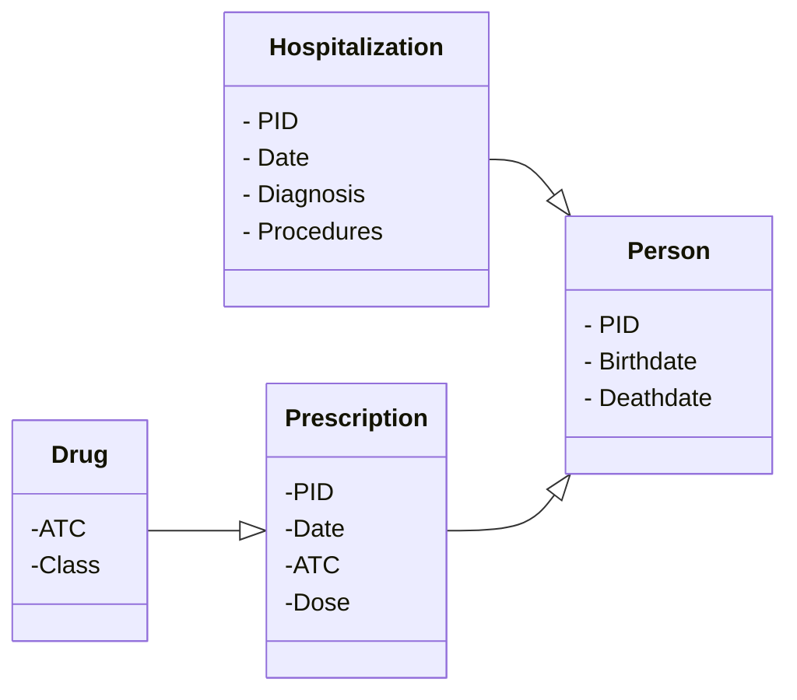

# Merging/joining data

Lecture 8 | Day 3, B | Slides: <https://sachsmc.github.io/r-programming/lectures/merging-data.html>

## Register data example

We’ve worked a bit with the patient register data defining possible exposures/outcomes using ICD codes and dates

- There are other registers, drug, cause of death, social welfare, etc.
- We want to obtain data from these other data sets and match it to individuals we already have

## Keys

- A *key* is one or more variables that can be used to identify observations
- Examples, CPR number, hospital code, drug codes

## Example



# Joins

## Types of joins

Often the goal of a join or merge is to add new variables to an existing data table

Example, given a table of hospitalization diagnoses, I want to know the drug dispensations that happened for each person after the hospitalization date

## Left join

```r
library(dplyr) |> suppressPackageStartupMessages()
library(data.table) |> suppressPackageStartupMessages()
x <- tribble(
  ~key, ~val_x,
     1, "x1",
     2, "x2",
     3, "x3"
)
y <- tribble(
  ~key, ~val_y,
     1, "y1",
     2, "y2",
     4, "y3"
)
x
```

    #> # A tibble: 3 x 2
    #>     key val_x
    #>   <dbl> <chr>
    #> 1     1 x1
    #> 2     2 x2
    #> 3     3 x3

```r
y
```

    #> # A tibble: 3 x 2
    #>     key val_y
    #>   <dbl> <chr>
    #> 1     1 y1
    #> 2     2 y2
    #> 3     4 y3

### Tidyverse

```r
x |> left_join(y, by = "key")
```

    #> # A tibble: 3 x 3
    #>     key val_x val_y
    #>   <dbl> <chr> <chr>
    #> 1     1 x1    y1
    #> 2     2 x2    y2
    #> 3     3 x3    <NA>

### Base R

```r
merge(x, y, by = "key", all.x = TRUE)
```

    #>   key val_x val_y
    #> 1   1    x1    y1
    #> 2   2    x2    y2
    #> 3   3    x3  <NA>

### data.table

same as base R.

Slightly different (right join):

```r
xdt <- data.table(x)
ydt <- data.table(y)

ydt[xdt, on = .(key)]
```

    #>      key  val_y  val_x
    #>    <num> <char> <char>
    #> 1:     1     y1     x1
    #> 2:     2     y2     x2
    #> 3:     3   <NA>     x3

## Many-to-one

```r
x <- tribble(
  ~key, ~val_x,
     1, "x1",
     2, "x2",
     3, "x3"
)
y <- tribble(
  ~key, ~val_y,
     1, "y1",
     1, "y1b",
     2, "y2",
     4, "y3"
)

merge(x, y, by = "key", all.x = TRUE)
```

    #>   key val_x val_y
    #> 1   1    x1    y1
    #> 2   1    x1   y1b
    #> 3   2    x2    y2
    #> 4   3    x3  <NA>

## One-to-many

```r
x <- tribble(
  ~key, ~val_x,
     1, "x1",
     1, "x1b",
     2, "x2",
     3, "x3"
)
y <- tribble(
  ~key, ~val_y,
     1, "y1",
     2, "y2",
     4, "y3"
)

merge(x, y, by = "key", all.x = TRUE)
```

    #>   key val_x val_y
    #> 1   1    x1    y1
    #> 2   1   x1b    y1
    #> 3   2    x2    y2
    #> 4   3    x3  <NA>

## Many-to-many

```r
x <- tribble(
  ~key, ~val_x,
     1, "x1",
     1, "x1b",
     2, "x2",
     3, "x3"
)
y <- tribble(
  ~key, ~val_y,
     1, "y1",
     1, "y1b",
     2, "y2",
     4, "y3"
)

merge(x, y, by = "key", all.x = TRUE)
```

    #>   key val_x val_y
    #> 1   1    x1    y1
    #> 2   1    x1   y1b
    #> 3   1   x1b    y1
    #> 4   1   x1b   y1b
    #> 5   2    x2    y2
    #> 6   3    x3  <NA>

## Other merge types

- Right join: `merge(x, y, by = "key", all.y = TRUE)`
- Inner join: `merge(x, y, by = "key", all = FALSE)` (the default)
- Full join: `merge(x, y, by = "key", all = TRUE)`

# Real data is harder

## Examples from the register

- Inpatient and outpatient hospitalizations are in different tables, outpatient has only admission date, inpatient also has discharge date
- Drugs are large in number, so drug registers are stored in different files by year
- Dates do not match exactly in different registers, often want to match within a range of dates

## Non exact joins

I want to merge these two tables where `key1` matches exactly, and `key2` in `y` is less than `key2` in `x`

```r
x <- tribble(
  ~key1, ~key2x, ~val_x,
     1, 20, "x1",
     1, 50, "x1b",
     2, 35, "x2",
     3, 10, "x3"
)
y <- tribble(
  ~key1, ~key2y, ~val_y,
     1, 10, "y1",
     1, 25, "y1b",
     1, 35, "y1c",
     2, 20, "y2",
     2, 50, "y2b",
     3, 30, "y3"
)
```

## Base R

Multi step process in base R

```r
merge(x, y, by = "key1", all = FALSE) |>
  subset(key2y <= key2x)
```

    #>   key1 key2x val_x key2y val_y
    #> 1    1    20    x1    10    y1
    #> 4    1    50   x1b    10    y1
    #> 5    1    50   x1b    25   y1b
    #> 6    1    50   x1b    35   y1c
    #> 7    2    35    x2    20    y2

```r
## merge allows multiple keys, but only exact matching
merge(x, y,
      by.x = c("key1", "key2x"),
      by.y = c("key1", "key2y"), all = FALSE)
```

    #> [1] key1  key2x val_x val_y
    #> <0 rows> (or 0-length row.names)

## data.table

```r
xdt <- data.table(x, key = "key1")
ydt <- data.table(y, key = "key1")

ydt[xdt, on = .(key1, key2y <= key2x), nomatch = NULL]
```

    #> Key: <key1>
    #>     key1 key2y  val_y  val_x
    #>    <num> <num> <char> <char>
    #> 1:     1    20     y1     x1
    #> 2:     1    50     y1    x1b
    #> 3:     1    50    y1b    x1b
    #> 4:     1    50    y1c    x1b
    #> 5:     2    35     y2     x2

## Rolling joins with data.table

The previous example returns all matches satisfying the inequality, what if we only want the *closest* one?

```r
## return all
ydt[xdt, on = .(key1, key2y <= key2x), nomatch = NULL]
```

    #> Key: <key1>
    #>     key1 key2y  val_y  val_x
    #>    <num> <num> <char> <char>
    #> 1:     1    20     y1     x1
    #> 2:     1    50     y1    x1b
    #> 3:     1    50    y1b    x1b
    #> 4:     1    50    y1c    x1b
    #> 5:     2    35     y2     x2

```r
## only closest match
ydt[xdt, on = .(key1, key2y == key2x), roll = TRUE, nomatch = NULL]
```

    #>     key1 key2y  val_y  val_x
    #>    <num> <num> <char> <char>
    #> 1:     1    20     y1     x1
    #> 2:     1    50    y1c    x1b
    #> 3:     2    35     y2     x2

## Tidyverse

This is available in `dplyr` since version 1.1.0

```r
x |> inner_join(y, join_by(key1, key2x >= key2y))
```

    #> # A tibble: 5 x 5
    #>    key1 key2x val_x key2y val_y
    #>   <dbl> <dbl> <chr> <dbl> <chr>
    #> 1     1    20 x1       10 y1
    #> 2     1    50 x1b      10 y1
    #> 3     1    50 x1b      25 y1b
    #> 4     1    50 x1b      35 y1c
    #> 5     2    35 x2       20 y2

Also can keep only the closest.

```r
x |> inner_join(y, join_by(key1, closest(key2x >= key2y)))
```

    #> # A tibble: 3 x 5
    #>    key1 key2x val_x key2y val_y
    #>   <dbl> <dbl> <chr> <dbl> <chr>
    #> 1     1    20 x1       10 y1
    #> 2     1    50 x1b      35 y1c
    #> 3     2    35 x2       20 y2

I prefer the dplyr in this case, because it is easier to communicate and inspect what is going on.

## Remember

When working with real data, remember these principles when merging

- What is the key? Is it named something else in the other table?
- Does the key define unique observations? If not (e.g., multiple rows per individual), then you will have a non one-to-one merge.
- Working with dates and ranges is possible, but be careful and **check the results** carefully

## Practical

After the next lecture, we will continue using the register data example to practice merging and defining new variables based on dates and strings.

[Link home](../index.html)
